# WTerminal / LTerminal (1.0.0)

---

Terminal multipestaña de escritorio construida sobre Tauri 2, Rust y xterm.js.
Detecta las shells, distribuciones WSL, contenedores Docker y dispositivos
Android disponibles en la máquina y los ofrece como entornos intercambiables
dentro de la misma ventana. Funciona además como hub local de proyectos GitHub
y como lanzador de scripts.

La aplicación se llama **WTerminal** en Windows y **LTerminal** en
Linux. No es una marca distinta: es la misma base con identidad,
identificador y rutas de datos propias por plataforma (`src-tauri/src/config/identity.rs`).

Este README explica el uso, la arquitectura y los procedimientos de
validación. El [mapa técnico de archivos y llamadas](#mapa-de-archivos-llamadas-y-mantenimiento)
completa cada ruta de `src/` y `src-tauri/src/`, las llamadas entre
Svelte, Tauri y Rust y los diagramas Mermaid de los flujos principales. Si
modificas uno de esos flujos, actualiza ambos documentos junto al código.
Para proponer cambios, consulta [CONTRIBUTING.md](CONTRIBUTING.md); los reportes
de seguridad se reciben por el canal privado de [SECURITY.md](SECURITY.md).

| | |
|---|---|
| Versión | 1.0.0 |
| Plataformas | Windows 10/11 (x64), Linux (x64) |
| Runtime | Tauri 2 · Rust 1.77+ · Node.js ≥ 22.12.0 (solo para compilar) |
| Licencia | MIT |
| Idiomas | Español, inglés, francés, alemán, italiano, portugués, rumano, ruso, ucraniano, polaco, chino, japonés, coreano, hindi y árabe |

## Índice

- [Requisitos](#requisitos)
- [Instalación para usar la aplicación](#instalación-para-usar-la-aplicación)
- [Entorno de desarrollo](#entorno-de-desarrollo)
- [Limpieza del repositorio](#limpieza-del-repositorio)
- [Scripts npm](#scripts-npm)
- [Compilación y distribución](#compilación-y-distribución)
- [Arquitectura](#arquitectura)
- [Diagramas de flujo detallados](#diagramas-de-flujo-detallados)
- [Mapa de archivos, llamadas y mantenimiento](#mapa-de-archivos-llamadas-y-mantenimiento)
- [Flujos de ejecución y diagnóstico](#flujos-de-ejecución-y-diagnóstico)
- [Contrato IPC](#contrato-ipc)
- [Seguridad](#seguridad)
- [Entornos y shells](#entornos-y-shells)
- [Alias y comandos integrados](#alias-y-comandos-integrados)
- [Panel de entorno y dependencias](#panel-de-entorno-y-dependencias)
- [Proyectos y GitHub](#proyectos-y-github)
- [Panel de scripts](#panel-de-scripts)
- [Explorador de archivos](#explorador-de-archivos)
- [Pestañas, división y ciclo de vida](#pestañas-división-y-ciclo-de-vida)
- [Atajos de teclado](#atajos-de-teclado)
- [Paleta de comandos](#paleta-de-comandos)
- [Configuración](#configuración)
- [Internacionalización](#internacionalización)
- [Datos, logs y diagnóstico](#datos-logs-y-diagnóstico)
- [Perfiles portables y plugins](#perfiles-portables-y-plugins)
- [Pruebas](#pruebas)
- [Convenciones del código](#convenciones-del-código)
- [Comparativa con Alacritty y WezTerm](#comparativa-con-alacritty-y-wezterm)
- [Problemas conocidos](#problemas-conocidos)
- [Créditos](#créditos)

---

## Requisitos

**Para usar la aplicación** no hace falta nada adicional en la distribución
instalable. En Windows, la build completa incluye el instalador offline de
WebView2 junto al ejecutable desempaquetado y dentro del portable de un solo
archivo; el arranque comprueba el runtime del sistema y usa ese recurso cuando
falta. En Linux,
el AppImage necesita las bibliotecas de escritorio habituales (WebKitGTK 2.40
o posterior), que cualquier distribución mantenida ya trae. El JavaScript se
compila para un único estándar, ES2023, igual en Windows (WebView2) y Linux
(`vite.config.ts`).

**Para compilarla**:

- **Node.js ≥ 22.12** — solo construye el frontend; la app final no lleva Node.
- **Rust ≥ 1.77** (`rustup`). Es la MSRV declarada: no se usan APIs más nuevas.
- **Linux**: las bibliotecas de desarrollo de WebKitGTK. `linux/build.sh` las
  comprueba antes de compilar y dice el comando de instalación de apt, dnf y
  pacman si falta alguna.
- **Windows**: Node.js y Rust mediante `rustup`. Visual Studio Build Tools con
  la carga de trabajo C++ y el Windows SDK son la ruta recomendada. `windows/build.ps1`
  importa automáticamente el entorno de MSVC y, si no está disponible, acepta el
  `rust-lld.exe` incluido en el toolchain para la build portable `--no-bundle`.
  El instalador NSIS puede seguir necesitando las herramientas de Visual Studio
  según los recursos nativos que se empaqueten.
- **Compilar Windows desde Linux**: además de lo anterior, MinGW x64
  (`x86_64-w64-mingw32-gcc`) y, para el smoke opcional, Wine. El script puede
  instalar esos paquetes con el gestor de la distribución.

Los chequeos de Rust lanzados desde npm usan `scripts/run-rust-tool.mjs`: si la
sesión ya estaba abierta cuando se instaló Rust, buscan también en
`%USERPROFILE%\\.cargo\\bin` y no exigen reiniciar la terminal para que `cargo
fmt`, `clippy` o los tests estén disponibles.

Para ejecutar la batería E2E al final del build hace falta además
`tauri-driver`, un controlador nativo compatible y una sesión gráfica. En
Windows no hace falta instalar el navegador Microsoft Edge: el builder instala
`tauri-driver` con Cargo si falta, detecta la versión registrada de WebView2
Runtime y descarga en `src-tauri/target/e2e-driver/` el `msedgedriver.exe`
compatible. Se puede usar un driver preparado manualmente mediante
`TAURI_NATIVE_DRIVER=C:\ruta\msedgedriver.exe`; `-InstallE2eDriver` sigue
aceptándose por compatibilidad, pero ya no es necesario. En Linux, `--install-e2e-driver`
instala los controladores cuando sea posible y `--e2e-driver
/ruta/WebKitWebDriver` permite indicar el ejecutable nativo si la distribución
no lo incluye. Si una precondición no puede prepararse, el script lo indica y
no marca la release como verificada.

### Wine para la validación cruzada

Para compilar el ejecutable Windows desde Arch/CachyOS e inspeccionarlo bajo
Wine, instala las herramientas de la cadena cruzada y del entorno gráfico:

```bash
sudo pacman -S --needed mingw-w64-gcc zip wine winetricks cabextract unzip xdotool xorg-server-xvfb openbox
rustup target add x86_64-pc-windows-gnu
```

La batería Rust no necesita WebView2. El smoke predeterminado es headless:
ejecuta el PE Windows real bajo Wine, envía `echo` por stdin, comprueba que el
marcador vuelve por stdout/stderr y exige que la shell termine con código cero.
Usa pipes solo para esta validación; no prueba la GUI ni el ConPTY real. Windows
nativo sigue necesitando su validación propia. La batería y el smoke headless
comparten `WINE_SMOKE_PREFIX` o `WINEPREFIX`; si no se indica ninguno, usan
`~/.cache/lterminal/wine-smoke-prefix`, sin recurrir por defecto a `~/.wine`.

Después ejecuta:

```bash
LTERMINAL_REQUIRE_SIGNING=0 \
bash linux/build-windows.sh --fast --no-install --skip-checks --wine-smoke
```

También se puede fijar un prefijo concreto con `WINE_SMOKE_PREFIX=/ruta/al/prefijo`.
El backend temporal de pipes se activa solo con `LTERMINAL_TEST_UNDER_WINE=1`,
porque Wine no implementa `CreatePseudoConsole` con fidelidad suficiente.
`LTERMINAL_WINE_GUI_SMOKE=1` activa, como diagnóstico opcional, el smoke GUI:
localiza/instala WebView2 en `WINE_SMOKE_PREFIX`, `WINEPREFIX`, `~/.wine`, Lutris
o Steam. `LTERMINAL_WINE_XVFB=auto` (predeterminado) primero comprueba que el
display heredado responde a `xdpyinfo` y, si está roto o ausente, usa un Xvfb
privado. `=1` fuerza Xvfb y `=0` exige el display actual. El smoke busca la
ventana visible, espera a que WebView2 y el PTY estén preparados y guarda una
captura; falla si la imagen sigue negra o vacía. Esto valida la presentación
bajo Wine, no sustituye una prueba nativa de Windows ni demuestra ConPTY real.
La captura puede guardarse fuera de temporales mediante
`LTERMINAL_WINE_GUI_CAPTURE_DIR`. La instalación automática del Runtime GUI se
puede desactivar con `LTERMINAL_WINE_WEBVIEW2_AUTO_INSTALL=0`.

Cada E2E de Windows crea además un perfil WebView2 temporal y exclusivo, que
EdgeDriver recibe mediante `webviewOptions`. Algunas combinaciones de WebView2
y EdgeDriver crean `DevToolsActivePort` dentro del subdirectorio `EBWebView`,
aunque el driver lo busca en la raíz del perfil; durante la creación de sesión
el smoke activa un puerto de depuración dinámico y refleja ese archivo en la
ubicación esperada. Así se automatiza la propia release, sin recompilar un
segundo perfil debug. El protocolo se activa en segundo plano únicamente cuando
el smoke define `LTERMINAL_E2E_WEBDRIVER=1`, incluso si el build está elevado;
el inspector visual solo se muestra al definir
`LTERMINAL_OPEN_DEVTOOLS`, para que no robe el foco de EdgeDriver. El perfil se
elimina al pasar; si falla, su ruta queda en el informe y en la salida para
diagnóstico.
`E2E_WEBVIEW2_USER_DATA_FOLDER` permite fijar una ruta escribible propia cuando
sea necesario.

### conpty.dll

En Windows la app **necesita** `conpty.dll`, `OpenConsole.exe` y
`WebView2Loader.dll` junto al ejecutable. Los dos recursos ConPTY se obtienen
durante el build desde el paquete oficial de Microsoft
`Microsoft.Windows.Console.ConPTY` (`1.24.260710001`), y se extraen solo tras
verificar el SHA-512 publicado por NuGet, las rutas exactas del ZIP, sus CRC,
los tamaños y la arquitectura PE x64. Se guardan en `src-tauri/vendor/conpty/`, una carpeta ignorada y
generada; no se versionan binarios PE en el repositorio. El tercero lo aporta
la dependencia de WebView2 al compilar para Windows. El ConPTY del sistema falla en algunos Windows
recortados con `STATUS_DLL_INIT_FAILED`, y el error tarda más de dos minutos en
aparecer: las pestañas se quedan en blanco sin decir por qué. `build.rs` copia
ConPTY en cada compilación y los scripts de build descargan/preparan la pareja
si no está presente o no coincide con la versión fijada. El instalador/portable
incluye los recursos junto al ejecutable.

## Instalación para usar la aplicación

**Windows portable.** La release nativa publica la carpeta desempaquetada,
su ZIP y un único `WTerminal-<versión>-Portable.exe`. La carpeta y el ZIP
traen `wterminal.exe`, `conpty.dll`, `OpenConsole.exe`,
`WebView2Loader.dll` y el instalador offline completo de WebView2. El
`-Portable.exe` es la misma aplicación en un solo archivo: se abre con doble
clic, sin diálogo de extracción ni archivos a su lado. Lleva dentro
`conpty.dll`, `OpenConsole.exe`, el instalador de WebView2 y los avisos de
terceros, añadidos al final del ejecutable y fuera de la imagen PE, así que
Windows no los carga al arrancar. La app coloca en silencio su ConPTY en
`%LOCALAPPDATA%\WTerminal\runtime\<huella>`, verificado por SHA-256 y
reutilizado mientras no cambie. Solo saca el instalador de WebView2 a una
carpeta temporal, y lo borra después, si el runtime falta. El cargador de
WebView2 va enlazado en el ejecutable. Se actualiza solo descargando el
`-Portable.exe` nuevo, que reemplaza al que corre, como un AppImage. En
cualquiera de las tres formas, si falta el runtime, la aplicación lo instala
en silencio antes de crear la ventana, sin necesitar red. No crea accesos
directos. Las operaciones de sistema se descubren desde
LTools / WinSlim Tools. La build cruzada de Windows desde Linux puede usar el
bootstrapper web cuando no dispone del instalador offline.

**Windows instalable.** La release completa (`npm run dist:win`) y su alias
explícito `npm run dist:win:installer` generan un NSIS con el instalador
offline de WebView2 incluido y lo publican como
`release/WTerminal-<versión>-x64-setup.exe`. Es la opción recomendada
para equipos recortados, instalaciones limpias o despliegues sin Internet.

**Linux.** Un AppImage: `chmod +x LTerminal-*.AppImage` y se ejecuta.

**Carpeta propia: cachés, descargas, modelos, herramientas e historial.**
Lo que descargan y crean desde WTerminal los gestores de paquetes, las
herramientas y los REPL se guarda en `%LOCALAPPDATA%\WTerminal\entornos` (en
Linux, bajo `~/.local/share/LTerminal/entornos`), por categorías:

| Categoría | Subcarpeta | Variables | De fábrica |
|---|---|---|---|
| Cachés | `cache\` | `npm_config_cache`, `YARN_CACHE_FOLDER`, `BUN_INSTALL_CACHE_DIR`, `DENO_DIR`, `PIP_CACHE_DIR`, `UV_CACHE_DIR`, `GOMODCACHE`, `GOCACHE`, `NUGET_PACKAGES`, `COURSIER_CACHE`, `COMPOSER_CACHE_DIR` | activa (con el interruptor general) |
| Descargas del panel | `descargas\panel` | `WTERMINAL_DOWNLOADS` (lo usan las acciones que descargan antes de instalar, como ADB) | activa |
| Modelos de IA | `ia\` | `HF_HOME`; `OLLAMA_MODELS` solo si aún no hay modelos en la carpeta de siempre de Ollama | activa |
| Herramientas y lenguajes nuevos | `herramientas\` | `npm_config_prefix`, `CARGO_INSTALL_ROOT`, `GOBIN`, `PYTHONUSERBASE`, y su carpeta de programas delante en el PATH de WTerminal y, con la integración con el PATH, también en el del usuario | activa |
| Historial de los REPL | `historial\` | `NODE_REPL_HISTORY`, `PYTHON_HISTORY` (3.13+), `SQLITE_HISTORY`, `PSQL_HISTORY` | activa |

WTerminal exporta esas variables estándar solo a los procesos que lanza
(pestañas y sondas de detección): no toca las variables del sistema, respeta
las que el usuario ya tenga definidas y **nunca mueve nada ya instalado**. De
fábrica se centralizan las cinco categorías:

- **Herramientas y lenguajes nuevos** cambia dónde se instala lo nuevo. Lo que
  ya tenías sigue donde estaba y se sigue detectando. Las carpetas `bin`
  nuevas van delante en el PATH de WTerminal (`process::set_extra_path`) y,
  mientras «Invocar WTerminal desde el PATH» esté activa (lo está de fábrica),
  también al **final** del PATH del usuario (`path_integration::sync_tool_bins`,
  solo `HKCU`): así lo instalado desde WTerminal se ve en cualquier terminal
  sin tapar lo que ya tenías. WTerminal apunta en
  `HKCU\Software\WTerminal\PathIntegration` (`ToolBinDirs`) cuáles añadió él y
  solo quita esas al apagar la categoría o la integración; una carpeta que ya
  estaba en tu PATH no se toca nunca (`path_with_tool_bins`). Se sincroniza al
  arrancar, al guardar Ajustes y al activar o desactivar la integración; en
  Linux, por ahora, solo dentro de WTerminal. Actualizar con la categoría
  activa una herramienta instalada antes deja una segunda copia en la carpeta
  propia, que es la que se usa dentro de WTerminal.
- **Historial de los REPL** separa el historial de los intérpretes abiertos
  desde WTerminal del que tengas fuera.

Con Ollama hay un matiz: los modelos los guarda su servidor, que suele
arrancar la aplicación de Ollama fuera de WTerminal con su propia carpeta. Por
eso `OLLAMA_MODELS` solo se fija si todavía no tienes modelos; entonces es la
carpeta que usa «Arrancar el servidor de Ollama» desde el panel, y la detección
de modelos del selector la lee también. Los modelos que ya tienes no se tocan.

Ajustes → Comportamiento → «Entornos y descargas» tiene el interruptor general,
uno por categoría (con lo que cambia cada una), la carpeta, el tamaño de cada
entrada y dónde está: con su categoría apagada (o el interruptor general
apagado) cada entrada sigue apareciendo con la **ubicación de siempre** de la
herramienta y su espacio (`%LOCALAPPDATA%\npm-cache`, `%APPDATA%\npm`,
`~\.cargo`, `~\go\bin`, `%APPDATA%\Python`, `~\.node_repl_history`…, marcada
«sin centralizar · ubicación actual»; `system_location` en
`config/toolchain_store.rs`), y con una variable tuya, tu carpeta. Además hay
otras ubicaciones conocidas (solo lectura) y «Vaciar cachés», que solo borra
las cachés que están en la carpeta propia. El espacio de las ubicaciones de
siempre se mide una vez y se reutiliza 10 minutos (`cached_system_size`), igual
que el de las ubicaciones externas: recorrer `~\.cargo` o el npm global
tardaba de 7 a 11 s en cada apertura de Ajustes y, como el comando retiene su
hilo mientras mide, varias aperturas seguidas dejaban el guardado automático
esperando. Las cachés de la carpeta propia se miden siempre en el momento. Los
tres comandos de esta sección (`toolchain_store_status`,
`toolchain_store_external_sizes` y `toolchain_store_clear_caches`) son `async`
y miden en `spawn_blocking`: la primera medición externa pasa del minuto en
frío y cada apertura de Ajustes pedía otra que esperaba a la anterior dentro
de un hilo del runtime; con ocho aperturas la app dejaba de responder.

En esa misma sección están **todas las carpetas que usa WTerminal** y las de
otras herramientas, con su tamaño. Al pasar el ratón (o el foco del teclado)
por cualquiera, una tarjeta explica para qué sirve, quién la crea y si se puede
borrar, con un punto de color: verde, se puede borrar (temporales, registros o
cachés que se vuelven a generar); ámbar, con cuidado (contiene programas
instalados o configuración); rojo, no se borra a mano (se gestiona con su
propia herramienta). La tarjeta se coloca siempre dentro del panel de Ajustes,
debajo de la fila o encima si no cabe, y se recoloca tras medirse si la ruta
o el texto la hacen más alta (`src/lib/floating-tip.ts`).

| Carpeta | Qué es | ¿Se puede borrar? |
|---|---|---|
| Ajustes (`%APPDATA%\wterminal\settings.json`) | Tus preferencias | No: volverías a la configuración de fábrica (usa «Exportar perfil») |
| Biblioteca de scripts | Los scripts que guardas | Solo si ya no los quieres |
| Plugins | Plugins instalados y sus copias de seguridad | Mejor desde Ajustes → Plugins |
| Registros (`logs`) | Diagnóstico (`main.log`, rota solo) | Sí, se vuelve a crear |
| Caché de detección | Resultados de Entorno y dependencias, discos y hardware | Sí, la próxima detección tarda algo más |
| Datos de la interfaz (WebView2/WebKitGTK) | Caché y almacenamiento del motor de la interfaz | Sí, con la app cerrada |
| Temporales de sesión (`%TEMP%\wterminal`) | Scripts de inicio y banners, una carpeta por proceso | Sí; WTerminal borra al arrancar las de procesos que ya no existen |
| Proyectos | Tus repositorios clonados | No: es tu trabajo |
| Componentes del portable (`runtime`) | ConPTY que extrae el portable de un solo archivo | Sí, con la app cerrada; se vuelve a extraer |
| Perfil de Clink | Historial y ajustes de Clink en cmd | Sí, pero pierdes el historial de cmd |
| Cachés centralizadas (npm, pip, Go…) | Descargas de cada gestor | Sí, «Vaciar cachés» |
| Descargas del panel (`entornos\descargas`) | Archivos que bajan las acciones antes de instalar | Sí |
| Modelos de IA (`entornos\ia`) | Hugging Face y, si los había, modelos de Ollama | Sí, pero hay que volver a descargarlos (mejor «Borrar» cada modelo) |
| Herramientas nuevas (`entornos\herramientas`) | Lo instalado con npm -g, cargo, go o pip --user con la categoría activa | No a mano: desinstálalas desde el panel |
| Historial de los REPL (`entornos\historial`) | Historial de Node, Python, SQLite y psql | Sí, se pierde ese historial |
| Cargo, rustup, Go, Bun, npm global | Herramientas y compiladores instalados | Con cuidado: usa su desinstalador |
| Cachés de npm, pip, pnpm, Yarn, uv, Deno, NuGet | Descargas de cada gestor | Sí, con su orden de limpieza |
| Gradle, Maven | Dependencias y configuración (con credenciales) | Conserva `gradle.properties` y `settings.xml` |
| Modelos de Ollama | Modelos de IA locales | Con `ollama rm` o desde el panel |
| WinGet, Chocolatey, Scoop, Docker, distros WSL | Programas, contenedores o sistemas completos | No a mano: con su propia herramienta (`wsl --unregister`, `docker system prune`…) |

La licencia del código fuente es MIT. Las dependencias y recursos de terceros
conservan sus licencias originales; el instalador incluye
`THIRD-PARTY-NOTICES.txt`.

La aplicación consulta sus actualizaciones en su repositorio propio, que se
mantiene separado de los proyectos anclados: no aparece en la biblioteca ni se
puede clonar desde el panel como proyecto. El porqué de cada paso está en
`src-tauri/src/updater/self_update.rs`.

La comprobación se inicia en segundo plano después de montar la interfaz. Si
encuentra una release estable, el aviso inferior solo aparece tras autenticar
con Ed25519 el manifiesto y confirmar que este declara el SHA-256 del artefacto
de la plataforma. El paquete completo se descarga y vuelve a verificarse solo
si se pulsa «Actualizar y reiniciar». También se consulta el gestor nativo de
paquetes (WinGet en Windows; apt, dnf, pacman, zypper o apk en Linux); ese aviso
solo informa y abre Entorno y dependencias. No instala aplicaciones en segundo
plano. El gestor puede refrescar su propia caché durante la consulta, que tiene
un timeout y nunca bloquea la interfaz.

## Entorno de desarrollo

Desde una copia local del código:

```bash
npm ci
npm start
```

`npm start` levanta Vite y compila el backend con `cargo`, y abre la ventana con
recarga en caliente del frontend. La primera compilación de Rust tarda varios
minutos; las siguientes son incrementales.

El puerto de Vite es fijo (1420) y `strictPort` está activo a propósito:
`tauri.conf.json` apunta a esa URL, y que Vite se moviera solo a otro puerto
dejaría la ventana en blanco sin decir por qué. Si queda ocupado de una
ejecución anterior, hay que liberarlo antes.

## Limpieza del repositorio

Los limpiadores eliminan únicamente salidas reproducibles, artefactos de
auditoría visual, cachés e informes conocidos, incluidos los Markdown que tienen
nombre de informe generado. No tocan documentación mantenida. En `%TEMP%` (o
`/tmp`) solo consideran nombres reservados por LTerminal para backups de versión,
descargas de herramientas, logs de build, Wine, smoke y E2E. Las extracciones
AppImage —que usan un nombre genérico con hash— solo se limpian si contienen el
ejecutable y el desktop de LTerminal; se conservan si algún proceso las está
usando o no se puede comprobar su actividad. No se borran temporales genéricos
de otras aplicaciones. El builder Windows guarda los instaladores temporales en
`winslim-terminal-build-*`, que elimina al terminar o el limpiador recoge si el
proceso se interrumpe. También retiran logs de build en AppData y cachés privadas
de LTerminal. `release/` y todo su contenido están protegidos y nunca se borran.
Por seguridad, la vista previa es el comportamiento predeterminado; el borrado
requiere una opción explícita.

```powershell
powershell -ExecutionPolicy Bypass -File scripts/clean-repository.ps1
powershell -ExecutionPolicy Bypass -File scripts/clean-repository.ps1 -Apply
powershell -ExecutionPolicy Bypass -File scripts/clean-repository.ps1 -Light -Apply
```

```bash
scripts/clean-repository.sh
scripts/clean-repository.sh --apply
scripts/clean-repository.sh --light --apply
```

**Modo ligero** (`-Light` / `--light`): quita solo los restos y conserva
`node_modules`, `target` y los logs de la app, así que el siguiente build sigue
siendo rápido. Su vista previa termina sugiriendo la orden ligera completa
(`-Light -KeepDays N -Apply`); antes sugería solo `-Apply`, que es la limpieza
completa. Restos que recoge:

- logs sueltos de la raíz (`build-*.log`…) y `dist/`;
- las releases anteriores que la build completa aparta en
  `src-tauri/target/dist/release-anterior`;
- las evidencias de `artifacts/` con más de `-KeepDays`/`--keep-days` días (3
  de fábrica);
- los temporales de pruebas con nombre propio (`wterminal-e2e-*`,
  `winslim-terminal-webview2-e2e-*`, `wtools-path-repro*`…) y las sesiones
  `%TEMP%\wterminal\<pid>` de procesos que ya no existen.

En Windows también retira del PATH de usuario las entradas que apuntan a
carpetas que ya no existen dentro de `%TEMP%` o del `release\` del repositorio
(restos de pruebas y de builds anteriores); las demás entradas, aunque no
existan, son del usuario y no se tocan. El PATH se lee y se reescribe sin
expandir, conservando las `%VARIABLES%`. Todo sale en la vista previa antes de
borrar nada.

No usa `git clean`: no borra `.git`, código fuente ni configuraciones locales.
Tampoco atraviesa enlaces simbólicos o junctions: conserva una salida raíz
enlazada y evita borrar logs/cachés a través de carpetas padre enlazadas; dentro
de una carpeta generada, quita el enlace sin tocar su destino.
Los datos de usuario (`settings.json`, scripts, plugins y proyectos) se
conservan; solo se elimina la carpeta `logs` y las sesiones temporales antiguas.
Si Windows mantiene un artefacto abierto, elimina lo que esté libre y termina
con error indicando la ruta exacta que queda por cerrar. Las sesiones temporales
de procesos activos se conservan para no interrumpir una terminal en uso.

### Codificación

El repositorio no usa ANSI. Rust, Svelte, JSON, Bash, Node (`.mjs` incluidos),
tests y archivos de configuración son **UTF-8 sin BOM**. Los `.ps1` y
`.ps1.in` usan **UTF-8 con BOM** para que Windows PowerShell 5 lea correctamente
`ñ`, tildes y el resto de Unicode. Los `.cmd`/`.bat` se mantienen ASCII por
compatibilidad con `cmd.exe`; al abrir una sesión CMD, `init.cmd` activa
`chcp 65001` antes de leer banner y ayuda UTF-8. `npm run check:encoding`
verifica esta política y rechaza ANSI, BOM indebidos o una regresión que vuelva
a degradar Unicode a ASCII.

## Scripts npm

Todos se ejecutan desde la raíz del repositorio.

Los scripts del repositorio en `scripts/` sirven para desarrollo, pruebas y
empaquetado; no se instalan ni se muestran como operaciones integradas de la
aplicación. Las operaciones de sistema reutilizables las publica LTools como
catálogo versionado y LTerminal las descubre y ejecuta de forma segura.

| Script | Qué hace |
|---|---|
| `npm start` | Arranca la aplicación en desarrollo (Vite + `cargo run`). |
| `npm run check` | Ciclo completo: versión, metadatos, recursos, arquitectura, documentación, enlaces, fuentes de instalación, catálogo WinGet cuando se ejecuta en Windows, `svelte-check`, formato, análisis estático y pruebas Rust. **Es lo que hay que pasar antes de compilar.** |
| `npm run check:local` | Validación sin red: contratos, documentación, i18n, lógica frontend, restauración de versión tras fallos y pruebas locales. |
| `npm run check:workspace` | Comprueba que las cachés, salidas y directorio temporal se puedan leer y escribir; detecta un `chown`/`chmod` pendiente antes de una build. |
| `npm run check:install-sources` | Sondea 16 fuentes que usa el catálogo (WinGet, Chocolatey, Flathub y los registros de los principales ecosistemas) y distingue una caída de red de un error del código. |
| `npm run check:i18n` | Comprueba la paridad de los 15 catálogos, textos visibles, marcadores dinámicos y fugas de idioma en búsquedas y comandos internos. |
| `npm run check:docs` | Valida los Markdown publicados (README, SECURITY, CONTRIBUTING): enlaces locales, anclas `#…` con el mismo criterio que GitHub y que ninguno enlace carpetas que no se publican (`docs-ia/`, `artifacts/`, `release/`, `dist/`). |
| `npm run check:flows` | Comprueba que el mapa técnico del README nombra cada archivo de código y script, y que los diagramas citan funciones que siguen existiendo. |
| `npm run check:contracts` | Cruza las preferencias Rust/TOML/TypeScript, los comandos internos Rust/Svelte y los recursos nativos Linux/Windows. |
| `npm run test:frontend-logic` | Ejecuta la lógica pura de idioma, identidad, scroll de terminal y los 20 atajos sin necesitar una ventana. |
| `npm run test:toolbar-layout` | Monta la barra real en Chromium sin ventana y prueba 504 combinaciones de ancho, idioma, controles y favoritos. Preparar el navegador una vez con `npx playwright install chromium --only-shell` (en Linux, añadir `--with-deps`). Guarda mediciones y capturas en un temporal, o en `E2E_CAPTURE_DIR` si se define. |
| `npm run test:ltools-contract` | Comprueba el contrato `ltools-actions-v1`, la validación de plataforma y la integración opcional de LTools; con `LTOOLS_TEST_BINARY` también prueba el CLI real. |
| `npm run test:e2e:ltools` | Ejecuta, contra un binario ya compilado, la E2E optativa de LTools: descubre el catálogo JSON real, abre el selector, fija una acción segura, cierra/reabre la Biblioteca para probar persistencia y verifica el comando canónico. Autodetecta el binario de la release más reciente; `E2E_BINARY` y `LTOOLS_TEST_BINARY` permiten fijarlos explícitamente. Si no hay release de LTools, lo informa como prueba omitida, nunca como éxito falso. |
| `npm run test:cleaner` | Prueba los limpiadores Bash y PowerShell en proyectos temporales; verifica los enlaces, conserva `release/` y descargas externas genéricas, y elimina solo temporales identificados de LTerminal. |
| `npm run test:version-restore` | Fuerza fallos de build y una copia de seguridad ausente; comprueba que no se anuncia éxito y que los cuatro manifiestos quedan byte a byte como estaban al terminar la prueba. |
| `npm run test:e2e-report` | Prueba que el validador acepta una batería E2E completa y rechaza estados fallidos, fases ausentes o una Biblioteca sin el contrato único de LTools. |
| `npm run test:e2e-native-driver` | Comprueba la detección de versión WebView2 y la selección de un Edge WebDriver compatible por build. |
| `npm run e2e` | Ejecuta el smoke WebDriver contra el binario existente indicado por `E2E_BINARY`; no compila. En Windows encuentra el Edge WebDriver compatible con WebView2 en PATH o en la caché de `src-tauri/target/e2e-driver/`; se puede fijar con `TAURI_NATIVE_DRIVER`. `E2E_CAPTURE_VIDEO=1` exige que `ffmpeg` esté disponible y hace fallar la pasada si no produce un MP4 válido. `E2E_SKIP_DEPENDENCY_REFRESH=1` omite solo el refresco completo para aislar pruebas visuales de matriz; la detección se valida aparte con `E2E_DEPENDENCY_AUDIT_ONLY=1`. Esa auditoría espera hasta quince minutos por cada detección completa; se puede ajustar con `E2E_DEPENDENCY_TIMEOUT_MS` sin cambiar el comportamiento de la aplicación. `E2E_MOUSE_SELECTION_ONLY=1` prueba el arrastre real para seleccionar texto; `E2E_SHELL_MATRIX_ONLY=1` detecta y prueba todos los shells/REPL seguros disponibles; `E2E_DEPENDENCY_AUDIT_ONLY=1` recorre todas las secciones, grupos y acciones y verifica el estado individual `installed`, `absent`, `unknown` o `not-applicable`; desplaza cada tarjeta visible al centro del panel sin pulsar operaciones destructivas. `E2E_FULL_VISUAL_AUDIT=1` añade Ajustes, transiciones 1→2→3→4→1, entradas largas con comillas, `clear`, reflow, barras de progreso y scroll horizontal; `npm run e2e:dependencies` activa esta cobertura, captura cada acción y genera segmentos de vídeo con la resolución nativa de cada cambio de ventana. La captura solicita 30 FPS por defecto en la auditoría completa (8 FPS en smoke); `E2E_VIDEO_FPS` admite hasta 60 para diagnósticos. El informe distingue la frecuencia solicitada de la efectiva, que puede ser menor bajo carga: para auditar parpadeos breves se debe medir la frecuencia real del MP4 y revisar frames contiguos. Los frames nativos de arranque se conservan como evidencia separada sin mezclarlos en el MP4; también se valida continuidad de origen y se publica la cobertura real, incluida la omisión de NSudo/k9s/Hyprland cuando el host no puede ejecutarlos. `E2E_DEPENDENCY_VISUAL_ACTIONS=0` desactiva solo ese recorrido y `E2E_DEPENDENCY_ACTION_HOLD_MS` ajusta la permanencia de cada tarjeta en el vídeo; `E2E_LANGUAGE_ONLY=1` cambia varios catálogos, valida las anclas traducidas y restaura el idioma automático del sistema; `E2E_PROGRESS_LAYOUT_ONLY=1` simula barras de `update`/`upgrade`, mide el overflow y verifica que el ancho se recupera; `E2E_ADB_REFRESH_ONLY=1` crea un dispositivo ADB falso temporal y valida tres salidas visibles sin resize ni cambios de panel; `E2E_TERMINAL_ONLY_ONLY=1` activa el modo de terminal limpia, comprueba que ocupa la ventana sin overflow, captura el estado y lo recupera con `Ctrl+Shift+M`. `E2E_HORIZONTAL_SEQUENCE_COUNT` permite acotar la sonda de secuencia para diagnósticos locales sin reducir la cobertura por defecto. |
| `npm run e2e:admin` | Ejecuta `windows/e2e-elevated.ps1` desde una PowerShell elevada contra `release\WTerminal-1.0.0\wterminal.exe`. Usa un perfil aislado, comprueba el token administrativo efectivo, el escenario `windows-admin-permissions` (`E2E_WINDOWS_ADMIN_ONLY=1`) con NSudo abierto directo y sin «Reiniciar como administrador», que el ejecutable no lleva `RUNASADMIN` y que AppCompat queda exactamente como estaba. |
| `npm run metadata:sync` | Propaga los datos editados en `src-tauri/config/package-metadata.json` a npm, Cargo y Tauri. |
| `npm run build` | Solo el frontend, con precomprobación de permisos y sincronización de metadatos. `LTERMINAL_SKIP_CHECKS=1` conserva Vite pero omite las sondas externas y `svelte-check`. |
| `npm run build:preview` | Genera un frontend navegable en `dist-preview/` con un backend simulado; no usa Tauri, no abre PTY y no modifica el equipo. |
| `npm run preview` | Sirve `dist-preview/` en `http://127.0.0.1:4173`; si no existe, lo genera automáticamente. Acepta `--port 4174` y `--build` para regenerar antes de servir. Es el preview web funcional, separado de `dist/`. |
| `npm run build:fast` | Atajo multiplataforma para `build` con `LTERMINAL_SKIP_CHECKS=1`; útil durante el desarrollo, no sustituye una release completa. |
| `npm run dist:win` | Ejecuta la release completa de Windows, incluida la batería de herramientas y el E2E WebDriver; comprueba recursos, valida y genera carpeta desempaquetada, ZIP, portable de un solo EXE e instalador NSIS. Los tres formatos incluyen WebView2 offline. |
| `npm run dist:win:fast` | Build de desarrollo rápida de Windows: usa compilación incremental, omite LTO y conserva símbolos; ejecuta solo el smoke mínimo y salta las comprobaciones previas. No es una release. |
| `npm run dist:win:installer` | Genera el instalador NSIS de Windows con WebView2 offline incluido y ejecuta la batería ampliada/E2E. |
| `npm run dist:win:validate` | Release completa con `-ReleaseValidation`: además de la batería, vídeo, descargas reales, auditoría del catálogo e instalación real del NSIS (pide UAC y lo desinstala). |
| `npm run e2e:suite` | Ejecuta suites E2E estandarizadas (`focused`, `full`, `video`, `downloads`, `dependency-audit`, `installer`) contra un binario existente y escribe `summary.json`/`summary.md`. |
| `npm run e2e:installer` | Instala de verdad el NSIS indicado (un UAC), lo verifica, ejecuta el E2E sobre lo instalado y lo desinstala. |
| `npm run test:e2e-suite` | Comprueba sin abrir la app el catálogo de suites, el ejecutor, su resumen y la comparación de binarios del instalador. |
| `npm run dist:win:linux` | Compila desde Linux el ejecutable Windows GNU x64, verifica los binarios nativos y ejecuta el smoke headless de Wine; el smoke GUI/WebView2 es optativo. |
| `npm run dist:win:linux:fast` | Build cruzada Windows GNU x64 rápida para desarrollo; omite las comprobaciones previas y conserva la salida portable para probarla en Wine/Windows. |
| `npm run dist:linux` | Ejecuta la build Linux completa: solicita la versión, valida y genera el AppImage. |
| `npm run dist:linux:fast` | Build de desarrollo rápida de Linux: compilación incremental sin LTO, smoke mínimo y sin comprobaciones previas. No es una release. |

Para una build completa y verificada, con sus comprobaciones previas y su
release comprimida, usar los scripts de `windows/` y `linux/` en vez de estos.
Tauri incrusta `dist/index.html` en el binario; por eso `src-tauri/build.rs`
declara ese archivo como entrada de Cargo. Sin ese enlace, una modificación
exclusivamente Svelte/CSS podía regenerar `dist/` y aun así reutilizar un
ejecutable incremental con el frontend anterior. La comprobación de scripts de
build exige esta dependencia y evita que una prueba aparentemente correcta se
ejecute contra una interfaz desactualizada.

Para repetir solo la prueba visual de selección en Linux sin recompilar, usa una
release existente y un perfil XDG temporal, para que el smoke no lea ni cambie
las preferencias o el portapapeles de tu sesión habitual:

```bash
e2e_profile="$(mktemp -d /tmp/lterminal-e2e.XXXXXX)"
mkdir -p "$e2e_profile/config" "$e2e_profile/data" "$e2e_profile/state" "$e2e_profile/cache"
XDG_CONFIG_HOME="$e2e_profile/config" \
XDG_DATA_HOME="$e2e_profile/data" \
XDG_STATE_HOME="$e2e_profile/state" \
XDG_CACHE_HOME="$e2e_profile/cache" \
E2E_BINARY="$PWD/release/dev/LTerminal-1.0.0-x86_64-dev.AppImage" \
E2E_MOUSE_SELECTION_ONLY=1 npm run e2e
```

Para probar shells y REPL sin ejecutar el resto de la batería, se puede usar el
mismo perfil temporal con `E2E_SHELL_MATRIX_ONLY=1 npm run e2e`. La prueba
descubre las opciones habilitadas en el selector y ejecuta una sonda inocua en
cada shell/REPL con sonda segura disponible; exige ver el eco y el resultado
evaluado en el PTY, registra las herramientas omitidas con su motivo, rechaza
errores del inicializador y restaura el entorno original. No inicia servicios
de bases de datos, contenedores, elevaciones ni dispositivos ADB reales.
`npm run test:e2e-environment-probes` comprueba localmente que los 89 REPL
declarados entre el código y el catálogo tienen una sonda o una omisión segura.

La integración con LTools también se puede probar sin recompilar:

```bash
E2E_BINARY="$PWD/release/dev/LTerminal-1.0.0-x86_64-dev.AppImage" \
LTOOLS_TEST_BINARY="$PWD/../Tools/release/ltools-1.0.0-linux-x86_64-cli.AppImage" \
npm run test:e2e:ltools
```

Esta prueba es optativa porque LTools no es una dependencia de LTerminal. La
release Linux se puede probar aunque el equipo no tenga FUSE montado: el
contrato establece automáticamente `APPIMAGE_EXTRACT_AND_RUN=1` al invocar el
AppImage. En Windows, usa el ejecutable CLI equivalente de la carpeta
`release/`. Si no se indica `E2E_BINARY`, la prueba busca automáticamente una
build local conocida; si no encuentra ninguna, termina como `SKIP` explícito.
Los puertos del driver y de la sonda nativa se reservan dinámicamente para no
colisionar con otra ejecución.
Si se ejecuta dentro de `xvfb-run` desde un escritorio Hyprland, usa
`E2E_SKIP_WINDOW_MANAGER=1`: así se omiten únicamente las comprobaciones del
dispatcher del compositor anfitrión, que no puede controlar la ventana del
display virtual; el resto del smoke sigue siendo obligatorio.

La interfaz no mantiene una lista cerrada: vuelve a leer `ltools-actions-v1`,
acepta los metadatos opcionales `label`, `shortLabel`, `description` y `quick`,
y muestra automáticamente cualquier acción nueva que cumpla las reglas de
seguridad. El usuario puede fijar todas las acciones compatibles que quiera;
no hay un límite artificial de ocho botones y la botonera mantiene su propio
scroll vertical. Las acciones nuevas no rompen la selección guardada y aparecen
en **Configurar…**. Las acciones que requieren un objetivo siguen fuera de esos
botones hasta que exista una interfaz explícita para pedirlo.

Para revisar exclusivamente el espacio horizontal que ocupan las salidas de
instaladores y actualizadores, reutiliza una build existente:

```bash
E2E_BINARY="$PWD/release/dev/LTerminal-1.0.0-x86_64-dev.AppImage" \
E2E_PROGRESS_LAYOUT_ONLY=1 npm run e2e
```

Este escenario no instala ni actualiza nada. Genera una barra corta de
`update`, una barra larga de `upgrade` con retorno de carro, toma capturas de
ambas y limpia después la pantalla. El informe falla si la barra corta crea
overflow, si la larga no lo crea solo por su contenido, o si la terminal no
recupera sus columnas mínimas al terminar.

Para comprobar el refresco de pantalla por el transporte ADB sin conectar un
dispositivo, usa ese mismo perfil con `E2E_ADB_REFRESH_ONLY=1 npm run e2e`. El
smoke antepone un `adb` simulado y aislado al `PATH`, selecciona su dispositivo,
emite tres frames separados y conserva capturas. La prueba falla si no se
repinta la salida o si cambia la geometría del panel durante el flujo.

Las builds normales (`dist:win`, `dist:win:installer` y `dist:linux`) usan el
perfil release comprimido: LTO completo, una unidad de generación y símbolos
eliminados. Para iteraciones de desarrollo están disponibles `-Fast` en
`windows/build.ps1`, `--fast` en `linux/build.sh` y `linux/build-windows.sh`, o
los comandos npm `*:fast`. Ese perfil conserva símbolos, activa compilación
incremental, reduce la optimización y desactiva LTO; por eso termina antes y
pesa más. `--fast` solo cambia la compilación: las pruebas se controlan aparte,
pero los comandos npm rápidos omiten deliberadamente las comprobaciones
previas y la batería ampliada. Antes de publicar hay que ejecutar la build
normal. Los artefactos rápidos quedan en `release/dev/` y llevan el sufijo
`-dev`, para que no se confundan con los publicables.

## Compilación y distribución

Para no tener que recordar las combinaciones de argumentos, el punto de entrada
recomendado es el menú de `build-tools/`:

```bash
bash build-tools/build.sh
```

```powershell
powershell -ExecutionPolicy Bypass -File build-tools/build.ps1
```

El menú organiza las tareas por resultado: desarrollo y preview, compilación,
pruebas/smoke sin recompilar y limpieza. Permite compilar frontend, backend,
Linux y Windows de forma individual, combinar frontend/backend o las dos
plataformas, elegir release completa, rápida o sin pruebas ampliadas, ejecutar
la E2E sobre un ejecutable ya existente y levantar el preview web funcional sin
Tauri. Este último usa `dist-preview/`, muestra una terminal simulada con
pestañas y comandos de demostración (`help`, `update`, `upgrade`, `clear`) y no
debe confundirse con una validación del backend real. En Linux pregunta antes
de instalar dependencias del sistema; en Windows avisa antes de iniciar el
builder, que puede preparar Node.js, Rust o herramientas de Visual Studio si
faltan. `release/` se conserva al limpiar; `dist-preview/` es
salida temporal ignorada.

La opción **Scripts npm** enumera dinámicamente todas las acciones declaradas en
`package.json`, permite buscarlas y ejecutarlas con sus argumentos. Usa `npm`
cuando está disponible y `pnpm` como alternativa, por lo que también funciona
en instalaciones Windows sin `npm` global. El comando equivalente para una
terminal es `node scripts/package-scripts.mjs list` o
`node scripts/package-scripts.mjs run <script> [argumentos]`.

En Windows, WTerminal arranca **sin** permisos de administrador y no escribe
por su cuenta la marca de compatibilidad `RUNASADMIN`. Quien los necesite tiene
en Ajustes → Comportamiento → Permisos de administrador «Reiniciar como
administrador», «Reiniciar sin permisos de administrador» y una sola elección
«Al abrir WTerminal»: sin permisos (de fábrica), «Iniciar siempre como
administrador» (lo pide WTerminal) o la marca de Windows en WTerminal.exe; el
detalle, junto con NSudo y gsudo, está en
[Permisos de administrador y NSudo](#permisos-de-administrador-y-nsudo).

En el primer inicio, WTerminal se añade automáticamente al `PATH` del usuario
para poder invocarse como `wterminal`. En **Ajustes > Comportamiento** puedes
desactivar o volver a activar esa integración; la elección se conserva entre
inicios. Windows actualiza el `Path` de HKCU y notifica el cambio; las consolas
abiertas deben reiniciarse para recibir el entorno actualizado. Linux crea un
lanzador en `~/.local/bin` y administra un bloque reversible en los perfiles de
Bash, Zsh y Fish. Solo se registra WTerminal; cada tool gestiona las aplicaciones
que instala.

La firma de commits Git es independiente de la compilación y de la firma
Ed25519 de las releases. No se solicita al buildear. Para activar la firma SSH
automática solo en este checkout, ejecuta
`bash build-tools/build.sh --setup-git-signing`. También puedes elegir la
opción 5 del menú. El asistente usa una clave SSH existente, configura Git
localmente y muestra la clave pública que debes añadir en GitHub como
**Signing key**; nunca sube la clave ni muestra la privada.

Los menús llaman a los builders mantenidos que siguen debajo de `linux/` y
`windows/`; esos puntos directos se conservan para CI y automatización avanzada.
Así, el flujo habitual queda en un solo menú `.sh` o `.ps1` por plataforma sin
perder las opciones especializadas de release, Wine, E2E y WSL.

```powershell
windows\build.ps1          # ruta directa: EXE + NSIS + checks + smoke + E2E
windows\build.ps1 -Fast -NoExtendedTests -SkipChecks  # iteración rápida de desarrollo
windows\build.ps1 -NoInstaller -NoRun  # solo portable, si se necesita explícitamente
windows\build.ps1 -NoRun -NonInteractive -ReleaseValidation  # validación completa para dar una release por buena
```

```bash
linux/build.sh
linux/build.sh --fast --no-extended-tests --skip-checks  # iteración rápida de desarrollo
```

Al ejecutar `windows\build.ps1` o `linux/build.sh` sin argumentos desde una
consola interactiva aparece un selector previo. Sus valores predeterminados son
la release más completa: perfil optimizado, checks estrictos, artefacto final,
smoke, batería ampliada y E2E; en Windows incluye EXE y NSIS offline, y en
Linux incluye el AppImage. Enter conserva esos valores. Las ejecuciones con
argumentos explícitos, `-NonInteractive`/`--non-interactive` o entrada
redirigida no preguntan nada y mantienen igualmente la ruta completa, salvo que
se solicite una excepción (`-NoInstaller`, `-NoExtendedTests`, `-SkipChecks`,
`--fast`, etc.).

Para validar la compatibilidad Windows desde Linux:

```bash
linux/build-windows.sh --version 1.0.0 --wine-smoke
```

Esta ruta compila en `src-tauri/target/windows-cross/x86_64-pc-windows-gnu/release/`
por defecto y, al terminar, publica una carpeta portable y un ZIP en la raíz
del proyecto: `release/WTerminal-<versión>/` y
`release/WTerminal-Unpacked-<versión>.zip`. Con `--fast`, ambos quedan
bajo `release/dev/` y llevan el sufijo `-dev`. También actualiza el
`SHA256SUMS.txt` de esa variante. El target conserva la salida técnica y la
caché de Cargo; el paquete limpio para probar o compartir queda en `release/`,
sin tener que rebuscar entre los intermedios. Esta es una compilación GNU x64
útil para compatibilidad y Wine,
no genera el instalador NSIS; la release oficial con MSVC sigue produciéndose
en Windows mediante `windows/build.ps1`. `--skip-checks` y `--no-install`
tienen el mismo sentido que en la build Linux; `--clean` elimina únicamente la
salida Windows cruzada. `LTERMINAL_WINDOWS_TARGET_DIR` permite cambiar esa
carpeta sin compartir locks con otra compilación. `--version X.Y.Z` fija la
versión antes de validar dependencias; si se omite en una consola interactiva,
se pregunta al principio y Enter conserva la versión actual. `--fast` usa el
perfil incremental. `--wine-smoke` ejecuta el smoke headless por defecto;
`LTERMINAL_WINE_GUI_SMOKE=1` solicita el smoke gráfico opcional. `--full-tests`
añade la batería Rust y `--wine-repeats N` repite el smoke (1–10). Las opciones
desconocidas y los valores ausentes se rechazan antes de empezar.
La cross-build usa un job de Cargo por defecto para no agotar la memoria durante
LTO y los tests PE bajo Wine; `CARGO_BUILD_JOBS=2` o superior queda como ajuste
explícito para máquinas con memoria suficiente. La batería PE bajo Wine dispone
de 1800 segundos para incluir una compilación de tests fría; se puede ajustar con
`LTERMINAL_WINE_TEST_TIMEOUT`.

Para hacer la validación cruzada completa desde Linux, incluyendo la batería
Rust compilada como PE Windows y tres arranques aislados bajo Wine:

```bash
linux/build.sh --full-tests --cross-windows
```

En Windows, `-CrossLinux` utiliza WSL. Si no existe WSL o no hay una
distribución instalada, intenta instalar WSL y Ubuntu con `winget`/`wsl.exe`;
después ejecuta dentro de WSL `linux/build.sh --full-tests
--install-e2e-driver --no-run`. Para que el E2E gráfico Linux funcione, Windows
debe disponer de WSLg:

```powershell
windows\build.ps1 -NonInteractive -FullTests -CrossLinux
```

Argumentos: `-Clean`/`--clean` borra `node_modules` y `target` antes,
`-SkipChecks`/`--skip-checks` salta todas las comprobaciones, incluidas las que
Tauri dispara dentro de `prebuild`, `-NoRun`/`--no-run` no lanza la app al
terminar. Si Windows no tiene DNS o acceso temporal a Internet, usa
`-AllowOfflineChecks`: convierte en avisos los enlaces, fuentes externas,
catálogo WinGet y registros externos, pero conserva
`svelte-check`, clippy y las pruebas Rust. La batería completa se ejecuta por
defecto; `-FullTests` en Windows o `--full-tests`/`--extended-tests` en Linux
la fuerzan explícitamente. Linux intenta instalar automáticamente el driver
nativo de WebKitGTK si falta; `--no-install` impide instalaciones automáticas.
En Windows, `-FullTests` ejecuta toda la batería y exige que las
herramientas instaladas respondan, pero conserva como diagnóstico las opcionales
que falten; `-StrictTests` convierte también esas ausencias en fallo. La build Linux ejecuta por defecto la batería ampliada y prepara
automáticamente `dash`, PostgreSQL cliente, Fortran y Bottles (Flatpak); usa
`--no-extended-tests` para una compilación rápida o `--no-install` para impedir
instalaciones automáticas. En Arch/CachyOS instala solo esos paquetes y no
actualiza todo el sistema; `LTERMINAL_ALLOW_SYSTEM_UPGRADE=1` habilita la
actualización completa de `pacman` de forma explícita.

Los tres lanzadores rechazan opciones desconocidas y valores ausentes antes de
instalar dependencias. En Windows tampoco se permiten combinaciones
contradictorias como `-Installer` con `-NoInstaller` o
`-FullTests`/`-StrictTests` con `-NoExtendedTests`; en Linux,
`--full-tests`/`--extended-tests` y `--no-extended-tests` siguen la misma regla.

En Windows, la batería ampliada se ejecuta automáticamente tanto en modo
interactivo como no interactivo; solo `-NoExtendedTests` la omite. Las sondas de shells y herramientas se
acumulan aunque alguna falle, de modo que el E2E no se pierde por un único
runtime averiado. Un fallo de sonda, WebDriver, E2E o WSL cruzado ya no impide
comprimir ni publicar la release: se muestra junto al resumen final y el
proceso termina con código 1 para que CI lo detecte. `-StrictTests` sigue
convirtiendo también las ausencias opcionales en ese diagnóstico final. El
informe E2E se conserva en `%TEMP%\wterminal-e2e-<id>.json` cuando falla.

#### Niveles de validación (Windows)

Todas las pruebas E2E salen de un catálogo único, `tests/e2e/suites.mjs`, y
pasan por el mismo ejecutor, `scripts/run-e2e-suite.mjs`, que deja un resumen
comparable (`summary.md`) con el resultado, la duración y el detalle de cada
escenario.

| Nivel | Qué ejecuta |
|---|---|
| `-NoExtendedTests` | Solo el smoke mínimo de arranque (iteración de desarrollo). |
| Por defecto o `-FullTests` | Checks, sondas de shells/herramientas, recorrido E2E completo sobre el ejecutable y sobre el portable de un solo archivo (copiado solo a una carpeta vacía), y la suite `focused` de regresiones (pie de Ajustes, Entornos y descargas, PATH, escribir tras redimensionar, entrada en cola, primera orden en pestañas nuevas ×3 y con la carrera forzada, casilla diminuta que crece, seguimiento del cursor en entradas largas, integridad horizontal, estilos ANSI, parpadeo del cursor, selección con el ratón, anchos Unicode, imágenes Sixel, sugerencias con el color elegido en Ajustes en cada shell, asistentes de IA con Claude Code de la app de escritorio y una acción de cmd en una sola línea, y apariencia: temas sobre la base neutra, recolorear todo, tema propio, paleta ANSI propia y Biblioteca abierta al marcar). |
| `-ReleaseValidation` | Todo lo anterior más el recorrido completo con vídeo, descargas reales con pip/npm/Deno/Bun/Go (necesita red), la auditoría completa del catálogo de dependencias y una instalación real del NSIS: un único aviso de UAC, comprobación de archivos, registro, accesos directos y binario, E2E sobre lo instalado y desinstalación verificada. Es el nivel que permite dar una release por buena. |

Las piezas de `-ReleaseValidation` también se pueden pedir sueltas con
`-VideoTest`, `-DownloadTests`, `-DependencyAudit` e `-InstallerTest`, y
`-NoFocusedTests` omite la suite de regresiones. Las suites se ejecutan al
final, contra los artefactos ya firmados, y su resumen queda en
`artifacts/release-validation/WTerminal-<versión>-<fecha>/summary.md`. La
prueba del instalador se niega a actuar si ya hay un WTerminal instalado (no
toca la instalación del usuario) y deja el equipo como estaba. Las suites
avisan si el procesador está cargado al empezar, porque los E2E dependen de
tiempos, y comprueban que el PATH del usuario queda idéntico.

Sin recompilar: `npm run e2e:suite -- --binary <wterminal.exe> --suite focused,video`
(`--list` muestra el catálogo, `--level release` lo selecciona todo y `--only appearance,shell-assist` repite solo esos escenarios) y
`npm run e2e:installer -- --installer release\WTerminal-<versión>-x64-setup.exe`.

Al comenzar, los scripts de empaquetado preguntan la versión a generar y
proponen la actual; pulsar Enter la conserva. Se puede evitar el diálogo con
`-Version 1.0.0 -NonInteractive` en Windows o `--version 1.0.0` en Linux.

Cada script comprueba los requisitos, instala dependencias, pasa `npm run check`,
compila, monta el artefacto, hace una comprobación de humo (abre la app y mira
que no se cierre sola) y publica la release con su SHA-256 en `release/`.
Por defecto los builders publican ahí. `LTERMINAL_RELEASE_DIR` permite elegir
otra carpeta; las rutas relativas se resuelven desde la raíz del proyecto. Para
mantener la estructura estándar, usa `LTERMINAL_RELEASE_DIR="$PWD/release"`:
Linux y Windows cruzado publicarán en la única carpeta de artefactos del
proyecto.
El manifiesto `SHA256SUMS.txt` se actualiza por artefacto y de forma atómica:
conserva los hashes de las demás arquitecturas, plataformas y perfiles de la
misma versión, y solo sustituye la entrada del archivo que se acaba de generar.
Las builds tampoco eliminan AppImage/ZIP anteriores del directorio de release.
En Windows, tras firmar, `Sync-PublishedFiles` vuelca a disco cada archivo de
`release\` (`FlushFileBuffers`): un apagado brusco a los pocos minutos de un
build dejó el instalador con su final a ceros y `SHA256SUMS.txt`, `.sig` y
`.sshsig` llenos de ceros porque Windows aún no los había escrito.
La comprobación estricta de enlaces distingue HTTP de repositorios Git: las
URLs normales usan el timeout corto configurado y `git ls-remote` dispone de
hasta 30 segundos y reintentos propios, para no rechazar una build porque la
negociación de un repositorio grande tarde más que una petición web.
`git ls-remote` se lanza sin ayudantes de credenciales ni preguntas
(`credential.helper=`, `GIT_TERMINAL_PROMPT=0`, `GCM_INTERACTIVE=never`): un
repositorio inexistente o privado falla al instante como enlace roto en vez de
abrir Git Credential Manager y su inicio de sesión en el navegador en mitad del
build. Los tests de «Mi GitHub» usan la cuenta fixture `owner`.
También respeta la plataforma: las fuentes AUR no bloquean una build nativa de
Windows y sí se comprueban en Linux o dentro de WSL; las URLs fijas de fixtures
de tests y el esquema remoto de Tauri no se consideran dependencias de red del
build.
Los enlaces que solo son destinos informativos de una acción de usuario se
comprueban igualmente, pero están marcados como no bloqueantes: por ejemplo,
`www.codeweavers.com` se abre en el navegador y no aporta ningún archivo al
binario. Si ese tercero responde con timeout/5xx, el informe muestra un aviso y
la build estricta continúa; una URL que sí sea fuente o dependencia de build
sigue siendo un fallo estricto.

No se descargan las URL que no pueden ser destinos reales: hosts locales, los
dominios reservados para ejemplos y pruebas (`example.com`, `example.net`,
`example.org`, `.example`, `.test` e `.invalid`, RFC 2606 y 6761) y los
fragmentos sin dominio completo (`https://ex`, `https://xn--`) con los que los
tests de enlaces clicables trocean una URL. `scripts/verify-links.mjs`
comprueba esas reglas al arrancar.

Si el equipo está temporalmente sin DNS o sin acceso a Internet, se puede
comprobar y compilar con `LTERMINAL_LINK_CHECK=warn npm run check` o anteponer
`LTERMINAL_LINK_CHECK=warn` a `npm run build`, `npm run dist:linux` o
`npm run dist:win:linux`. En ese modo las URLs y los registros externos quedan
marcados como avisos y no se consideran validados; para publicar una release
conviene repetir después el ciclo estricto con red disponible. En Windows
nativo, `windows\build.ps1 -AllowOfflineChecks` aplica este modo a toda la
build, incluidas las comprobaciones que lanza `prebuild`.

### Resumen al final de la build

`windows/build.ps1` termina con **Resumen de la build** (`Write-BuildSummary`):
los archivos de `release/` con su tamaño, la carpeta desempaquetada, cada
prueba ejecutada con su resultado y su duración (comprobaciones, smoke, E2E del
desempaquetado y del portable y cada escenario de las suites) y las evidencias:
informes E2E, vídeos, carpetas de capturas y logs. Las evidencias de la build
quedan en `artifacts/builds/WTerminal-<versión>-<fecha>/` (`e2e-desempaquetado`,
`e2e-portable` y `wterminal-main.log`, que antes se borraba con el temporal de
la build) y las de las suites en `artifacts/release-validation/…`, cada
escenario con su carpeta `<id>-captures`. Con `-VideoTest` las tres formas de
distribución dejan vídeo: el desempaquetado en la suite `video`, el portable en
su E2E y lo instalado en la suite `installer`.

### Qué produce cada build

| Plataforma | Artefacto |
|---|---|
| Windows | `WTerminal-<versión>-x64-setup.exe` (NSIS offline) + `WTerminal-<versión>-Portable.exe` (un solo archivo) + `WTerminal-Unpacked-<versión>.zip` + `SHA256SUMS.txt`, `.sig` y `.sshsig` |
| Linux | `LTerminal-<versión>-<arch>.AppImage` |

En Windows, `release/` contiene **exactamente lo que se sube a GitHub**: esos
seis archivos. El ZIP no es opcional: la actualización automática de las copias
instaladas o desempaquetadas lo descarga, y el actualizador solo ofrece una
release que publique el manifiesto con sus dos firmas (`.sig` y `.sshsig` son
firmas, no claves: las privadas nunca salen de tu perfil). La carpeta
desempaquetada y todo lo de las builds rápidas (`-dev`) son salidas intermedias
y viven en `src-tauri/target/dist/`. Antes de publicar, la build completa
aparta lo que no sea de esa versión a `src-tauri/target/dist/release-anterior/`
sin borrarlo. `target/` sigue siendo la salida interna de Tauri/Cargo. `-NoInstaller` omite explícitamente ese artefacto. La
build portable no genera instalador ni accesos directos.

La comprobación automática solo ofrece una release estable que tenga un
artefacto compatible con `self_update::asset_for_platform`, un manifiesto
SHA-256 y sus firmas verificables. Antes de mostrar el aviso autentica el
manifiesto y comprueba que contiene el hash del artefacto; al instalar vuelve a
validar las firmas y calcula el SHA-256 del paquete descargado.

### Seguridad de las releases

Las actualizaciones exigen `SHA256SUMS.txt`, la firma Ed25519 detached
`SHA256SUMS.txt.sig` y una segunda firma OpenSSH/SSHSIG
`SHA256SUMS.txt.sshsig`. El binario se compila con
`LTERMINAL_UPDATE_PUBLIC_KEY` (clave pública Ed25519 en hexadecimal),
`LTERMINAL_SSH_UPDATE_PUBLIC_KEY` y `LTERMINAL_SSH_UPDATE_IDENTITY`; la
comprobación automática verifica las dos firmas y el hash declarado antes de
mostrar el aviso, y la instalación vuelve a comprobarlas, descarga el paquete
y exige una coincidencia exacta de SHA-256 antes de extraer o aplicar el
payload. Si una build no fue autorizada con ambas claves, queda bloqueada para
autoactualizaciones.
Una release oficial falla si no recibe
`LTERMINAL_SIGNING_PRIVATE_KEY` en el entorno de CI. La clave privada nunca se
guarda en el repositorio ni se entrega a los jobs que compilan los binarios.

El workflow de publicación compila Linux y Windows sin permisos de escritura
ni acceso a la clave privada. Después de que ambos builds suban sus artefactos,
un único job reúne los archivos, genera un manifiesto SHA-256 común y lo firma
con Ed25519 y OpenSSH antes de adjuntar todo a la release. Así se evita que dos jobs
reemplacen entre sí el manifiesto o su firma; solo el job final recibe
`contents: write` y la clave privada. La clave pública se pasa también a los
builds para incrustarlas en el actualizador. Los builders locales aceptan
`LTERMINAL_SSH_SIGNING_KEY_FILE`, `LTERMINAL_SSH_SIGNING_PUBLIC_KEY_FILE` y
`LTERMINAL_SSH_SIGNING_IDENTITY`; también reutilizan
`~/.ssh/lterminal-release-signing` y, por compatibilidad con `Tools`,
`~/.ssh/ltools-release-signing`.

En una máquina de desarrollo, `linux/build.sh` y `windows/build.ps1` cargan
automáticamente esas dos claves desde `~/.config/lterminal/` (o desde
`%USERPROFILE%\.config\lterminal\` en Windows), siempre que no se hayan
proporcionado ya mediante variables de entorno. Windows también acepta el
Escritorio como fallback para las copias locales habituales. Se puede cambiar
la ubicación con `LTERMINAL_SIGNING_PRIVATE_KEY_FILE` y
`LTERMINAL_UPDATE_PUBLIC_KEY_FILE`. En CI no se usa este fallback local: el
workflow debe entregar los secretos mediante Actions. La build no afirma que
una firma es válida hasta verificarla con la clave pública, y elimina una firma
antigua si se intenta generar una build sin material de firma.

Los payloads comprimidos se inspeccionan antes de extraerse: se rechazan rutas
absolutas, `..`, separadores Windows, enlaces simbólicos, archivos especiales,
archivos excesivos y expansiones superiores a 512 MiB. El bootstrap de perfil
también exige el checksum del ZIP y limita sus hosts de descarga a GitHub.

El workflow `Wine` ejecuta la batería Rust Windows con Wine sin requerir
WebView2. El smoke headless se lanza con `--wine-smoke` y
`--full-tests`; el smoke GUI/WebView2 se puede solicitar con
`LTERMINAL_WINE_GUI_SMOKE=1` y localiza o instala automáticamente el Runtime en
un prefijo privado. También admite `WINE_SMOKE_PREFIX` para fijar uno concreto y
`LTERMINAL_WINE_RUNNER=proton` junto con `LTERMINAL_PROTON=/ruta/al/proton`.
En Linux, Wine 11 y Proton 11 están instrumentados y aislados. El smoke headless
confirma entrada, salida y cierre del backend temporal de pipes; no equivale a
probar ConPTY. El GUI smoke de Wine prueba una ventana/captura visible y el
handshake JavaScript/PTY, pero no activa EdgeDriver/CDP ni certifica Windows
nativo. WineHQ recoge un reporte de
ventanas WebView2 negras/blancas que relaciona el síntoma con D3D11 y
DirectComposition ([WineHQ 59370](https://bugs.winehq.org/show_bug.cgi?id=59370),
cerrado como duplicado de [WineHQ 58921](https://bugs.winehq.org/show_bug.cgi?id=58921));
los argumentos de renderizado alternativos probados aquí no lo resuelven de
forma fiable. No es una validación gráfica ni una confirmación de un defecto de
LTerminal: la presentación visual y ConPTY real deben confirmarse en Windows
nativo.

### Comprobaciones que hacen los scripts, y por qué

| Comprobación | Por qué está |
|---|---|
| Nada en marcha (puerto 1420, proceso de la app) | Windows no deja borrar un archivo en uso y `npm ci` empieza vaciando `node_modules`: con un servidor de desarrollo abierto falla con un `EPERM` sobre `esbuild.exe` que no dice cuál es la causa. |
| Recursos ConPTY oficiales verificados | El build los descarga si faltan y aborta si no puede verificar el paquete o la pareja DLL/host. |
| WebKitGTK (Linux) | Su ausencia son cientos de líneas de error de enlazado a mitad de la compilación. |
| Solo el artefacto esperado | Un `.deb` que se cuele acabaría publicado en una release sin que nadie lo haya probado. |
| Comprobación de humo | Que compile no significa que arranque. |

## Arquitectura

Dos lados con una separación estricta: un backend en Rust que es el único que
toca el sistema, y un frontend en Svelte que solo pinta.

El banner se imprime una sola vez como salida normal del PTY dentro de
`terminal-host`, por lo que comparte scrollback, cursor y selección con la
shell sin superponerse a ellos. Este README concentra la documentación
mantenida del repositorio.

El recorrido operativo, con el orden de arranque, el ciclo de vida de una
pestaña, la frontera IPC, los procesos, el actualizador y los límites de
confianza está desarrollado en este README. El
[mapa de arquitectura](#mapa-de-archivos-llamadas-y-mantenimiento) permite seguir esos recorridos
por archivos y funciones concretos.

```
src-tauri/src/
├── app/                     Arranque, estado y comandos Tauri
├── config/                  Identidad, rutas, preferencias, migración e i18n
├── environments/            Shells, WSL, Docker, Android y lenguajes
├── explorer/                Explorador y catálogo de visores
├── infrastructure/          Procesos y caché de PATH compartidos
├── packages/                Catálogo y acciones de instalación
├── platform/                Adaptadores compilados de Windows y Linux
├── projects/                GitHub y panel de proyectos
├── scripts/                 Escaneo, favoritos y lanzamiento de scripts
├── system/                  Modelos y políticas del sistema
├── terminal/                PTY, pestañas, flujo y sesiones
├── updater/                 Actualización de la aplicación
├── default_settings.toml    Valores de fábrica auditables
└── locales/                 Catálogos de traducción

src/
├── lib/api.ts               Único punto que conoce los nombres de los comandos
├── lib/appState.svelte.ts   Estado compartido de la interfaz
└── components/              Terminal, barra, y los cinco paneles
```

### Diagrama de flujo integral

Este diagrama es compatible con [mermaid.live](https://mermaid.live) y resume
el arranque, el ciclo PTY, el renderizado, las acciones, la detección de
dependencias y la verificación de una release.

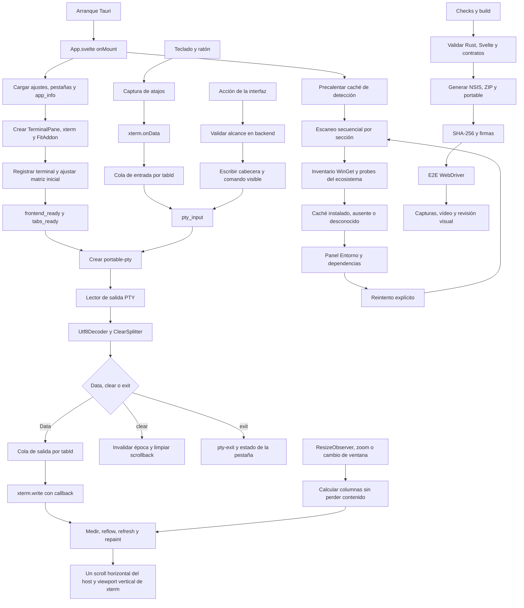

## Diagramas de flujo detallados

Un diagrama por flujo, con los **archivos y funciones reales** en cada nodo.
Todos se pueden pegar tal cual en [mermaid.live](https://mermaid.live).
`npm run check:flows` (`scripts/verify-flow-documentation.mjs`) comprueba que
cada función citada aquí sigue existiendo en el archivo indicado: si se
renombra o se mueve, el contrato falla y obliga a actualizar el diagrama.

### Arranque, ciclo de una pestaña y PTY/ConPTY

La rejilla de xterm nunca baja de 1024 columnas (la geometría de ConPTY) y la
shell no arranca hasta la primera medición real (`viewport_confirmed`).

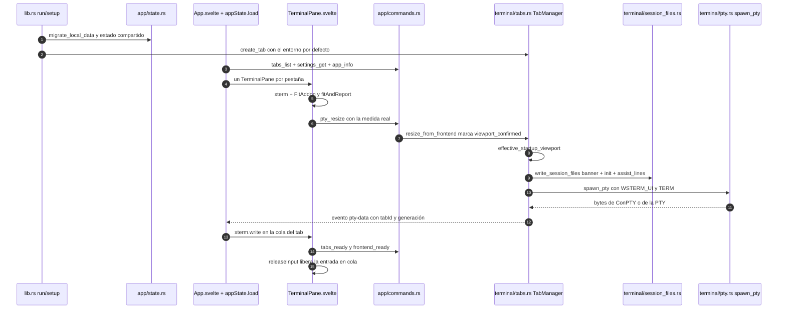

### IPC por dominio

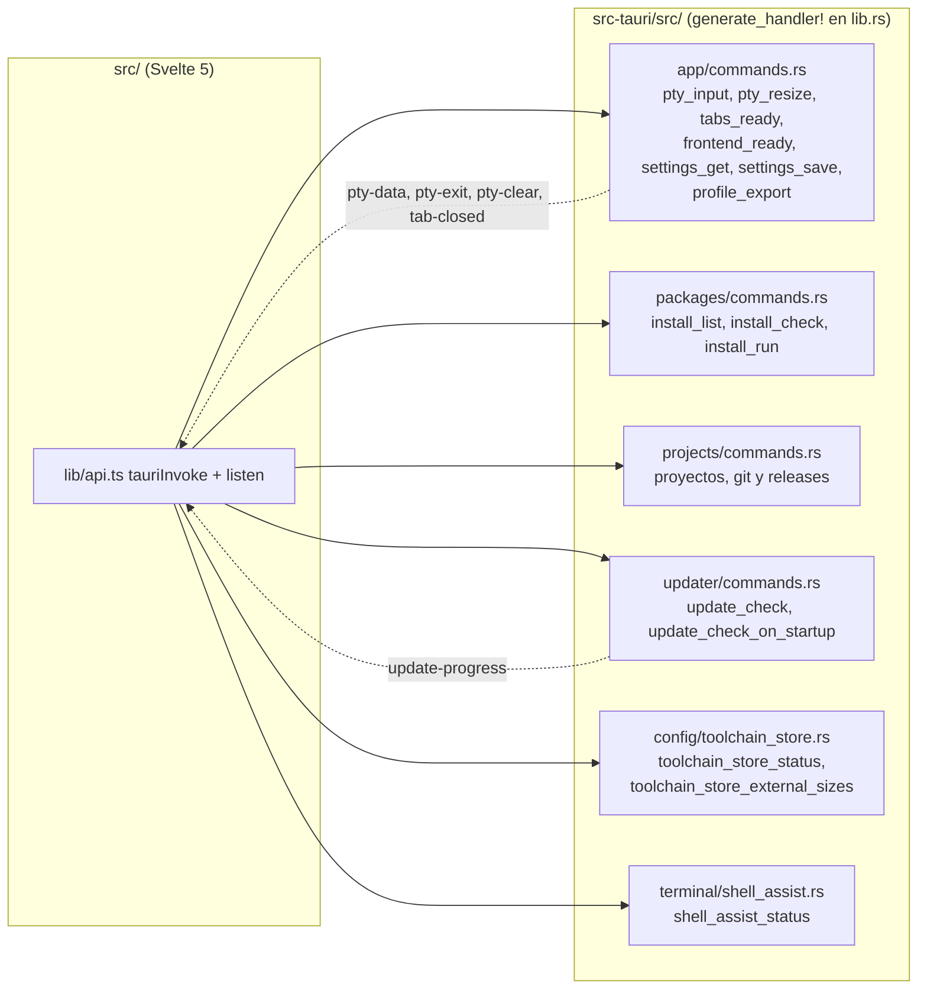

### Detección de entornos y WSL

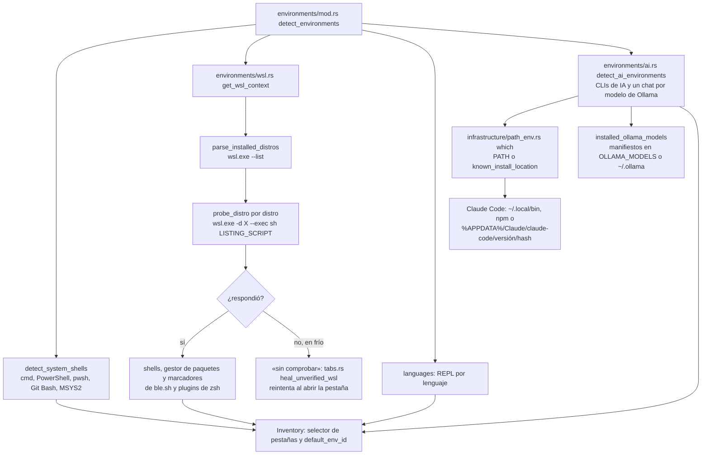

### Entorno y dependencias, con sus sondas

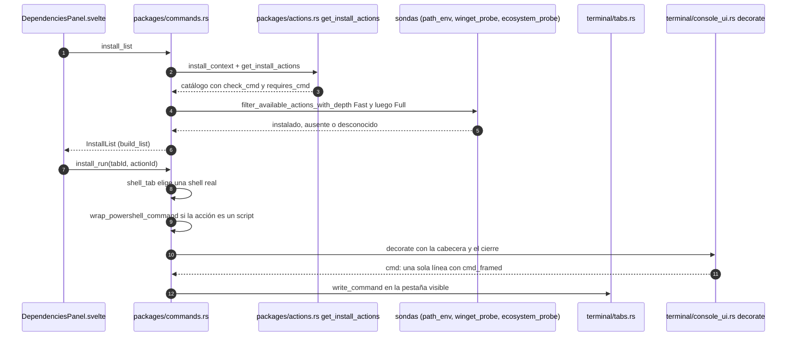

En cmd la orden visible es una sola línea:
`call "%WSTERM_UI%\ui-N-ini.cmd" & <orden real> & call "%WSTERM_UI%\ui-N-fin.cmd"`.
La cabecera y el cierre (con `if errorlevel`) viven en esos dos archivos de la
carpeta de sesión; `WSTERM_UI` la pone `spawn_pty` en el entorno de cada
pestaña.

### Sugerencias, colores y temas

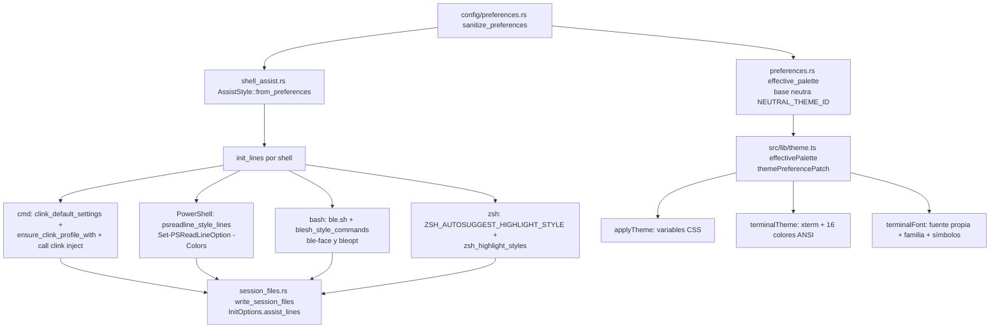

### Imágenes Sixel y símbolos

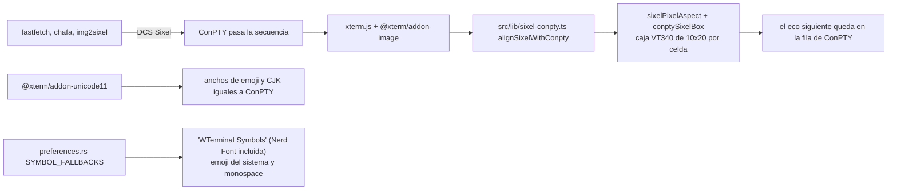

### Enlaces de la salida

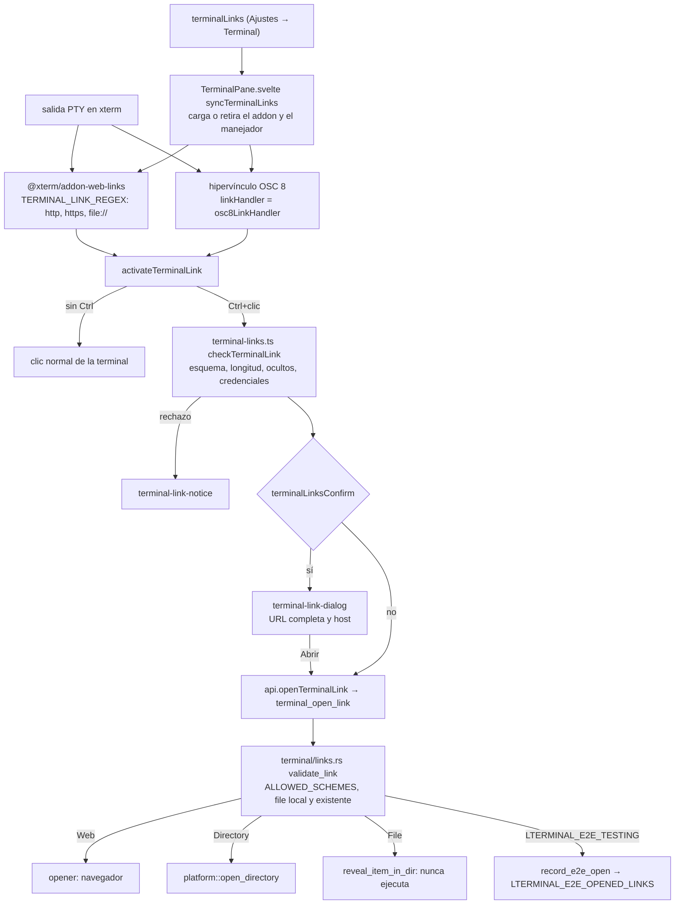

### Almacenamiento y cachés

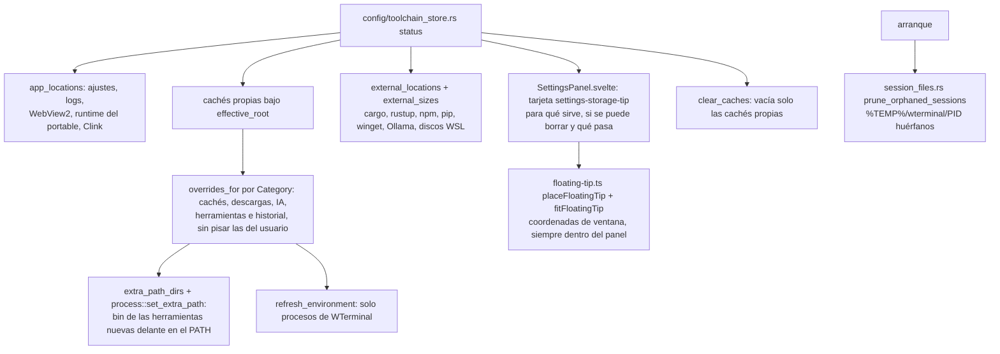

### Paleta de comandos

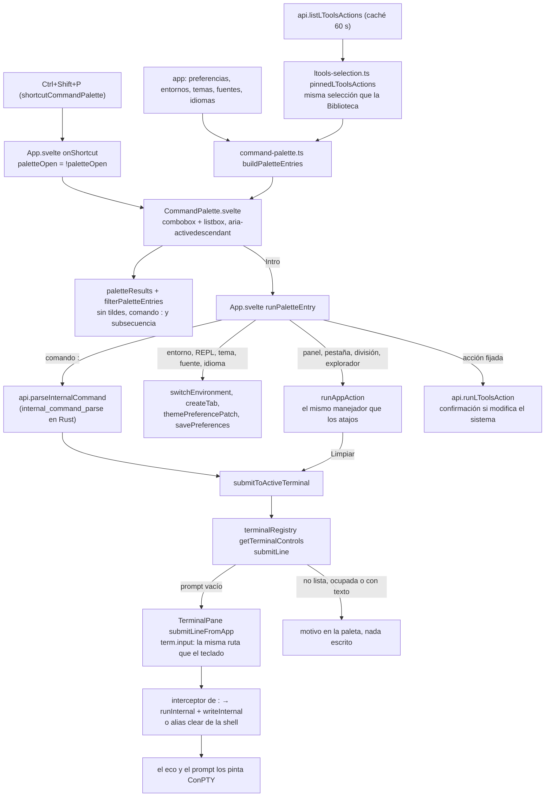

### Actualizador

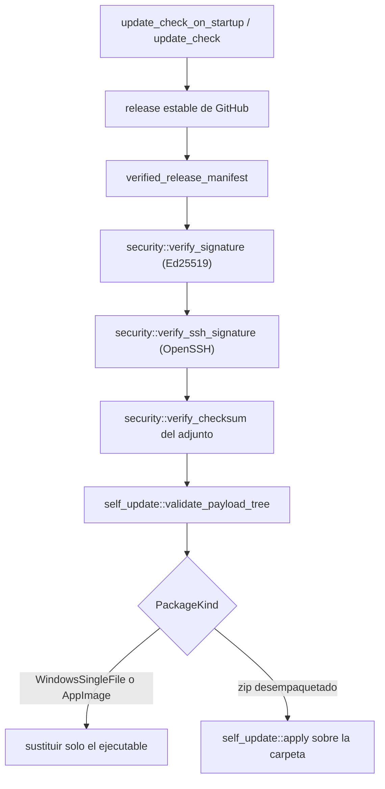

### Portable de un solo archivo

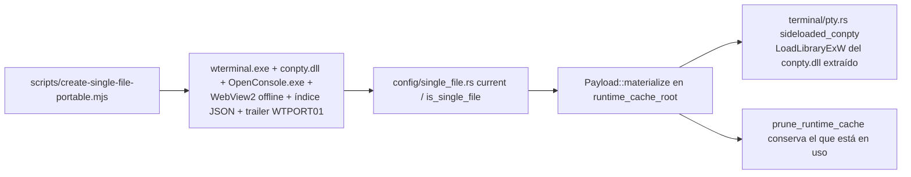

### Build y release

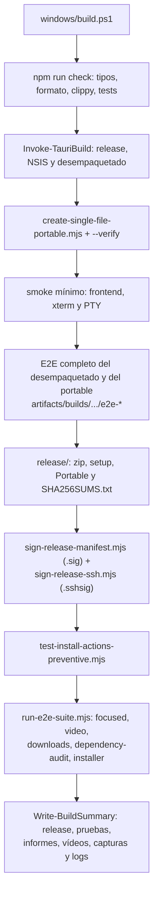

### E2E

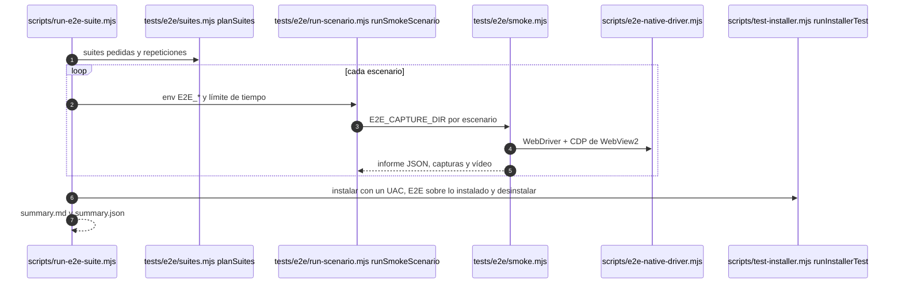

## Mapa de archivos, llamadas y mantenimiento

Esta sección es el mapa técnico completo del código: **cada archivo de
`src/` y `src-tauri/src/`** y cada script de `scripts/`, `windows/`,
`linux/`, `tests/` y `build-tools/`, quién llama a quién, dónde se
transforma un dato entre Svelte, IPC, Rust, la PTY y el sistema, el origen
de los datos y diagramas que se pueden pegar en
[mermaid.live](https://mermaid.live). Las flechas indican llamadas o eventos
reales; una respuesta asíncrona no garantiza que otra solicitud haya
terminado. Para orientarse sin leerla entera:

| Si necesitas cambiar… | Empieza aquí | Continúa por… |
|---|---|---|
| Arranque, primera ventana o PTY | [`src-tauri/src/lib.rs`](src-tauri/src/lib.rs) (`run`, `setup`) | [`app/state.rs`](src-tauri/src/app/state.rs) → [`terminal/tabs.rs`](src-tauri/src/terminal/tabs.rs) → [`src/App.svelte`](src/App.svelte) |
| Entrada, prompt, cursor y scroll | [`TerminalPane.svelte`](src/components/TerminalPane.svelte) (`releaseInput`, `fitAndReport`) | [`api.ts`](src/lib/api.ts) → [`app/commands.rs`](src-tauri/src/app/commands.rs) → [`terminal/tabs.rs`](src-tauri/src/terminal/tabs.rs) → [`terminal/pty.rs`](src-tauri/src/terminal/pty.rs) |
| Salida PTY o `cls` | [`terminal/pty.rs`](src-tauri/src/terminal/pty.rs) | [`terminal/stream.rs`](src-tauri/src/terminal/stream.rs) → [`terminal/tabs.rs`](src-tauri/src/terminal/tabs.rs) → [`src/App.svelte`](src/App.svelte) → xterm |
| Dependencias y detección | [`DependenciesPanel.svelte`](src/components/DependenciesPanel.svelte) | [`api.ts`](src/lib/api.ts) → [`packages/commands.rs`](src-tauri/src/packages/commands.rs) → [`packages/actions.rs`](src-tauri/src/packages/actions.rs) y [`environments/mod.rs`](src-tauri/src/environments/mod.rs) |
| Ajustes, idioma y tema | [`SettingsPanel.svelte`](src/components/SettingsPanel.svelte) | [`appState.svelte.ts`](src/lib/appState.svelte.ts) → [`api.ts`](src/lib/api.ts) → [`app/commands.rs`](src-tauri/src/app/commands.rs) → [`config/preferences.rs`](src-tauri/src/config/preferences.rs) |
| Releases y vídeo E2E | [`windows/build.ps1`](windows/build.ps1) | [`tests/e2e/smoke.mjs`](tests/e2e/smoke.mjs) → [`e2e-native-driver.mjs`](scripts/e2e-native-driver.mjs) → [`audit-video-frames.py`](scripts/audit-video-frames.py) |

Una ruta común de entrada y salida se lee así:

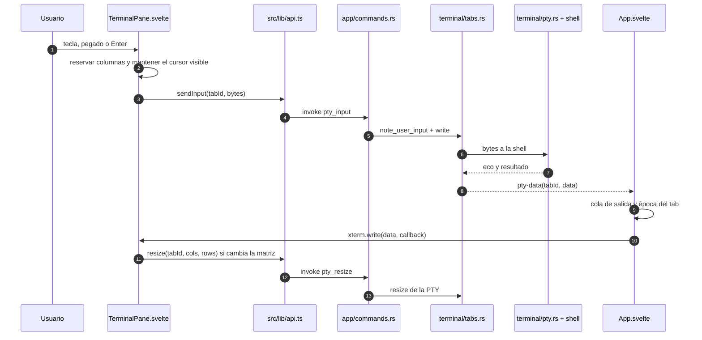

### Fronteras y fuentes de verdad

| Dato | Dueño | Consumidores | Cómo cambia |
|---|---|---|---|
| Pestañas y sesión de shell | `TabManager` en `terminal/tabs.rs` | `AppStore`, `TerminalPane` | IPC `tabs_*`, eventos `tab-closed` y `env-changed` |
| Bytes de salida | PTY y su lector en `terminal/pty.rs` | cola de `App.svelte`, xterm | `pty-data` o `pty-clear` con `tabId` |
| Cursor y edición | shell conectada a la PTY | xterm refleja lo recibido | `onData` → `pty_input` → eco de la shell |
| Geometría visible | `TerminalPane.svelte` | xterm y PTY | `fitAndReport` → `pty_resize`; el host posee el scroll horizontal |
| Preferencias persistentes | `config/preferences.rs` | `AppStore` y componentes | `settings_get/save/reset` |
| Catálogo de instalación | `packages/actions.rs` y `packages/commands.rs` | `DependenciesPanel` | `install_catalog/list/check/refresh` |
| Inventario de entornos | `environments/mod.rs` y `AppState` | selector, dependencias | `env_list/refresh`, evento `envs-updated` |
| Archivos y proyectos | backend `explorer`, `scripts`, `projects` | paneles | comandos de cada dominio; el backend revalida las rutas |

`src/lib/api.ts` es el puente único: encapsula `invoke` y `listen`. El
nombre de cada comando se registra en `src-tauri/src/lib.rs` mediante
`generate_handler!`. Un componente no debe construir un nombre IPC propio.
Las funciones del backend comprueban los datos recibidos: que una tarjeta o
una ruta exista en el frontend no constituye autorización.

### Mapa de directorios

| Ruta | Contenido y punto de entrada |
|---|---|
| `src/` | Interfaz Svelte 5, xterm.js, estilos y tipos. `main.ts` monta `App.svelte`. |
| `src/components/` | Cada región visual de la ventana. `TerminalPane.svelte` posee la instancia xterm de una pestaña. |
| `src/lib/` | Estado compartido, puente IPC y algoritmos puros de teclado, columnas, tema y render. |
| `src/styles/` | CSS general, paneles y geometría de la terminal. |
| `src-tauri/src/app/` | Estado Rust compartido y funciones Tauri invocables. |
| `src-tauri/src/terminal/` | Pestañas, PTY, shell, protocolos de salida y archivos de sesión. |
| `src-tauri/src/config/` | Preferencias, identidad, rutas, migración, traducción y plugins. |
| `src-tauri/src/environments/` | Detección de shells y sistemas externos. |
| `src-tauri/src/packages/` | Definición, estado y ejecución visible de acciones de instalación. |
| `src-tauri/src/explorer/` | Operaciones y visores de archivos. |
| `src-tauri/src/scripts/` | Escaneo, favoritos y ejecución de scripts. |
| `src-tauri/src/projects/` | Estado de proyectos, repositorios y cliente GitHub. |
| `src-tauri/src/updater/` | Comprobación, autenticación y aplicación de releases. |
| `src-tauri/src/platform/` | Adaptadores Windows/Linux; WebView2, elevación e integración de rutas. |
| `src-tauri/src/infrastructure/` | Ejecución de procesos, PATH y logging. |
| `src-tauri/src/system/` | Información de hardware y virtualización. |
| `src-tauri/locales/` | Un JSON por idioma; mismas claves en todos los catálogos. |
| `windows/`, `linux/` | Construcción y validación nativa o cruzada por sistema. |
| `scripts/` | Utilidades de build, firma, auditoría, contratos y pruebas. |
| `tests/e2e/` | Driver WebView2, escenarios observables y layout. |
| `tests/ui/` | Superficie aislada de la barra de herramientas. |
| `docs/` | Este mapa y auditorías de diseño comparativas. |
| `release/`, `artifacts/` | Salidas de trabajo; no son fuente de verdad del código. |

#### Rutas creadas durante la ejecución

Estas rutas salen de `config/paths.rs`; no debe codificarse su valor absoluto
en la UI. El slug cambia entre Windows (`wterminal`) y Linux
(`lterminal`). El E2E usa un directorio de datos aislado solo cuando se
activa `LTERMINAL_E2E_TESTING` con una ruta absoluta.

| Ruta lógica | Contenido | Productor / consumidor |
|---|---|---|
| `USER_DATA_DIR = appData/<slug>` | Raíz persistente de la instalación del usuario | `paths.rs`, todos los módulos de configuración |
| `USER_DATA_DIR/settings.json` | Preferencias y ajustes guardados | `config/preferences.rs`, `settings_get/save/reset` |
| `USER_DATA_DIR/scripts/` | Biblioteca de scripts por defecto | `scripts/scan.rs`, `ScriptsPanel` |
| `USER_DATA_DIR/logs/main.log` | Arranque, PTY, errores y métricas | `infrastructure/logger.rs`, E2E |
| `USER_DATA_DIR/install-actions-cache.json` | Estado conocido por ID de acción | `packages/commands.rs` |
| `USER_DATA_DIR/install-actions-snapshot.json` | Estructura del catálogo sin sondas, con esquema e idioma | `packages/commands.rs`; se descarta si cambia esquema o idioma |
| `LEGACY_USER_DATA_DIR` | Datos antiguos bajo el nombre visible | `config/migration.rs` los migra al slug estable |
| `documents/<nombre de proyectos>` | Carpeta inicial de repositorios descargados | `projects/commands.rs`, ajustable por usuario |
| `temp/<slug>/<pid>/` | Archivos de inicialización, banner y ayuda de esta sesión | `terminal/session_files.rs`; cada proceso usa su PID |
| `release/` | Solo lo que se sube a GitHub: instalador, portable de un solo archivo, ZIP desempaquetado y `SHA256SUMS.txt` con sus firmas `.sig`/`.sshsig` | `windows/build.ps1`; la build completa aparta lo demás a `src-tauri/target/dist/release-anterior/` |
| `src-tauri/target/dist/` | Carpeta desempaquetada (`WTerminal-<versión>`), salidas de las builds rápidas (`dev/`, `-dev`) y release anterior apartada | `windows/build.ps1`; ignorada por git |
| Directorio `E2E_CAPTURE_DIR` | Capturas, vídeo, segmentos nativos y frames de checkpoints | `tests/e2e/smoke.mjs` |

La caché de detección acelera la primera pintura, pero `install_refresh`
ejecuta sondas reales y actualiza el estado. Un valor cacheado debe etiquetarse
como tal; que una acción figure en `install-actions-snapshot.json` no demuestra
que el programa siga instalado ni que la tarjeta haya sido vista en vídeo.
`install_refresh` solo se une a una precarga que siga en vuelo; si ya terminó,
detecta de nuevo.

WinGet falla al instante (sin salida) cuando se le lanzan varias consultas a la
vez, así que todas las de la app pasan por `process::winget_probe` /
`winget_run_env`, que las serializan y reintentan una vez ese fallo. El
inventario consulta primero `winget list` y solo si falla los orígenes
`winget`/`msstore`. Las comprobaciones de familia (`install_check`) reutilizan
durante 60 s las listas de WinGet y los inventarios de ecosistemas (pip, npm,
gem…) de la última pasada; instalar desde el panel o repetir la detección los
invalida. En la pasada completa, un inventario de ecosistema que agota su plazo
se repite una vez. El log registra `Inventario de WinGet`, `Inventario de
ecosistemas`, las acciones sin confirmar por origen (`Catalogo de acciones
preparado`, `Catálogo de Dependencias entregado`) y las familias lentas.

### Inventario del frontend

| Archivo | Responsabilidad y conexiones |
|---|---|
| `src/main.ts` | Decide entre interfaz normal y preview; monta Svelte sobre `#app`. |
| `src/App.svelte` | Raíz y composición; registra una vez listeners PTY, colas de salida, atajos, avisos de actualización y carga inicial. Monta los paneles bajo demanda. `runAppAction` es el único manejador de las acciones de la aplicación (lo usan los atajos y la paleta de comandos); `runPaletteEntry` ejecuta cada entrada de la paleta con el manejador que ya tenía y `submitToActiveTerminal` teclea `clear` o un comando `:` en la pestaña activa por la ruta del teclado. |
| `src/PreviewApp.svelte` | Vista aislada para la comprobación de estilos sin arrancar Tauri. |
| `src/styles/app.css` | Layout global, superficies, paneles, scrollbar y variables de tema. |
| `src/components/Toolbar.svelte` | Selector de entorno y navegación principal. Nombra grupos y entornos con `environmentGroupLabel`/`environmentLabel` de `command-palette.ts`, igual que la paleta. |
| `src/components/TabBar.svelte` | Activación, creación, cierre y orden de pestañas. |
| `src/components/TerminalPane.svelte` | Crea xterm/FitAddon/SearchAddon, enruta entrada, mide y redimensiona rejilla, conserva scrollback, foco y cursor. La liberación del ancho horizontal usa `wideReleaseTimer`; el ajuste tardío usa `fitQuietTimer`, de modo que el segundo no cancele al primero tras una salida corta. Carga `@xterm/addon-web-links` y el `linkHandler` de los OSC 8 según `terminalLinks` (`syncTerminalLinks`), abre solo con Ctrl+clic, enseña la confirmación `terminal-link-dialog` y delega en `api.openTerminalLink`. Registra `openSearch` y `submitLineFromApp` en `terminalRegistry.ts` para la paleta de comandos: la línea se teclea con `term.input`, de modo que el interceptor de `:` (`runInternal` + `writeInternal`, que resincroniza su salida con ConPTY) o la shell la reciben como una orden escrita a mano. |
| `src/components/Panel.svelte` | Contenedor común de los paneles, cabecera y cierre. |
| `src/components/CommandPalette.svelte` | Paleta de comandos (`Ctrl+Shift+P`): diálogo modal con un `combobox` que controla un `listbox` agrupado (`role="group"` por sección) y anuncia la opción activa con `aria-activedescendant`, así el foco no sale del buscador. Flechas, RePág/AvPág, Intro y Escape (que no cierra el panel de detrás); Tab no escapa del diálogo. Pide el catálogo de LTools con una caché de 60 s (`LTOOLS_CACHE_MS`) y resuelve las fijadas con los helpers de `ltools-selection.ts`. Al cerrar devuelve el foco a donde estaba (cancelar) o a la terminal activa (ejecutar), salvo que la acción se lo haya llevado a un panel o al buscador. |
| `src/components/SettingsPanel.svelte` | Edita tema, terminal, atajos, idioma, integración, perfiles y plugins; guarda el borrador por `app.savePreferences`. |
| `src/components/DependenciesPanel.svelte` | Muestra secciones y acciones, combina catálogo con estado cacheado, consulta acciones pendientes y solicita refresco o ejecución. |
| `src/components/ProjectsPanel.svelte` | Busca repositorios, gestiona favoritos, releases y acciones de proyecto. |
| `src/components/GithubRepoManager.svelte` | «Gestionar…» de un repositorio de «Mi GitHub»: detalles, releases (crear con adjuntos, subir, publicar, borrar), git local (commit, ramas, push/pull en la terminal), pull requests, issues y Actions. |
| `src/components/ScriptsPanel.svelte` | Biblioteca de scripts, filtros, LTools, argumentos y ejecución opcional elevada. La selección, el nombre y la confirmación de las acciones de LTools salen de `ltools-selection.ts`, igual que en la paleta de comandos. La lista de tipos usa `bind:open` (`typesOpen`): con `open={…}` Svelte reescribía `open` en el mismo efecto que el contador del resumen y la lista se cerraba tras cada casilla. |
| `src/components/ExplorerSidebar.svelte` | Lista y manipula archivos; sigue el cwd del tab activo y descarta respuestas antiguas. |
| `src/lib/api.ts` | Envoltorios tipados de todos los comandos y eventos; cola y época de entrada por pestaña; APIs de ventana, diálogos y portapapeles. |
| `src/lib/appState.svelte.ts` | `AppStore`: pestañas, paneles, inventario, preferencias y serialización de operaciones de ciclo de vida. |
| `src/lib/types.ts` | Tipos compartidos de respuestas IPC, acciones, preferencias, inventarios y eventos. |
| `src/lib/panels.svelte.ts` | Panel activo y navegación entre superficies. |
| `src/lib/terminalRegistry.ts` | Relación `tabId → Terminal` que usa el listener único de `App.svelte`, y `tabId → TerminalControls` (`openSearch`, `submitLine`) que cada `TerminalPane` registra para la paleta de comandos. `submitLine` teclea con `term.input` (la ruta de `onData`, nunca escribe en xterm) y rechaza sin tocar nada si la shell no está lista (`not-ready`), hay un programa a pantalla completa o ningún prompt (`busy`) o la línea tiene texto sin enviar (`draft`). |
| `src/lib/command-palette.ts` | Registro y filtrado de la paleta, puro para probarlo en Node: `PALETTE_APP_ACTIONS` (acciones de `runAppAction` con su atajo y su comando `:` equivalente), `PALETTE_INTERNAL_COMMANDS` (los `:` que informan en la terminal), `buildPaletteEntries` (entradas a partir de preferencias, entornos, temas, fuentes, idiomas y acciones fijadas de LTools, con el motivo si están deshabilitadas), `filterPaletteEntries` (sin tildes, por palabras, comando y sinónimos; subsecuencia como último recurso; deshabilitadas detrás), `paletteResults` (ofrece una línea `:` nueva tal cual), `nextPaletteIndex`, `formatShortcut` y la traducción de grupos de entornos que comparte con `Toolbar.svelte`. |
| `src/lib/terminal-columns.ts` | Cálculo de columnas de reserva, entrada y salida visible. |
| `src/lib/floating-tip.ts` | Posición de tarjetas flotantes (`position: fixed`) dentro de un panel: `placeFloatingTip` calcula en coordenadas de la ventana junto a la fila (debajo, o encima si no caben unos 170 px) y `fitFloatingTip` devuelve el desplazamiento que mete la tarjeta ya medida dentro del panel por los cuatro lados, sin bucle si es más grande que él. La usa la tarjeta de carpetas de Ajustes. |
| `src/lib/terminal-links.ts` | Enlaces de la salida: `TERMINAL_LINK_REGEX` (la expresión estricta de `@xterm/addon-web-links` ampliada a `file://`; las rutas sueltas no se detectan para no subrayar cada prompt), `isLinkActivation` (solo Ctrl + botón principal), `checkTerminalLink` (espejo de `validate_link` sin la parte del disco: esquemas `TERMINAL_LINK_SCHEMES`, longitud, caracteres ocultos, credenciales; devuelve la URL normalizada y el host que enseña la confirmación) y `linkRejectionMessageKey` (aviso por código de rechazo). |
| `src/lib/settings-search.ts` | Buscador de Ajustes: `foldSearchText` (sin mayúsculas ni tildes), `settingsSearchVisibility` (qué títulos de sección, encabezados, filas y notas se ven para una búsqueda) y `visibleSettingsRows` (el recuento). `SettingsPanel` recorre su formulario como bloques y solo esconde lo que esta función diga; también construye el índice de apartados y pone a cada fila su explicación como `title`. |
| `src/lib/input-selection.ts` | Cortar o borrar una selección de la línea que se escribe: `promptInputStart` (dónde acaba el prompt), `columnAtTextIndex`/`contentEndColumn` (texto a celdas, caracteres anchos), `inputSelectionEdit` (flechas hasta el final de la selección y un DEL por carácter, solo dentro de lo escrito o tocando el cursor) y `selectionSearchText` (texto para «Buscar» del menú). |
| `src/lib/banner-image.ts` | Imagen a la izquierda del banner: `findBannerBlocks` reconoce cada banner por su título tras un margen de 10 a 42 espacios, el que dejó el backend al imprimirlo (`bannerImagePadding`, `BANNER_IMAGE_GAP` igual que en Rust) y `attachBannerImages` coloca una decoración de xterm anclada a ese título (encima del margen y centrada en él con el mismo hueco a cada lado, `bannerImageBox`; sin pasar por ConPTY), la retira si el texto cambia y sigue a la configuración y a la imagen elegida. |
| `src/lib/sixel-conpty.ts` | Imágenes Sixel alineadas con ConPTY: ConPTY las mide como un VT340 (celda virtual de 10×20 y píxel 2:1 salvo atributos de trama) y baja `floor(alto·aspecto/20)` filas; antes de que `@xterm/addon-image` coloque la imagen se encaja, sin deformarla, en esa caja de celdas para que el cursor de xterm acabe en la misma fila. Solo en Windows. |
| `src/lib/terminal-prompt.ts` | Reconocimiento de prompt y señales de disponibilidad de REPL. |
| `src/lib/terminal-ready.ts` | Reintento acotado del handshake de disponibilidad. |
| `src/lib/terminal-render.ts` | Planificación y refresco final del renderer xterm. |
| `src/lib/terminal-scroll.ts` | Normalización de delta de rueda y desplazamiento. |
| `src/lib/shortcuts.ts` | Normalización, comparación y defaults de atajos, incluido `shortcutCommandPalette` (`Ctrl+Shift+P`). |
| `src/lib/keyed-serial-queue.ts` | Cola serial por clave para operaciones concurrentes. |
| `src/lib/theme.ts` | Conversión de preferencias a tema, fuente y cursor xterm. `effectivePalette` (base neutra de «Cian técnico» salvo `themeRecolorAll`, mismas reglas que `effective_palette` en Rust), `themePreferencePatch` (lo que cambia elegir un tema, en Ajustes y en `:theme`), los 16 colores ANSI (`ANSI_COLOR_KEYS`, `DEFAULT_ANSI_COLORS`) y la fuente escrita a mano delante de la familia. |
| `src/lib/localization.ts` | Comparación y búsqueda localizada; texto de marca por plataforma. |
| `src/lib/ltools-selection.ts` | Reconciliación de selección de acciones LTools guardada, y lo que comparten la Biblioteca y la paleta de comandos: clave de almacenamiento por sistema (`ltoolsSelectionStorageKey`), acciones fijadas en su orden (`pinnedLToolsActions`), nombre desambiguado (`ltoolsActionLabel`, `ltoolsActionMeta`) y si piden confirmación (`ltoolsActionNeedsConfirmation`). |
| `src/lib/performance.ts` | Marcas de tiempo y métricas `frontend.performance`. |

### Inventario del backend Rust

#### Entrada, configuración y plataforma

| Archivo | Responsabilidad y conexiones |
|---|---|
| `src-tauri/src/main.rs` | Llama a `lib::run()`. |
| `src-tauri/src/lib.rs` | Migra datos, prepara PATH/estado, construye Tauri, registra IPC y crea la primera pestaña en `setup`. Antes de todo instala un runtime asíncrono propio (`install_async_runtime`, `async_worker_threads`: 4 hilos por núcleo, entre 16 y 64): Tauri ejecuta los comandos síncronos `#[tauri::command(async)]` dentro de esos hilos, y con los de fábrica (uno por núcleo) ocho comandos esperando dejaban la app sin atender ningún otro comando asíncrono, guardar las preferencias incluido. |
| `src-tauri/src/app/mod.rs` | Declara módulos de aplicación. |
| `src-tauri/src/app/state.rs` | `AppState`, `TabManager`, inventario de entornos y caché de catálogo; arranca detección completa en segundo plano. |
| `src-tauri/src/app/commands.rs` | IPC de pestañas, PTY, entorno, ajustes, perfil, información y telemetría. |
| `src-tauri/src/app/panel_commands.rs` | IPC de Biblioteca y Explorador; valida rutas visibles y escribe comandos en la pestaña. |
| `src-tauri/src/config/mod.rs` | Reexporta módulos de configuración. |
| `src-tauri/src/config/identity.rs` | Nombre WTerminal/LTerminal y metadatos por plataforma. |
| `src-tauri/src/config/paths.rs` | Directorios de datos, caché, logs y perfiles. |
| `src-tauri/src/config/settings.rs` | Lectura/escritura de configuración de aplicación. |
| `src-tauri/src/config/preferences.rs` | Esquema, defaults, validación y persistencia de preferencias. Temas: `effective_palette` y `NEUTRAL_THEME_ID`, temas propios (`CustomTheme`, como mucho 24, ids `custom-…`), paleta ANSI de 16 colores y fuente propia validada; aspecto de las sugerencias (`shellAssistSuggestionColor`…`shellAssistListView`). Atajos: `safe_shortcut` normaliza cada `shortcut*`, conserva `""` como «sin asignar» y devuelve el de fábrica si falta o no es un atajo válido. |
| `src-tauri/src/config/migration.rs` | Traslada datos de ubicaciones anteriores al slug estable. |
| `src-tauri/src/config/install_dir.rs` | Determina ubicación instalada y portable. |
| `src-tauri/src/config/single_file.rs` | Portable de un solo `.exe`: lee los archivos añadidos tras la imagen PE (respetando una firma Authenticode posterior), coloca `conpty.dll`/`OpenConsole.exe` en `%LOCALAPPDATA%\WTerminal\runtime\<huella>` verificados por SHA-256, saca el instalador de WebView2 solo si falta el runtime y valida el `-Portable.exe` que descarga el actualizador. |
| `src-tauri/src/config/i18n.rs` | Catálogos y traductor backend. |
| `src-tauri/src/config/plugins.rs` | Inventario y operaciones del sistema de plugins. |
| `src-tauri/src/config/toolchain_store.rs` | Carpeta propia (`%LOCALAPPDATA%\WTerminal\entornos`) por categorías (`Category`: cachés, descargas del panel, modelos de IA, herramientas nuevas, historial de los REPL; `Categories::from_preferences`): variables estándar inyectadas solo en procesos de WTerminal (`overrides_for`), carpetas `bin` de las herramientas nuevas delante del PATH de WTerminal (`extra_path_dirs` → `process::set_extra_path`, que aplican `child_environment`, `hidden_command` y `path_env::which`), `OLLAMA_MODELS` solo si no había modelos, tamaños y vaciado (solo la categoría de cachés); las ubicaciones de siempre de las categorías apagadas se miden con `cached_system_size` y se reutilizan 10 min, las propias se miden siempre. Además mide y explica cada ubicación: `app_locations` (ajustes, scripts, plugins, registros, caché de detección, datos del WebView, temporales de sesión, proyectos, runtime del portable, perfil de Clink) y `external_locations` (Cargo, rustup, Go, Bun, Ollama, cachés de npm/pip/pnpm/Yarn/uv/Deno, WinGet, Docker, Chocolatey, Scoop y el disco de cada distro WSL leído de `HKCU\…\Lxss`). Cada una lleva `LocationInfo` (para qué sirve, si se puede borrar y `Safety`: `safe`/`regenerates`/`caution`/`keep`), que Ajustes enseña en una tarjeta al pasar el ratón. |
| `src-tauri/src/platform/mod.rs` | Selección de implementación de host por sistema. |
| `src-tauri/src/platform/traits.rs` | Contratos de operaciones dependientes de plataforma. |
| `src-tauri/src/platform/system_info.rs` | Datos de sistema y hardware para banner e información. `build_banner`/`build_banner_with` componen el banner; con la imagen activada lo hacen en lo que queda tras el margen de `banner_image_padding` y desplazan cada línea con espacios. |
| `src-tauri/src/terminal/banner_image.rs` | Imagen propia del banner: `banner_image_read` la valida por su firma (`image_mime`: PNG, JPEG, GIF, WebP, BMP, ICO, SVG con `<svg`) y tamaño (`MAX_BANNER_IMAGE_BYTES`, 8 MB) y la devuelve como `data:`. |
| `src-tauri/src/platform/recycle.rs` | Envío a papelera del sistema. |
| `src-tauri/src/platform/path_integration.rs` | Integración del ejecutable en PATH (HKCU). Ajustes bloquea la casilla mientras se aplica: dos escrituras cruzadas dejaban entradas sueltas. El E2E guarda y repone una copia exacta de `HKCU\Environment\Path` y `HKCU\Software\WTerminal\PathIntegration`, porque el perfil aislado no cubre el registro. |
| `src-tauri/src/platform/windows_integration.rs` | Estado y activación de integración Windows (menús, App Paths, `wterminal://`) y de los permisos de administrador: `WindowsIntegrationStatus` lleva `elevated`, `nsudoLauncher`, `gsudoPath` y `windowsSudo`; `StartElevation::should_relaunch` decide «Iniciar siempre como administrador»; `relaunch_elevated` y el IPC `app_restart_as_admin` relanzan con `--elevated-relaunch`; `relaunch_unelevated` y el IPC `app_restart_unelevated` vuelven sin permisos (con `unelevated_restart_blocker` como guarda). |
| `src-tauri/src/platform/windows/mod.rs` | Adaptador Windows. |
| `src-tauri/src/platform/windows/webview2.rs` | Verifica runtime WebView2 e instala desde carga offline si procede. |
| `src-tauri/src/platform/windows/path.rs` | Rutas y localización de herramientas en Windows. |
| `src-tauri/src/platform/windows/elevation.rs` | Token efectivo (`is_process_elevated`), modo del sudo de Windows leído del registro (`WindowsSudo`), ruta de gsudo, citado de argumentos con las reglas de `CommandLineToArgvW` y `run_elevated` (ShellExecuteW «runas»; el código 5 es el UAC cancelado). |
| `src-tauri/src/platform/linux/mod.rs` | Adaptador Linux. |
| `src-tauri/src/platform/linux/path.rs` | Rutas y herramientas en Linux. |
| `src-tauri/src/infrastructure/mod.rs` | Módulos de infraestructura compartida. |
| `src-tauri/src/infrastructure/logger.rs` | Eventos y métricas estructurados en `main.log`. |
| `src-tauri/src/infrastructure/process.rs` | Lanzamiento, captura y timeout de procesos externos. `run_with_timeout_env` vacía stdout/stderr en hilos aparte (`drain_in_background`) mientras espera: leer solo al terminar bloqueaba a cualquier hijo cuya salida no cabía en la tubería (catálogo de WTools, listados largos) hasta el timeout. Tras salir el proceso espera la salida como mucho lo que queda de plazo, para que un nieto con la tubería heredada no la cuelgue. `hidden_command` y las pestañas dan a Windows PowerShell 5.1 un `PSModulePath` depurado (`is_windows_powershell`, `windows_powershell_module_path`): sin las carpetas de PowerShell 7 heredadas y con la de usuario de 5.1 delante. |
| `src-tauri/src/infrastructure/path_env.rs` | PATH combinado y refresco desde el sistema. `is_tool_installed` descarta los lanzadores `.bat`/`.cmd` sencillos cuyo intérprete ya no existe (p. ej. los de RubyGems tras desinstalar Ruby). `which` busca además fuera del PATH las herramientas que se instalan sin tocarlo (`known_install_location`): Claude Code en `~/.local/bin`, npm o la CLI de la app de escritorio (`%APPDATA%\Claude\claude-code\<versión>\<hash>\claude.exe`, gana la versión más alta). |
| `src-tauri/src/system/mod.rs` | Reexporta información y virtualización. |
| `src-tauri/src/system/virtualization.rs` | Sondas de capacidades de virtualización. |

#### Terminal y entornos

| Archivo | Responsabilidad y conexiones |
|---|---|
| `src-tauri/src/terminal/mod.rs` | Declara los submódulos de terminal. |
| `src-tauri/src/terminal/tabs.rs` | `TabManager`: ciclo de vida, generación de sesión, orden de eventos, comandos pendientes, banner y resize. |
| `src-tauri/src/terminal/pty.rs` | Crea `portable-pty`, reader/waiter, fallback de pipes y tamaño físico. |
| `src-tauri/src/terminal/stream.rs` | Decodificación UTF-8 incremental, separación de clear y eventos PTY. |
| `src-tauri/src/terminal/semantic_zones.rs` | Separa marcadores semánticos de acciones/progreso de los bytes visibles. |
| `src-tauri/src/terminal/aliases.rs` | Alias de shell configurados y de scripts. En Windows, `ls`/`ll` entienden opciones de Unix: en cmd con `wt-ls.cmd` (`CMD_LS_SCRIPT`, `CMD_LS_HELPER`), en PowerShell con la función `POWERSHELL_LS_BODY`, tras quitar el alias integrado `ls` (`POWERSHELL_FREE_LS_ALIAS`), que si no ganaba a la función. |
| `src-tauri/src/terminal/console_ui.rs` | Texto, cabeceras y avisos de acciones imprimibles en terminal. En cmd cada acción es una sola línea (`cmd_framed`/`cmd_one_line`): la cabecera y el cierre se escriben en `ui-N-ini.cmd`/`ui-N-fin.cmd` de la carpeta de sesión (`CMD_FRAME_DIR_VAR` = `WSTERM_UI`, que `terminal/pty.rs` pone en cada pestaña) y se llaman con `call` alrededor de la orden real. |
| `src-tauri/src/terminal/internal_commands.rs` | Analiza comandos internos de la aplicación. |
| `src-tauri/src/terminal/links.rs` | Enlaces de la salida (Ctrl+clic). IPC `terminal_open_link`: comprueba que `terminalLinks` sigue activo y vuelve a validar el texto con `validate_link` (`ALLOWED_SCHEMES` = `http`, `https`, `file`; hasta `MAX_LINK_LENGTH` = 2048 caracteres; rechaza controles, espacios y marcas invisibles como los controles bidireccionales, credenciales `usuario:contraseña@`, `file://` de otro equipo, rutas UNC y rutas que no existen). Las URL salen normalizadas por `tauri::Url` (dominios internacionales en punycode) y se abren con el opener de Tauri; una carpeta `file:` se abre con `platform::open_directory` y un archivo solo se muestra seleccionado en su carpeta (`reveal_item_in_dir`), nunca se ejecuta. El log guarda la acción y el host, nunca la URL entera. Con `LTERMINAL_E2E_TESTING=1` no abre nada y añade `{url, action}` a `LTERMINAL_E2E_OPENED_LINKS`. |
| `src-tauri/src/terminal/current_dir.rs` | Extrae cwd de OSC 7 y prompts de respaldo. |
| `src-tauri/src/terminal/powershell.rs` | Adaptación de comandos a PowerShell. |
| `src-tauri/src/terminal/session_files.rs` | Archivos temporales de inicialización, ayuda y banner, y el `wt-ls.cmd` de las pestañas de cmd (se reescribe solo si cambió). |
| `src-tauri/src/terminal/shell_assist.rs` | Sugerencias del historial y colores en la línea de órdenes con la herramienta de cada shell: inyecta Clink en cmd con un perfil propio (`default_settings` con sugerencias en línea y colores; las pestañas arrancan con `/d` y no pasan por su AutoRun), activa las predicciones de PSReadLine si nadie las configuró y carga ble.sh o los plugins de zsh si existen. `UNIX_PLUGINS` es la única tabla de rutas y marcadores de ble.sh y los plugins de zsh: de ella salen la línea de bash/zsh, la detección del catálogo en Linux (`packages::commands`, por marcador) y el fragmento que imprime el marcador en la sonda de WSL. Preferencias `shellAssist` y, por shell, `shellAssistCmd`/`shellAssistPowershell`/`shellAssistBash`/`shellAssistZsh`. `AssistStyle` traduce el aspecto elegido en Ajustes a cada herramienta (`clink_default_settings`, `psreadline_style_lines`, `blesh_style_commands`, `zsh_highlight_styles`); sin cambios produce exactamente los valores de fábrica. IPC `shell_assist_status` (estado por shell para Ajustes; con `refresh` hace el inventario detallado de WSL). En E2E se desactiva con `LTERMINAL_E2E_DISABLE_SHELL_ASSIST` salvo en `E2E_SHELL_ASSIST_ONLY`, que además elige en Ajustes un color de sugerencia (#ff00ff) y exige verlo en PSReadLine, Clink y ble.sh, y `LTERMINAL_E2E_BLESH_PATH` (solo con `LTERMINAL_E2E_TESTING=1`, ruta absoluta sin caracteres de shell) carga un ble.sh instalado en el `/tmp` de la distro de pruebas. |
| `src-tauri/src/terminal/shell_paths.rs` | Ubicación de ejecutables de shells. |
| `src-tauri/src/terminal/spawn_cwd.rs` | Selección segura del cwd de una sesión nueva. |
| `src-tauri/src/environments/mod.rs` | Modelo `Environment`/inventario; detección rápida y completa; selección por defecto. |
| `src-tauri/src/environments/wsl.rs` | Estado de WSL y distribuciones: sonda rápida (`printenv SHELL`, 15 s y un reintento para la VM en frío) y, al abrir Dependencias, inventario detallado con `LISTING_SCRIPT` (sin un `basename` por archivo ni el PATH de Windows en `/mnt/<unidad>`) más los marcadores de `shell_assist::plugin_probe_script`. Todo con `wsl.exe --exec`: con `--` la login shell de la distro expande `$1`/`$HOME` antes que `sh` y el inventario salía con error. Comprueba que cada intérprete ELF se ejecuta (`runnable_probe_script`, marca `wterminal-unrunnable:`; los que dan 126 van a `unrunnable`) y lanza los REPL con `repl_launch_args` (shell de login + `USER_BIN_DIRS`, las mismas carpetas que recorre la sonda). `cached_installed` devuelve la última detección sin arrancar nada. |
| `src-tauri/src/environments/docker.rs` | Contenedores y disponibilidad de Docker. |
| `src-tauri/src/environments/android.rs` | Dispositivos y transporte ADB. |
| `src-tauri/src/environments/languages.rs` | REPL y herramientas de lenguajes. Los de WSL (`detect_wsl_language_environments`) se lanzan con `wsl::repl_launch_args` y solo con las herramientas que se pueden ejecutar (`InstalledDistro::runnable_tools`). |
| `src-tauri/src/environments/ai.rs` | Entornos de IA: CLIs de asistentes detectadas en el PATH (y Claude Code fuera de él, ver `path_env`), con `cli_args` para abrir en modo chat las que lo necesitan (`llm chat`, `sgpt --repl temp`), y un chat por cada modelo local de Ollama leído de sus manifiestos (sin arrancar `ollama list`); catálogo curado de modelos con tamaños y cálculo de memoria frente a la RAM del equipo; sonda `ollama-model:` del panel. |

#### Paneles y servicios

| Archivo | Responsabilidad y conexiones |
|---|---|
| `src-tauri/src/packages/mod.rs` | Declara módulos de paquetes. |
| `src-tauri/src/packages/actions.rs` | Construye el catálogo de acciones por plataforma, familia, gestor y comando. |
| `src-tauri/src/packages/commands.rs` | IPC de catálogo/sondas/refresco/ejecución, instantáneas y caché de estados. `install_run` ejecuta la acción de la última lista del panel y, si una comprobación posterior la sacó de ella, la busca en el catálogo (`DetectionDepth::Catalog`) antes de responder que ya no existe. |
| `src-tauri/src/packages/descriptions.rs` | Descripciones legibles de acciones. |
| `src-tauri/src/packages/aliases.rs` | Nombres equivalentes de herramientas/paquetes. |
| `src-tauri/src/packages/command_not_found.rs` | Sugiere herramienta al fallar un comando. |
| `src-tauri/src/packages/ltools.rs` | Catálogo y ejecución de acciones LTools (`ltools-actions-v1` de `wtools-cli.exe actions list --format json`). Tolerante a versiones nuevas de Tools: ignora campos desconocidos, descarta solo las acciones mal formadas o inseguras y recorta (no rechaza) por encima de `MAX_ACTIONS` (1000); hasta 4 MB y 15 s (`CATALOG_TIMEOUT`). `order_candidates`: `LTOOLS_PATH`, después el PATH y, entre las copias descubiertas, primero los CLI y después la más reciente por fecha de modificación. |
| `src-tauri/src/explorer/mod.rs` | Declara explorador y reexporta papelera. |
| `src-tauri/src/explorer/files.rs` | Listado y operaciones de archivo con validación. |
| `src-tauri/src/explorer/viewers.rs` | Selección de visores para abrir un archivo. |
| `src-tauri/src/scripts/mod.rs` | API interna de Biblioteca. |
| `src-tauri/src/scripts/types.rs` | Tipos de scripts, filtros y contexto de ejecución. |
| `src-tauri/src/scripts/scan.rs` | Descubrimiento de scripts desde carpetas permitidas. |
| `src-tauri/src/scripts/pins.rs` | Favoritos persistentes de scripts. |
| `src-tauri/src/scripts/launch.rs` | Planificación de comando de ejecución y elevación. |
| `src-tauri/src/projects/mod.rs` | Declara proyectos y GitHub. |
| `src-tauri/src/projects/commands.rs` | IPC de proyectos, favoritos, descarga, CD y ejecución. |
| `src-tauri/src/projects/github.rs` | Cliente HTTP, catálogos y metadatos GitHub. |
| `src-tauri/src/projects/gh_cli.rs` | «Mi GitHub»: sesión y repositorios de la cuenta con GitHub CLI (`gh api user`, `gh repo list/create/edit/archive/unarchive/rename/delete`) con argumentos fijos y validados (`valid_new_repo_name`, `create_args`, `change_args`…), solo sobre repositorios del último listado (`OWN_REPOSITORIES`); `gh auth setup-git` una vez con sesión. Login, logout y el permiso `delete_repo` van a una pestaña visible (`projects::commands::github_cli_terminal`). |
| `src-tauri/src/projects/gh_manage.rs` | «Gestionar…» de «Mi GitHub» con `gh`: detalles (`gh repo view/edit`), releases (`gh release list/view/create/upload/edit/delete/delete-asset`), pull requests (`gh pr list/create/merge`), issues (`gh issue list/create/close`) y Actions (`gh run list/rerun`). Argumentos fijos y validados (`valid_ref_name`, `valid_topic`, `valid_homepage`, `valid_files`…), JSON saneado (`parse_*`) y solo repositorios del listado (`gh_cli::own`). |
| `src-tauri/src/projects/git_local.rs` | Git en la copia local de un repositorio de la cuenta (`local_clone`: la carpeta la calcula el backend): estado (`parse_status`), commit de todo y ramas (`branch_args`: `switch -c`, `switch`, `branch -d`), sin preguntas (`GIT_TERMINAL_PROMPT=0`). Push, pull y publicar rama van a una pestaña visible (`commands::github_git_terminal` con `github::build_git_sync_command`). |
| `src-tauri/src/updater/mod.rs` | Declara actualizador. |
| `src-tauri/src/updater/commands.rs` | Consulta release, manifiesto, estado y aplicación. |
| `src-tauri/src/updater/security.rs` | Verificación de firma Ed25519/OpenSSH y checksum. |
| `src-tauri/src/updater/self_update.rs` | Validación del árbol y sustitución del binario. |
| `src-tauri/src/updater/package_updates.rs` | Sondeos de actualizaciones de gestores, solo lectura. |

#### Configuración de build y recursos

| Archivo o ruta | Para qué sirve |
|---|---|
| `src-tauri/Cargo.toml`, `Cargo.lock` | Dependencias Rust y versiones cerradas. |
| `src-tauri/build.rs` | Recursos/manifest de Windows para el ejecutable y tests. |
| `src-tauri/tauri.conf.json` | Configuración común de Tauri y ventana. |
| `src-tauri/tauri.windows.conf.json`, `tauri.windows.installer.conf.json`, `tauri.linux.conf.json` | Diferencias de plataforma y empaquetado. |
| `src-tauri/capabilities/default.json` | Permisos de comandos/plugins del WebView. |
| `src-tauri/default_settings.toml` | Valores de fábrica. |
| `src-tauri/locales/*.json` | Mensajes localizados. |
| `src-tauri/icons/` | Iconos de ejecutable, instalador y tienda. |
| `src-tauri/windows-test.manifest`, `.rc` | Manifest Windows enlazado al ejecutable de test del host. |
| `package.json`, `package-lock.json` | Comandos npm y versiones de frontend. |
| `pnpm-workspace.yaml`, `pnpm-lock.yaml` | Instalación alternativa de workspace. |
| `vite.config.ts`, `svelte.config.js`, `tsconfig.json`, `index.html` | Bundling, compilación de Svelte/TS y HTML de entrada. |

#### Raíz del repositorio y automatización

| Archivo o ruta | Función y relación con el resto |
|---|---|
| `README.md` | Guía del producto, instalación, build, validación y flujos operativos; enlaza este mapa. |
| `CONTRIBUTING.md` | Reglas para cambios, pruebas y actualización conjunta de documentación. |
| `SECURITY.md` | Política de reporte de vulnerabilidades. |
| `LICENSE`, `THIRD-PARTY-NOTICES.txt` | Licencia del proyecto y atribuciones de terceros; se revisan al distribuir. |
| `deny.toml` | Política de dependencias Rust utilizada por `cargo deny`. |
| `docs/audits/alacritty-wezterm-wterminal.md` | Comparación de terminales y observaciones de auditoría; no define el comportamiento ejecutable. |
| `tests/e2e/smoke.mjs` | Orquestador WebDriver sobre el binario indicado por `E2E_BINARY`; produce JSON, capturas y vídeo. |
| `tests/e2e/toolbar-layout.mjs`, `terminal-url-matcher.mjs` | Reglas puras que reutilizan el E2E y sus pruebas unitarias. |
| `tests/ui/toolbar.html`, `toolbar.js` | Fixture pequeño para revisar la barra de herramientas sin lanzar la aplicación completa. |
| `build-tools/` | Entradas auxiliares para build por host y configuración local de firma Git. |
| `fuzz/` | Crate separado y target de fuzzing para destinos GitHub. |
| `.github/ISSUE_TEMPLATE/` | Formularios de incidencias y propuestas; orientan qué evidencia adjuntar. |
| `.github/dependabot.yml` | Programación de actualizaciones de dependencias. |
| `.github/workflows/ci.yml`, `workflow-security.yml` | Validación de cambios y guardas de workflows. |
| `.github/workflows/release.yml` | Empaquetado/publicación desde una etiqueta de versión o lanzamiento manual. |
| `.github/workflows/wine.yml`, `fuzz.yml` | Smoke bajo Wine y fuzzing automatizado. |
| `.github/workflows/codeql.yml`, `dependency-review.yml`, `scorecard.yml` | Análisis estático, revisión de dependencias y prácticas de seguridad del repositorio. |

Los archivos de `release/`, `artifacts/` y `src-tauri/target/` son salidas
generadas. Para depurar un fallo de distribución, anotar el ejecutable exacto,
su hash y el informe E2E correspondiente; el nombre de la carpeta por sí solo
no demuestra que el vídeo y el código fuente sean de la misma build.

### Diagrama de arranque y terminal

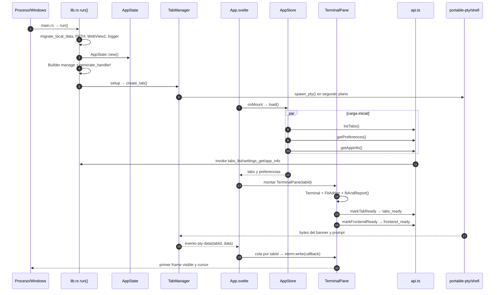

El orden exacto de `tabs_ready`, `frontend_ready` y la salida de la shell
depende de la latencia del proceso. Las barreras impiden que se pierdan bytes
cuando la PTY se adelanta al montaje de xterm. `App.svelte` registra listeners
una sola vez; `TerminalPane` se mantiene montado al cambiar de pestaña.

### Diagrama de entrada, salida y reflow

```mermaid
flowchart LR
    K[Tecla o pegado] --> X[xterm.onData]
    X --> P[TerminalPane: espejo y reserva de columnas]
    P --> A[api.sendInput: cola y época por tabId]
    A --> C[commands::pty_input]
    C --> T[TabManager::write / note_user_input]
    T --> S[Shell por portable-pty]
    S --> R[pty.rs: reader]
    R --> D[stream.rs: UTF-8 y clear]
    D --> Z[semantic_zones.rs]
    Z --> E[TabManager::on_pty_event]
    E --> Q[Evento Tauri pty-data/clear/exit]
    Q --> O[App.svelte: outputQueues y outputEpochs]
    O --> W[xterm.write con callback]
    W --> M[TerminalPane: medir filas y scroll]
    M --> F[fitAndReport: columnas/filas]
    F --> V[api.resize → commands::pty_resize]
    V --> T
    M --> H[Host: scroll horizontal único]
```

Para una entrada larga, `reserveCurrentInputColumns` y
`queueInputPtyResize` preparan la matriz antes de entregar bytes a la shell.
Para salida larga, `onTerminalOutputBusy` y `onTerminalOutputIdle` delimitan
la ráfaga y `fitAndReport` compara contenido visible, viewport y reserva.
`pty_resize` comunica el mismo tamaño a la PTY; xterm y ConPTY deben coincidir.
ConPTY coloca el eco con coordenadas absolutas (`ESC[fila;colH`), así que
cualquier diferencia de filas o columnas hace aparecer la orden debajo de su
prompt. Por eso:

- La rejilla de xterm nunca baja de `CONPTY_MIN_COLS` (= `MIN_INTERACTIVE_COLS`
  del backend, 1024). Lo que la vista pide se publica aparte como
  `data-display-cols` y es lo que miden las comprobaciones de anchura.
- Las filas siempre se envían a ConPTY, aunque una reserva de entrada proteja
  las columnas; un resize aplazado por salida se reenvía al quedar inactiva.
- Si xterm pasa por un tamaño transitorio (p. ej. 1 fila al dividir), esa
  reducción se reproduce en ConPTY antes de la geometría final.
- Una pestaña nueva no arranca la shell hasta su primer `pty_resize` medido.

- El resize de ConPTY lleva 250 ms de debounce, pero xterm cambia sus filas al
  instante: la entrada adelanta ese resize pendiente (`flushPendingPtyResize`)
  y, en una casilla que vuelve a ser visible, espera su primera medida
  (`activationGeometryReady`, máx. 250 ms) antes de enviar teclas.
- Una casilla oculta (`display: none`) pausa el renderer de xterm. Si se
  reajusta antes de que su IntersectionObserver la vuelva a ver, xterm aplaza
  el resize hasta que la página queda inactiva y, mientras tanto, su área de
  scroll tiene rango 0: la vista caía a la cima del historial y no seguía la
  salida. Al volver de oculta, el reajuste espera esa visibilidad
  (`openVisibilityGate`, máx. 200 ms); además la posición guardada al ocultarse
  se reaplica en los renders durante 4 s (`restoreScrollAfterRender`, como
  mucho cada 80 ms; la rueda o la barra de scroll la cancelan).
  `data-scroll-restore-*` y `data-scroll-guard-applied` lo registran.
- La reserva de columnas del primer eco (`localInputGridPinned`) solo dura
  mientras hay entrada en cola; mantenerla bloqueaba el ajuste de filas en los
  resize siguientes. `data-fit-skip` publica por qué se aplazó un ajuste.

- La salida del inicializador no llega a xterm: el backend la sustituye por
  `banner_text` tras el marcador. El archivo que la shell imprime con `type`
  (`refresh_banner_files`) debe producir exactamente las mismas filas; sin
  banner (casilla diminuta) queda vacío. Antes conservaba un `\r\n` y ConPTY
  acababa una fila por debajo de xterm: el eco de la primera orden salía
  separado del prompt cuando ningún repintado posterior lo disimulaba. El
  backend compara la fila que deja ConPTY (`startup_cursor_hint`) con la que
  tendrá xterm y registra «Desalineación entre ConPTY y xterm tras el
  arranque»; `assertCurrentLog` falla si aparece. Además lo corrige:
  `startup_alignment` añade al banner sustituto `\r\n` (bajar, con el mismo
  scroll que hizo ConPTY) o `CUU` (subir) y, si ConPTY quedó a mitad de
  línea, `CHA` a su columna. Solo se corrige si la salida de arranque no se
  recortó (`OUTPUT_BUFFER_CHARS`): sin el borrado inicial la fila calculada no
  es fiable. El aviso queda en el registro con `corrected` para el
  diagnóstico.
- Las líneas de sugerencias (`InitOptions.assist_lines`) van antes del
  borrado y el banner iniciales, no justo antes del marcador: ble.sh imprime
  «updating tput cache» la primera vez que se carga con un `TERM` nuevo y
  movía ConPTY una fila por debajo de xterm (E2E `shell-assist` en WSL). Su
  salida no se puede redirigir porque ble.sh guarda los descriptores que
  tenga al cargarse para pintar la línea de órdenes; cargado antes del
  borrado, el aviso desaparece con él.
- La sonda de recuperación del primer prompt (`recoverInitialPrompt`) solo
  envía Enter cuando la casilla ya recibió salida de la shell y el prompt
  sigue sin aparecer 2 s después. Con un inicializador lento, el Enter
  quedaba en cola y duplicaba el prompt; en una casilla de 1-2 filas ese salto
  desplazaba el historial y, al crecer la casilla, ConPTY recuperaba la fila
  oculta mientras xterm (`windowsPty`) no lo hace.
- Una pestaña nace con la geometría guardada de la ventana. Al dividir, el
  panel anterior puede no haber informado aún de su nuevo alto, así que la
  geometría heredada (26 filas) no coincide con la casilla real (4). La
  preparación del banner corre en segundo plano y, si terminaba después del
  primer `pty_resize`, pisaba esa medida: la shell arrancaba con ConPTY a 26
  filas y xterm a 4, y el eco de la primera orden salía despegado al crecer la
  casilla. `effective_startup_viewport` conserva la medida confirmada por el
  frontend. El escenario `new-tab-echo-forced-race`
  (`E2E_NEW_TAB_ECHO_FORCED_RACE`) fuerza ambas condiciones con
  `LTERMINAL_E2E_BIRTH_ROWS` y `LTERMINAL_E2E_BANNER_DELAY_MS`, que solo se
  respetan con `LTERMINAL_E2E_TESTING=1`: falla con el código anterior y pasa
  con la corrección.
- xterm pinta colores de la paleta, negrita, cursiva, alto de fila y
  parpadeo con hojas `<style>` que crea en tiempo de ejecución. Tauri añade
  nonces a `style-src` y con ellos el navegador ignora `'unsafe-inline'` (la
  `sheet` quedaba en null): la salida ANSI salía gris y sin atributos. Por
  eso `tauri.conf.json` declara
  `dangerousDisableAssetCspModification: ["style-src"]`; `script-src` sigue
  con nonces y sin `'unsafe-inline'` ni `'unsafe-eval'`; solo añade
  `'wasm-unsafe-eval'` para el decodificador Sixel (WebAssembly) del
  complemento de imágenes. `@xterm/addon-unicode11` alinea los anchos de
  emoji y símbolos con los de ConPTY; el E2E `inline-images` comprueba que
  ConPTY deja pasar Sixel e iTerm2, que xterm los pinta y que el eco sigue
  alineado después de una imagen. El E2E `ansi-styles` lo comprueba
  midiendo el estilo calculado. `TerminalPane` repite en CSS estático la
  fuente y el tamaño de `.xterm-rows` (`--wt-xterm-font-*`) como red de
  seguridad: sin las hojas, las filas heredaban 13 px mientras xterm mide con
  su `fontSize` y cursor, textarea y scroll se desfasaban un 8 % por columna.
- Seguimiento horizontal al escribir: `keepCursorHorizontallyVisible` deja
  tres celdas de margen, vuelve al principio si el cursor cabe en el primer
  tercio y amplía el ancho desplazable (`ensureHorizontalRoom`) si el cursor
  no cabe. La reserva de entrada mide prompt + tecleado (`inputStartColumn`).
  Solo un gesto real (puntero pulsado o rueda) bloquea el seguimiento; el
  desplazamiento nativo que provoca el textarea de xterm no, y teclear cierra
  la ventana del gesto. Escenario: `E2E_INPUT_FOLLOW_ONLY` (tecleo a ritmo
  humano, scroll manual, Mayús+rueda, Inicio/Fin/flechas/Retroceso, inserción,
  ventana, más de 1024 columnas e Intro).

El E2E lo vigila con `assertNoDetachedCommandEcho` y los escenarios enfocados
`E2E_NEW_TAB_ECHO_ONLY` (con `E2E_NEW_TAB_ECHO_ROTATE=1 E2E_NEW_TAB_ECHO_SWITCH=1`),
`E2E_QUEUED_INPUT_RESIZE_ONLY` (entrada escrita antes del prompt y resize) y
`E2E_RESIZE_TYPE_ONLY` (escribir justo tras cambiar la altura, también al
volver a una pestaña que estaba oculta) y `E2E_TINY_GROW_ONLY` (casilla de 1-2 filas
cuyo historial se desplaza y que después crece, al volver a un panel o al
agrandar la ventana).
El buffer de xterm conserva el historial. El tamaño de la barra horizontal por
sí solo no prueba que el final esté pintado: el E2E debe inspeccionar tanto
buffer/DOM como píxeles del extremo y los frames intermedios. Cambiar esta
cadena obliga a revisar el escenario de input largo, scroll, `cls`, resize y
división de paneles.

### Diagrama de paneles e IPC

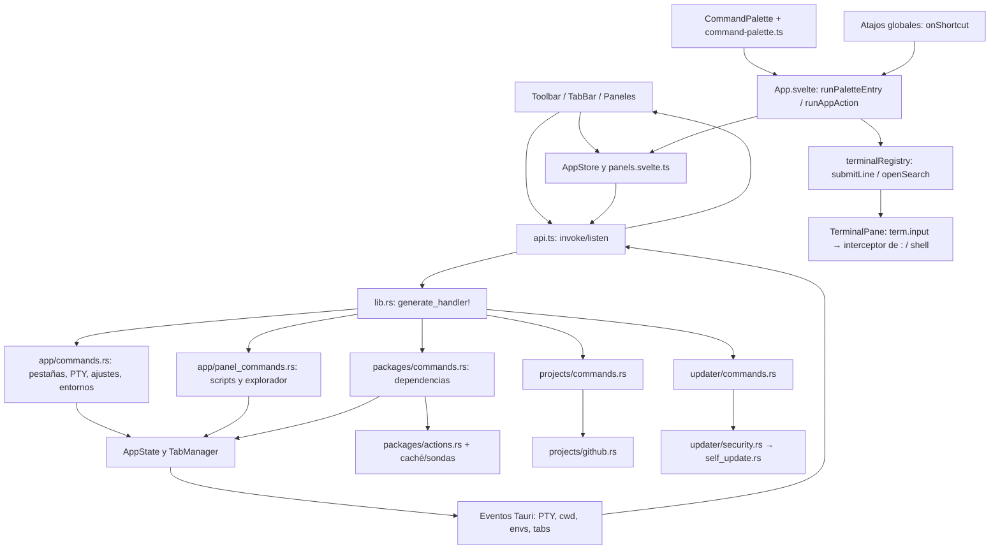

#### Contrato IPC por dominio

El identificador entre paréntesis es el nombre que `api.ts` entrega a
`invoke`. `lib.rs::generate_handler!` registra la función Rust del mismo
nombre; los métodos de `AppStore` coordinan las respuestas cuando hay estado
que puede quedar obsoleto. Esta tabla localiza la llamada antes de entrar a
depurar un handler.

| Productor frontend | Comandos IPC | Implementación y siguiente paso |
|---|---|---|
| `app.load/createTab/activateTab/closeTab`, `TabBar` | `tabs_list`, `tabs_create`, `tabs_activate`, `tabs_close` | `app/commands.rs` → `TabManager::{list,create_tab,activate,close_tab}` |
| `TerminalPane` durante montaje | `tabs_ready`, `frontend_ready`, `frontend_reveal` | `app/commands.rs` → `TabManager::mark_ready`; el reveal muestra la ventana |
| `TerminalPane` con teclado o cambio de matriz | `pty_input`, `pty_resize`, `pty_print_banner`, `internal_command_parse` | `app/commands.rs` → `TabManager::{write,resize,print_banner}` y analizador interno |
| `TerminalPane` al confirmar un Ctrl+clic sobre un enlace | `terminal_open_link` | `terminal/links.rs` → `validate_link` y opener de Tauri (navegador, carpeta o archivo mostrado en su carpeta) |
| Selector y `AppStore` | `env_list`, `env_refresh`, `env_switch` | `app/commands.rs` → `AppState::refresh_environments` o `TabManager` con nueva generación |
| `SettingsPanel` y `AppStore` | `settings_get`, `settings_save`, `settings_reset`, `profile_export`, `profile_import` | `app/commands.rs` → `config/preferences.rs`, `settings.rs` |
| `SettingsPanel` | `plugins_list`, `plugins_set_enabled`, `plugins_install`, `plugins_remove` | `config/plugins.rs` |
| Integración de escritorio | `windows_integration_status/set`, `app_restart_as_admin`, `path_integration_status/set` | `platform/windows_integration.rs`, `platform/path_integration.rs` |
| `ScriptsPanel` | `scripts_list`, `scripts_list_here`, `scripts_pick_target`, `scripts_open`, `scripts_cd`, `scripts_cd_directory`, `scripts_run`, `scripts_pin` | `app/panel_commands.rs` → `scripts/{scan,launch,pins}.rs` |
| `ExplorerSidebar` | `explorer_list`, `explorer_follow`, `explorer_create`, `explorer_open`, `explorer_rename`, `explorer_clip`, `explorer_paste`, `explorer_trash`, `explorer_cd`, `explorer_open_directory`, `explorer_open_directory_with` | `app/panel_commands.rs` → `explorer/files.rs`, `viewers.rs` y adaptador de plataforma |
| `DependenciesPanel` | `install_list`, `install_catalog`, `install_check`, `install_refresh`, `install_run` | `packages/commands.rs` → `actions.rs`, sondas y `TabManager::write_command` |
| `ScriptsPanel` para LTools | `ltools_actions_list`, `ltools_action_run` | `packages/ltools.rs` |
| `ProjectsPanel` | `projects_state_get`, `projects_downloaded`, `projects_cd`, `projects_lookup`, `projects_release`, `projects_download_release`, `projects_pin`, `projects_choose_folder`, `projects_open_github`, `projects_run` | `projects/commands.rs` → `projects/github.rs`, rutas y terminal |
| Aviso de versión y `SettingsPanel` | `update_check`, `update_check_on_startup`, `package_updates_check`, `update_install` | `updater/commands.rs` → `security.rs`, `self_update.rs` y `package_updates.rs` |
| Telemetría de frontend | `app_info`, `log_frontend_error`, `log_frontend_performance` | `app/commands.rs` → identidad, log estructurado |

Los eventos tienen dirección inversa; se registran con `listen` en
`api.ts` y se procesan en `App.svelte` o en un componente dueño del estado:

| Evento | Emisor | Consumidor y efecto |
|---|---|---|
| `pty-data`, `pty-clear`, `pty-exit` | `TabManager` | `App.svelte`: cola xterm, invalidación del clear, aviso de salida |
| `pty-command-resize` | `TabManager` | `TerminalPane`: sincroniza tamaño antes del comando de panel |
| `tab-closed`, `env-changed`, `envs-updated` | `TabManager` / `AppState` | `AppStore`: actualiza identidad, tab activo e inventario |
| `terminal-cwd-changed` | Inspector de salida de `TabManager` | `ExplorerSidebar`: seguimiento condicionado al tab y solicitud actual |
| `command-not-found` | Inspector de salida | `AppStore`: sugerencia contextual |
| `terminal-semantic-zone` | `semantic_zones.rs` | `api.onSemanticZone` expone la suscripción; la interfaz actual no la registra de forma permanente |
| `update-progress` | `updater/commands.rs` | `SettingsPanel`: estado visible de descarga/aplicación |

Las funciones de ventana, portapapeles, diálogo y abrir con el sistema en
`api.ts` usan los plugins oficiales de Tauri; no pasan por un handler Rust
propio de `generate_handler!`. La excepción son las URL: el WebView no tiene el
permiso `opener:allow-open-url` y solo puede pedir abrir un enlace a través de
`terminal_open_link`, que lo valida en Rust.

#### Ejemplos de llamadas completas

| Intención | Cadena desde la UI | Confirmación / riesgo de carrera |
|---|---|---|
| Abrir pestaña | `TabBar` o `Toolbar` → `app.createTab` → `api.createTab` → `tabs_create` → `TabManager::create_tab`/`spawn_pty` | `TerminalPane` confirma ready; el PTY puede crearse después de la respuesta inicial. |
| Activar una casilla | puntero/teclado → `TerminalPane.tomarElFoco` → `app.activateTab` → `tabs_activate` | El foco programático de xterm se distingue del foco del usuario. Un frame de resize solo puede enfocar la pestaña que sigue activa y se cancela al cambiar la activación; así se evita un ciclo de activaciones entre paneles. |
| Cambiar shell | selector → `app.switchEnvironment` → `api.switchEnvironment` → `env_switch` → reemplazo de generación en `TabManager` | `pty-clear` y `env-changed`; invalidar colas anteriores. |
| Repetir detección | `DependenciesPanel.repeatDetection` → `refresh` → `api.refreshInstallActions` → `install_refresh` → `build_list` | `envs-updated`, estados de cada sonda; distinguir caché, desconocido y comprobación real. |
| Ejecutar acción | tarjeta → `DependenciesPanel.run` → `api.runInstallAction` → `install_run` → `TabManager::write_command` | Comando visible, salida PTY y sonda posterior; no inferir instalación por salida solamente. |
| Guardar ajuste | control → `SettingsPanel.scheduleAutoSave/saveDraft` → `app.savePreferences` → `api.savePreferences` → `settings_save` | `AppStore` serializa los IPC; `SettingsPanel` compara la revisión del borrador antes de aplicar la respuesta. Si hubo otra edición mientras guardaba, conserva el borrador vivo y programa otro guardado. |
| Seguir cwd | salida shell → `current_dir.rs` → `terminal-cwd-changed` → `ExplorerSidebar.follow` → `explorer_follow` | Número de petición y tab activo; se descartan respuestas obsoletas. |
| Actualizar app | aviso/ajustes → `checkForUpdate`/`installUpdate` → `update_check`/`update_install` | Firma, checksum y árbol de payload antes de aplicar; progreso por evento. |
| Abrir un enlace de la salida | `@xterm/addon-web-links` (URL `http`/`https`/`file`) u OSC 8 (`linkHandler`) → `TerminalPane.activateTerminalLink` (Ctrl+clic, `isLinkActivation`) → `checkTerminalLink` → confirmación `terminal-link-dialog` si `terminalLinksConfirm` → `api.openTerminalLink` → `terminal_open_link` → `terminal::links::validate_link` → opener de Tauri | El backend revalida y no confía en el frontend: con `terminalLinks` desactivado responde `disabled`; `javascript:`, `ms-settings:`, credenciales, caracteres ocultos o un `file://` de otro equipo se rechazan con su código y el frontend muestra `terminal-link-notice`. Un `file:` a un archivo solo se muestra en su carpeta. E2E enfocado: `E2E_TERMINAL_LINKS_ONLY` imprime una URL, comprueba el subrayado y el aviso al pasar el ratón, que un clic sin Ctrl no hace nada, que Ctrl+clic pide confirmación con la URL y el host exactos, que cancelar no abre y que «Abrir» pide exactamente esa URL (registro del backend en `LTERMINAL_E2E_OPENED_LINKS`, sin lanzar el navegador; la llamada IPC solo se espía si el WebView deja reemplazar `__TAURI_INTERNALS__.invoke`, que Tauri 2 declara no modificable); repite con un hipervínculo OSC 8 si ConPTY lo deja pasar, sin confirmación, con un `file://` a un `.exe` (acción `reveal`) y a una carpeta (`directory`), pide al backend por IPC `javascript:`, `ms-settings:`, un `file://` remoto, credenciales y un salto de línea escondido (todos rechazados) y, con los enlaces desactivados, comprueba que no se subraya ni se abre nada. |
| Paleta de comandos | `Ctrl+Shift+P` → `App.svelte` `onShortcut` (también desde un campo de formulario, salvo los de grabar atajos) → `CommandPalette.svelte` → `buildPaletteEntries`/`paletteResults` → Intro → `runPaletteEntry` → `runAppAction` (paneles, explorador, pestañas, división, buscar, limpiar, modo limpio, refrescar entornos), `app.switchEnvironment`, `app.createTab(envId)` (REPL), `themePreferencePatch` + `app.savePreferences` (tema, fuente, idioma), `api.parseInternalCommand` → `submitToActiveTerminal` → `TerminalPane.submitLineFromApp` (comandos `:`), o `api.runLToolsAction` (acciones fijadas) | La paleta no tiene manejadores propios: cada entrada llama al mismo código que su atajo, botón o comando. Lo que se escribe en la terminal pasa por `term.input` y lo pinta ConPTY, y solo sobre un prompt vacío; si hay texto sin enviar, la shell no está lista o hay un programa a pantalla completa, la paleta muestra el motivo y no teclea nada. «Limpiar» ejecuta el alias `clear` de la shell (antes `terminal.clear()` vaciaba solo xterm y separaba su cursor del de ConPTY) y se deshabilita en REPL y asistentes, igual que los comandos `:`. E2E enfocado: `E2E_COMMAND_PALETTE_ONLY` abre con `Ctrl+Shift+P`, comprueba roles ARIA, flechas con vuelta, Escape (foco devuelto a la terminal) y el atajo como cierre, abre Ajustes filtrando `:config` y lee el atajo grabado, ejecuta `:terminal list` y una línea nueva `:panel list` con el eco de la orden siguiente pegado a su prompt, comprueba el aviso con texto a medio escribir, limpia con historial vacío y eco pegado, y abre una pestaña eligiéndola con las flechas. |
| Apariencia | `SettingsPanel` (temas, «Recolorear toda la interfaz», «Guardar como tema», colores ANSI) → `settings_save` → `config/preferences.rs` (`effective_palette`, `customThemes`, `terminalAnsiColors`) → `src/lib/theme.ts` (`applyTheme`, `terminalTheme`) | `E2E_APPEARANCE_ONLY` comprueba que Carmesí solo cambia el acento, que recolorear cambia el fondo, que un tema propio se guarda, se selecciona y se borra, que el rojo ANSI propio se pinta en xterm y que la lista de tipos de la Biblioteca sigue abierta tras marcar una casilla. |
| Inteligencia artificial | `DependenciesPanel` (sección `ai`) → `ai_actions` en `packages/actions.rs` (CLIs por npm/pip con su ciclo instalar/actualizar/desinstalar, Ollama, Claude Code y LM Studio por WinGet, modelos `ollama pull`/`ollama rm` con la sonda `ollama-model:`) → `environments::ai::detect_ai_environments` añade al selector `ai:<cli>` y `ai:ollama:<modelo>` | Son interfaces, no shells: `repl: true`, sin alias, `no_auto_select`. La matriz de shells del E2E las omite; las cubre `E2E_AI_ENVIRONMENTS_ONLY`, con `ollama.cmd` simulado en el PATH, un manifiesto falso en `OLLAMA_MODELS` y Claude Code FUERA del PATH, donde lo deja la app de escritorio, bajo `LTERMINAL_E2E_KNOWN_LOCATIONS_ROOT` (`roaming/Claude/claude-code/<versión>/<hash>/claude.exe`, dos versiones: debe abrirse la mayor, una copia de `choice.exe`, que pinta su pregunta y espera). El mismo escenario ejecuta «Ver los modelos descargados» en una pestaña de cmd y exige que sea una sola línea `call …ini.cmd & ollama list & call …fin.cmd`, sin `echo` sueltos, con su cierre ✔. Cualquier modelo descargado por nombre aparece en el selector. |
| Entornos y descargas | `SettingsPanel` (Comportamiento) → `api.getToolchainStore`/`api.getToolchainExternalSizes`/`api.clearToolchainCaches` → `toolchain_store_status`/`toolchain_store_external_sizes`/`toolchain_store_clear_caches` (las ubicaciones externas se miden aparte y se reutilizan 10 min: `~/.rustup` o WinGet tardan decenas de segundos); guardar `toolchainStoreEnabled`/`toolchainStoreDir` → `settings_save` → `toolchain_store::refresh_environment` | Las variables de caché (`npm_config_cache`, `PIP_CACHE_DIR`, `GOMODCACHE`…) se publican en `process::set_extra_environment` y solo llegan a los PTY y sondas que se lancen después; una variable ya definida por el usuario manda. Vaciar borra únicamente las subcarpetas conocidas de `<raíz>/cache`. `toolchain_store_external_sizes` devuelve también las carpetas de WTerminal (`group: "app"`) y cada fila trae su `info`; `SettingsPanel` coloca una sola tarjeta flotante (`settings-storage-tip`, `position: fixed`) en coordenadas de la ventana con `placeFloatingTip` y, tras pintarla, la mide y la mete en el panel por los cuatro lados con `fitFloatingTip` (`src/lib/floating-tip.ts`): el `container-type` del panel no crea bloque contenedor para elementos fijos, y unas coordenadas relativas al panel la dibujaban a su izquierda. Las carpetas de sesión huérfanas (`<temp>/<slug>/<pid>` de procesos que ya no existen) se borran al arrancar con `session_files::prune_orphaned_sessions`. E2E enfocado: `E2E_TOOLCHAIN_STORE_ONLY` (lista, carpetas de WTerminal clasificadas, tarjeta al pasar el ratón dentro del panel, variable en la terminal y vaciado en el perfil aislado); con `E2E_TOOLCHAIN_STORE_DOWNLOAD=1` además descarga de verdad con pip, npm, Deno, Bun y Go y comprueba que todo cae en la carpeta propia y se vacía (incluida la caché de módulos de Go, de solo lectura). |

### Builds, E2E y evidencia

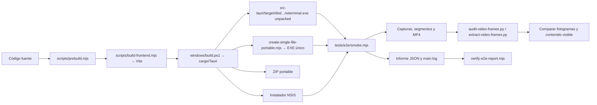

`scripts/run-dependency-audit.mjs` ejecuta la variante de Dependencias;
`scripts/e2e-native-driver.mjs` conecta el WebView2 y controla captura nativa.
El informe funcional y las capturas son evidencias complementarias: el estado
`passed` de un JSON no certifica continuidad del MP4 ni ausencia de clipping,
saltos del cursor o parpadeos. La aprobación visual exige auditar el vídeo
completo de la misma build, con duración y segmentos correspondientes al E2E.

#### Validación estandarizada

`tests/e2e/suites.mjs` es el catálogo único de suites: `focused` (regresiones
enfocadas: pie de Ajustes, Entornos y descargas, PATH, escribir tras
redimensionar, entrada en cola, primera orden en pestañas nuevas ×3 y con la
carrera forzada, casilla diminuta que crece, seguimiento del cursor en
entradas largas, integridad horizontal, estilos ANSI, parpadeo del cursor,
selección con el ratón y enlaces clicables con Ctrl+clic, `terminal-links`, que
comprueba qué se pide abrir sin lanzar el navegador, y la paleta de comandos,
`command-palette`, que la maneja con el teclado y comprueba el efecto de cada
acción, y los permisos de administrador, `admin-permissions`, que recorre
también la ruta de NSudo a través de un gsudo simulado sin pedir nunca el
UAC), `full`, `video`, `downloads` (descarga real,
necesita red), `dependency-audit` e `installer`. `scripts/run-e2e-suite.mjs` las ejecuta
contra cualquier binario mediante `tests/e2e/run-scenario.mjs` (salida, informe
y log por escenario, límite de tiempo que mata el árbol de procesos) y escribe
`summary.json` y `summary.md`. No se detiene en el primer fallo, avisa si el
procesador está cargado y comprueba con `tests/e2e/windows-path-guard.mjs` que
el PATH del usuario (HKCU) queda idéntico. Si se lanza desde PowerShell 7, el
ejecutor, el smoke y la preparación de herramientas quitan el `PSModulePath`
heredado (`tests/e2e/powershell-env.mjs`): con él, el Windows PowerShell 5.1
que lanzan no podía cargar ni `Get-AuthenticodeSignature`.

`scripts/test-installer.mjs` prueba el NSIS de verdad con un único UAC: se
niega si ya hay un WTerminal instalado; si hay un `SHA256SUMS.txt` junto al
instalador, su huella debe coincidir antes de pedir el UAC (`installerIntegrity`:
un instalador dañado solo hacía que NSIS devolviera «código 2»);
`windows/test-installer-elevated.ps1`
instala en silencio y espera, se comprueban archivos, entrada de
desinstalación, accesos directos y que el ejecutable instalado es el de la
release salvo la marca `__TAURI_BUNDLE_TYPE_VAR_` que escribe el empaquetador,
se ejecuta el recorrido completo sobre lo instalado y se desinstala
verificando que no queda nada. Suelto, `node scripts/test-installer.mjs
--installer <setup.exe> --release-dir <carpeta desempaquetada> --video` graba
además ese recorrido sin repetir la suite `video`.

`windows/build.ps1` añade `focused` a la batería ampliada (salvo
`-NoFocusedTests`) y con `-ReleaseValidation` (o `-VideoTest`,
`-DownloadTests`, `-DependencyAudit`, `-InstallerTest`) el resto, siempre
contra los artefactos ya firmados. El resumen queda en
`artifacts/release-validation/WTerminal-<versión>-<fecha>/summary.md`; un
fallo o una validación omitida se listan al final y el código de salida es 1.
`scripts/test-e2e-suite.mjs` comprueba sin abrir la app el catálogo, los
niveles, los argumentos, el resumen y la comparación de binarios del
instalador.

### Mapa de scripts y pruebas

| Archivos | Función |
|---|---|
| `windows/build.ps1`, `windows/build.bat` | Pipeline Windows: comprobaciones, build, instalador y artefactos portables. Termina con `Write-BuildSummary` (release, pruebas, informes, vídeos, capturas y logs) y guarda las evidencias en `artifacts/builds/`. |
| `tests/e2e/suites.mjs` | Catálogo único de suites E2E y niveles de validación (`-FullTests`, `-ReleaseValidation`). |
| `scripts/run-e2e-suite.mjs` | Ejecuta suites contra un binario y escribe `summary.json`/`summary.md`. |
| `tests/e2e/run-scenario.mjs` | Lanza un escenario del smoke con informe, log y límite de tiempo; sus capturas y vídeo van a `<id>-captures` junto al informe (`E2E_CAPTURE_DIR`). |
| `tests/e2e/windows-path-guard.mjs` | Copia y restauración exacta del PATH del usuario y del estado de la integración (HKCU). |
| `tests/e2e/powershell-env.mjs` | Quita el `PSModulePath` heredado de PowerShell 7 (`dropPowerShell7ModulePath`, `windowsPowerShellEnvironment`) para que los `powershell.exe` 5.1 que lanzan las pruebas carguen sus propios módulos. |
| `scripts/test-installer.mjs`, `windows/test-installer-elevated.ps1` | Prueba real del instalador NSIS: instala con un UAC, verifica, E2E sobre lo instalado (con vídeo si la suite `video` va en la misma ejecución) y desinstala. |
| `scripts/test-e2e-suite.mjs` | Prueba sin app del catálogo de suites, el ejecutor y la comparación de binarios del instalador. |
| `scripts/prepare-e2e-shell-tools.mjs` | Solo para `E2E_SHELL_ASSIST_ONLY`: descarga a `artifacts/e2e-tools` (ignorado por git) Clink portable y el PSReadLine actual con versión y SHA-256 fijados, comprueba la firma de Microsoft de PSReadLine y los reutiliza; el smoke los pone delante en `PATH` y `PSModulePath`. No instala nada. |
| `scripts/test-single-file-portable.mjs` | Prueba sin app del empaquetador del portable de un solo `.exe`: formato, contenido, alteraciones y contrato con `single_file.rs`. |
| `windows/e2e-elevated.ps1` | E2E elevado con UAC en host Windows. |
| `linux/build.sh`, `linux/build-windows.sh` | Build Linux y build cruzada de Windows. |
| `linux/validate-release.sh`, `linux/exercise-host.sh` | Integridad de release y ejercicio del host Linux. |
| `scripts/prebuild.mjs`, `build-frontend.mjs`, `build-fast.mjs` | Precondiciones, bundle UI y ruta rápida de desarrollo. |
| `scripts/create-single-file-portable.mjs`, `finalize-offline-webview2.ps1`, `prepare-conpty.mjs` | Portable EXE único y recursos Windows necesarios. |
| `scripts/create-release-manifest.mjs`, `sign-release-manifest.mjs`, `sign-release-ssh.mjs`, `update-release-hash.mjs`, `verify-release-artifacts.mjs` | Manifiesto, hash, firmas y verificación de artefactos. |
| `scripts/e2e-native-driver.mjs`, `e2e-environment-probes.mjs`, `run-dependency-audit.mjs` | Driver, sondeos seguros y variante de dependencias. |
| `scripts/audit-video-frames.py`, `extract-video-frames.py`, `create-e2e-contact-sheet.py` | Decodificación de todos los frames, extracción precisa e índice visual de capturas. |
| `tests/e2e/smoke.mjs` | Escenarios E2E, acciones UI, vídeo, capturas e informe estructurado. |
| `tests/e2e/toolbar-layout.mjs`, `tests/e2e/terminal-url-matcher.mjs` | Contratos de geometría y resolución de URL del driver. |
| `tests/ui/toolbar.js`, `tests/ui/toolbar.html` | Caso aislado de barra de herramientas y su página de prueba. |
| `scripts/verify-*.mjs` | Contratos estáticos de arquitectura, build, documentación, enlaces, i18n, fuente y reportes. |
| `scripts/test-*.mjs` | Pruebas preventivas y de lógica/build/firmas sin abrir toda la aplicación. |
| `scripts/clean-repository.ps1`, `clean-repository.sh` | Limpieza controlada de salidas. |
| `scripts/preview.mjs`, `build-preview.mjs`, `package-manager.mjs`, `package-scripts.mjs`, `run-rust-tool.mjs` | Preview y ejecución compatible de herramientas. |
| `scripts/probe-windows-tools.ps1`, `wine-gui-smoke.sh`, `patch-appimage-gtk-hook.mjs`, `package-windows-cross.mjs` | Herramientas y adaptaciones de empaquetado por host. |
| `scripts/publish-release-artifact.mjs`, `set-package-version.mjs`, `sync-package-metadata.mjs`, `verify-version.mjs` | Publicación y sincronía de metadatos. |
| `build-tools/build.ps1`, `build-tools/build.sh`, `build-tools/configure-git-signing.sh` | Atajos auxiliares de build y configuración de firma Git. |
| `fuzz/Cargo.toml`, `fuzz/Cargo.lock`, `fuzz/fuzz_targets/github_target.rs` | Crate y caso de fuzzing de destinos GitHub. |

#### Índice individual de `scripts/`

Los nombres `verify-*` inspeccionan contratos sin ejecutar la app; los
`test-*` ejercitan lógica o fixtures. Para localizar una condición precisa,
buscar el nombre de la comprobación que imprime cada archivo y luego su
entrada en `package.json`.

| Archivo | Qué examina o produce |
|---|---|
| `scripts/prebuild.mjs` | Precondiciones antes del bundle frontend. |
| `scripts/build-frontend.mjs` | Bundle Vite de la interfaz. |
| `scripts/build-fast.mjs` | Ruta de compilación rápida. |
| `scripts/build-preview.mjs` | Construcción de la vista previa sin backend. |
| `scripts/preview.mjs` | Arranque de la vista previa ya construida. |
| `scripts/package-manager.mjs` | Selección del gestor de paquetes disponible. |
| `scripts/package-scripts.mjs` | Lanzamiento portátil de los scripts de `package.json`. |
| `scripts/run-rust-tool.mjs` | Invocación de Cargo/herramientas Rust con entorno del proyecto. |
| `scripts/prepare-conpty.mjs` | Preparación y verificación del recurso ConPTY. |
| `scripts/probe-windows-tools.ps1` | Disponibilidad de herramientas Windows para build y prueba. |
| `scripts/create-single-file-portable.mjs` | Crea el portable de un solo `.exe` (`wterminal.exe` + `conpty.dll`, `OpenConsole.exe`, instalador de WebView2 y avisos tras la imagen PE, índice JSON y cola `WTPORT01`); `--verify` lo compara con la carpeta unpacked. No es un autoextraíble: arranca con doble clic. La build lo copia solo a una carpeta vacía, pasa el E2E completo con `E2E_EXPECT_SINGLE_FILE=1` (ConPTY desde la caché de runtime) y exige que no deje nada a su lado. |
| `scripts/finalize-offline-webview2.ps1` | Completa recursos offline WebView2 en un artefacto Windows. |
| `scripts/create-release-manifest.mjs` | Inventario de artefactos y hashes de release. |
| `scripts/sign-release-manifest.mjs` | Firma Ed25519 del manifiesto. |
| `scripts/sign-release-ssh.mjs` | Firma OpenSSH del manifiesto. |
| `scripts/lib/ssh-signing.mjs` | Funciones compartidas del formato de firma SSH. |
| `scripts/update-release-hash.mjs` | Actualiza suma publicada tras empaquetado. |
| `scripts/publish-release-artifact.mjs` | Coloca un artefacto verificado en el destino de publicación. |
| `scripts/set-package-version.mjs` | Cambia la versión declarada de los paquetes. |
| `scripts/sync-package-metadata.mjs` | Sincroniza metadatos entre manifiestos. |
| `scripts/patch-appimage-gtk-hook.mjs` | Ajusta integración GTK del AppImage. |
| `scripts/package-windows-cross.mjs` | Empaqueta una build Windows hecha desde otro host. |
| `scripts/wine-gui-smoke.sh` | Prueba de ventana Windows bajo Wine. |
| `scripts/clean-repository.ps1`, `scripts/clean-repository.sh` | Limpieza de salidas de trabajo por host. |
| `scripts/e2e-native-driver.mjs` | Descubre/conecta WebDriver a WebView2 y coordina control nativo. |
| `scripts/e2e-environment-probes.mjs` | Clasifica entornos/acciones que pueden probarse sin efectos reales. |
| `scripts/run-dependency-audit.mjs` | Lanza la auditoría E2E de dependencias. |
| `scripts/audit-video-frames.py` | Decodifica todos los frames y mide negro, quietud y cambios. |
| `scripts/extract-video-frames.py` | Extrae fotogramas concretos de un MP4. |
| `scripts/create-e2e-contact-sheet.py` | Monta una hoja de contacto de capturas E2E. |
| `scripts/verify-architecture.mjs` | Comprueba módulos, recursos y adaptadores de plataforma. |
| `scripts/verify-build-scripts.mjs` | Contratos de los scripts de empaquetado. |
| `scripts/verify-contracts.mjs` | Fronteras y nombres de comandos entre capas. |
| `scripts/verify-docs.mjs` | Existencia de enlaces y rutas locales documentadas. |
| `scripts/verify-flow-documentation.mjs` | Anclas de flujos y cobertura individual de archivos fuente en este mapa. |
| `scripts/verify-encoding.mjs` | Codificación uniforme de archivos de texto. |
| `scripts/verify-e2e-report.mjs` | Estructura y coherencia del informe E2E. |
| `scripts/verify-fuzzing.mjs` | Configuración de fuzzing. |
| `scripts/verify-github-security.mjs` | Seguridad de workflows y referencias fijadas. |
| `scripts/verify-i18n.mjs` | Claves y catálogos traducidos. |
| `scripts/verify-install-sources.mjs` | Fuentes permitidas de instalación. |
| `scripts/verify-links.mjs` | Destinos HTTP/Git citados por código y docs. |
| `scripts/verify-logic-surface.mjs` | Presencia de guardas de lógica de frontend/backend. |
| `scripts/verify-release-artifacts.mjs` | Estructura, contenido y arquitectura de distribución. |
| `scripts/verify-runtime-assets.mjs` | Recursos que necesita una app compilada. |
| `scripts/verify-test-surface.mjs` | Contratos y escenarios que no deben desaparecer del E2E. |
| `scripts/verify-version.mjs` | Consistencia de versión entre paquetes. |
| `scripts/verify-winget-catalog.mjs` | IDs WinGet del catálogo. |
| `scripts/verify-workspace.mjs` | Rutas y estado mínimo del workspace. |
| `scripts/test-build-menu.mjs` | Opciones del menú de build. |
| `scripts/test-clean-repository.mjs` | Guardas de la limpieza de salidas. |
| `scripts/test-e2e-environment-probes.mjs` | Sondas y clasificación de entornos E2E. |
| `scripts/test-e2e-native-driver.mjs` | Conexión y control del driver nativo. |
| `scripts/test-e2e-report.mjs` | Fixtures válidos e inválidos de informe. |
| `scripts/test-e2e-url-matcher.mjs` | Resolución de URL/puerto de WebView2. |
| `scripts/test-frontend-logic.mjs` | Idioma, identidad y atajos. |
| `scripts/test-install-actions-preventive.mjs` | Acciones y sondeos de catálogo. |
| `scripts/test-ltools-contract.mjs` | Contrato de acciones LTools. |
| `scripts/test-ltools-e2e.mjs` | Ejercicio E2E de LTools. |
| `scripts/test-prepare-conpty.mjs` | Integridad del recurso ConPTY preparado. |
| `scripts/test-preventive.mjs` | Guardas de UI/layout y rutas históricas. |
| `scripts/test-preview.mjs` | Generación y arranque de preview. |
| `scripts/test-release-hash.mjs` | Hashes de artefactos. |
| `scripts/test-release-manifest.mjs` | Construcción de manifiesto. |
| `scripts/test-release-publish.mjs` | Publicación local de artefactos. |
| `scripts/test-release-signature.mjs` | Firma Ed25519. |
| `scripts/test-release-ssh-signature.mjs` | Firma OpenSSH. |
| `scripts/test-toolbar-layout.mjs` | Geometría de barra y pestañas. |
| `scripts/test-version-restore.mjs` | Restauración de metadatos de versión. |
| `scripts/test-windows-cross-release.mjs` | Estructura de la build Windows cruzada. |

### Dónde empezar al investigar un síntoma

| Síntoma | Leer en este orden |
|---|---|
| Texto tecleado fuera del prompt | `TerminalPane.svelte` (`onData`, `releaseInput`, reserva) → `api.ts` (`sendInput`) → `commands.rs` (`pty_input`) → `tabs.rs` (`write`) → frames de vídeo. |
| Scroll horizontal que aparece/desaparece | `TerminalPane.svelte` (`fitAndReport`, `updateHorizontalScrollState`, `onHorizontalViewportScroll`) → `terminal-columns.ts` → `app.css` → `tabs.rs::resize` → captura de extremo derecho. |
| Cursor sin parpadeo | `TerminalPane.svelte::startCursorBlinkTimer` → `theme.ts` → CSS de cursor → foco del tab y serie temporal de frames. |
| Catálogo cambia entre pasadas | `DependenciesPanel.refresh/repeatDetection` → `packages/commands.rs::install_refresh/build_list` → `environments/mod.rs::detect_environments` → snapshot y log. |
| Un panel pierde datos | `App.svelte::loadDeps/loadSettings/loadScripts/loadProjects` → estado de petición del panel → IPC específico → backend del dominio. |
| Un ajuste vuelve al valor anterior | `SettingsPanel.svelte::scheduleAutoSave/saveDraft` → revisión del borrador y `loadSerial` → `AppStore::savePreferences` → `settings_save`; comprobar clic real, estado `data-state` y persistencia tras reabrir. |
| Build portable no arranca | `windows/build.ps1` → `create-single-file-portable.mjs --verify` → `config/single_file.rs` (log «ConPTY del portable de un solo archivo listo» o el error de la caché de runtime) → `platform/windows/webview2.rs` → log de arranque y E2E del EXE concreto. |

### Mantener este mapa al cambiar código

1. Al mover o crear un archivo fuente, actualizar su entrada en el inventario
   de esta sección (el contrato `check:flows` exige que esté cada archivo). Al cambiar un comando IPC, actualizar la cadena de la
   tabla y el diagrama afectado junto con `api.ts` y `generate_handler!`.
2. Al cambiar geometría, readiness o colas PTY, actualizar el diagrama de
   entrada/salida y explicar qué barrera evita la carrera. Indicar también el
   escenario E2E y la evidencia visual que lo comprueba.
3. Al cambiar empaquetado, actualizar el diagrama de artefactos y qué variante
   se ejecutó. Un vídeo de una build anterior no valida el binario nuevo.
4. Ejecutar `npm run check:docs`, `npm run check:flows` y
   `npm run check:architecture` para comprobar rutas y anclas. Estas
   comprobaciones detectan documentación desactualizada estructuralmente;
   hay que revisar el contenido técnico junto al cambio de código.

### Reglas que atraviesan todo el backend

- **Las operaciones sensibles validan las rutas en el backend.** Scripts,
  repositorios y entradas de archivos pasan por listas blancas o por una
  comprobación contra la vista actual. La interfaz no debe considerarse una
  frontera de seguridad contra el propio usuario: una terminal permite
  comandos explícitos arbitrarios y las rutas recibidas deben seguir
  revalidándose antes de cada operación.
- **Nada se ejecuta a escondidas.** Lo que un panel «hace» es escribir un
  comando en la terminal visible, con su cabecera y su resultado. El usuario lo
  lee entero antes de que pase nada y puede cancelarlo con Ctrl+C.
- **Los comandos lentos no bloquean la ventana.** En Tauri un comando síncrono
  se ejecuta en el hilo principal, que es el que pinta. Los 40 que tocan disco,
  red o lanzan procesos llevan `#[tauri::command(async)]`. Se quedan en el hilo
  principal los rápidos y **`pty_input`**, que además tiene que conservar el
  orden de las pulsaciones.

## Flujos de ejecución y diagnóstico

La terminal no es una única llamada ni una única pantalla: es una cadena de
flujos concurrentes que comparten estado. Una regresión visible (un cursor
extraño, un espacio que parece desaparecer, parte del `fastfetch` de otra
pestaña o un explorador atrasado) puede nacer en cualquiera de estas fronteras.
La regla para depurarla es seguir el dato desde su origen hasta el píxel, y
correlacionarlo siempre por `tabId`, generación de PTY y época de entrada o
salida.

### 1. Flujo global: de la ventana al prompt

```text
proceso Tauri
  ├─ configuración, rutas y estado compartido del backend
  ├─ App.svelte:onMount
  │   ├─ registra una sola vez los listeners Tauri
  │   └─ app.load()
  │       ├─ tabs_list + settings_get + app_info en paralelo
  │       ├─ aplica preferencias, tema y modo de ventana
  │       └─ inicia la detección de entornos sin bloquear la primera terminal
  ├─ un TerminalPane por pestaña
  │   ├─ crea xterm.js + FitAddon y lo monta
  │   ├─ registra el terminal en terminalRegistry
  │   ├─ mide columnas/filas reales
  │   ├─ tabs_ready: libera la salida retenida por el backend
  │   ├─ frontend_reveal: muestra la interfaz mientras arranca la PTY
  │   └─ frontend_ready: libera la entrada cuando existe sesión; el smoke reintenta
  ├─ TabManager solicita la PTY en segundo plano y devuelve la pestaña
  │   └─ hilo de conexión: adjunta la sesión cuando portable-pty responde
  │   ├─ lector: bytes de la shell → salida incremental
  │   └─ waiter: final de proceso → pty-exit
  └─ inicializador, banner y prompt visible
```

Hay paralelismo intencional entre cargar ajustes, información de aplicación y
la detección de entornos. No lo hay entre “xterm existe” y “vaciar la salida
pendiente”: `tabs_ready` es la barrera que evita enviar bytes a un terminal que
aún no tiene consumidor. La detección completa se retrasa hasta que la primera
sesión puede responder para que un escaneo de PATH o de WSL no congele la
interfaz ni retrase innecesariamente el prompt.

Cada etapa tiene una condición observable. Si falla antes de `app.load()`, hay
que mirar configuración y backend; si falla entre `tabs_ready` y el primer
`pty-data`, hay que separar creación de PTY, inicializador y shell; si el evento
llega pero no se ve, el problema está en la cola del frontend, xterm, el tamaño
del viewport o el repintado.

### 2. Flujo de salida PTY

La salida de una pestaña sigue este recorrido, en este orden:

```text
shell / proceso hijo
  → portable-pty (lector por bloques de hasta 64 KiB)
  → Utf8Decoder + ClearSplitter
  → Outbound::{Data, Clear, Exit}
  → outbound_lock de TabManager
  → evento Tauri: pty-data / pty-clear / pty-exit
  → listener único de App.svelte
  → outputQueues[tabId]
  → xterm.write(data, callback)
  → scroll, idle, fit y repintado
```

`Utf8Decoder` es incremental: una secuencia UTF-8 partida entre dos lecturas
no se convierte en caracteres corruptos. `ClearSplitter` reconoce el marcador
de limpieza sin destruir el orden de los datos que lo rodean. El backend
serializa la emisión con `outbound_lock`; el frontend serializa las escrituras
con una cola por pestaña; xterm mantiene su propio parser y renderizador. Estas
tres fronteras son necesarias porque `AppHandle::emit` no proporciona un orden
total entre hilos y una impresión del banner puede competir con el lector de la
PTY.

Un `pty-clear` no es “borrar un poco de texto”: es una transición de sesión. El
frontend invalida la cola pendiente, limpia la pantalla y el scrollback de
xterm con las secuencias apropiadas, y solo después deja pasar la salida nueva.
`outputEpochs[tabId]` descarta una escritura que se hubiera quedado esperando en
una promesa de una época anterior. Por eso no basta con emitir `\x1b[2J` desde
un sitio cualquiera: limpiar sin invalidar la cola permite que el bloque viejo
aparezca después del nuevo.

Los campos mínimos para seguir una salida son `tabId`, `generation`, entorno,
columnas/filas y marca temporal. La generación vive en el backend; la época es
la barrera local del frontend. La primera descarta callbacks de una PTY
reemplazada y la segunda descarta promesas de renderizado ya obsoletas.

### 3. Flujo de entrada, cursor y teclado

```text
tecla física
  ├─ captura global de App.svelte, fase capture
  │   ├─ si coincide con un atajo: preventDefault + stopPropagation + acción
  │   └─ si no coincide: continúa hacia el textarea oculto de xterm
  └─ xterm.onData
      → TerminalPane (mirror, comandos internos y preparación)
      → api.sendInput(tabId, data)
      → inputQueues[tabId]
      → pty_input
      → note_user_input + escritura en portable-pty
      → eco de la shell / salida normal
```

El textarea oculto de xterm es el dueño de la edición de línea. La aplicación
no debe reconstruir el cursor a partir de cada tecla ni capturar flechas,
espacios, Backspace o Enter como si fueran atajos normales. `shortcutFromEvent`
exige al menos un modificador, compara también `KeyboardEvent.code` y permite
que la distribución del teclado no cambie el significado de Backslash. Así
`ArrowLeft`, `ArrowRight`, `ArrowUp`, `ArrowDown` y el espacio siguen llegando
a la shell salvo que el usuario les asigne explícitamente una combinación con
modificadores.

La cola de entrada es por pestaña y conserva el orden de las pulsaciones. Cada
envío captura una época; al cerrar o reemplazar una sesión,
`api.invalidateInput(tabId)` incrementa esa época y elimina la cola pendiente.
Una promesa de la sesión anterior no puede escribir en la nueva PTY. El estado
visual de la línea (`mirroredLine`) solo sirve para selección contextual y
acciones de cortar/borrar; no es una segunda terminal ni una fuente de verdad
para el cursor. Los espacios son ASCII ordinario (`0x20`) y se preservan en
`sendInput`.

Durante el arranque o un cambio de shell, `queuedInput` retiene temporalmente
las pulsaciones hasta que el banner y el prompt están completos. Toda salida de
ese estado pasa por una única función: marca la terminal disponible y vacía la
cola en el mismo orden. El camino normal espera solo un frame breve después de
`term.write`; el límite de seguridad cubre prompts no reconocibles y también
vacía la cola, por lo que nunca puede dejar espacios o texto retenidos.

Los comandos internos se interceptan únicamente cuando hay una línea completa
con el prefijo `:`. Todo lo demás se entrega a la shell, incluido un comando
que tenga espacios. El comportamiento correcto se comprueba en tres niveles:
que el evento no sea consumido por un atajo, que `pty_input` reciba la misma
secuencia y que la shell la refleje con el cursor en la posición esperada.

### 4. Flujo de una pestaña y las carreras de cierre

```text
crear
  → TabManager asigna tab-<contador>, entorno y cwd heredado
  → generación nueva + solicitud de spawn de PTY (sin bloquear tabs:create)
  → TerminalPane keyed por tab.id
  → xterm abre, hace fit y llama tabs_ready
  → inicializador/banner/prompt
  → pestaña lista

cerrar
  → tabLifecycleQueue serializa la intención
  → backend toma outbound_lock, mata/libera la sesión
  → emite tab-closed con el siguiente tab activo
  → frontend invalida entrada y salida
  → actualiza estado; la última pestaña cierra la ventana
```

El `id` de la pestaña no se reutiliza durante la vida del proceso. El `{#each}`
del frontend está keyed por ese id y cada `TerminalPane` permanece montado,
aunque se oculte al cambiar de panel o de distribución. Esto conserva scrollback,
selección, foco y callbacks de xterm; reciclar el nodo DOM para otra pestaña
mezclaría estado visual aunque el backend estuviera correcto.

El cierre, la creación y el ciclo de paneles pasan por colas/guardas porque el
usuario puede abrir, dividir y cerrar casi en el mismo instante. Un evento
tardío de `pty-exit`, `pty-data` o `tab-closed` se ignora si su pestaña ya no
existe. Una sesión sustituida se identifica además por `generation`, por lo
que un callback de la shell antigua no puede cerrar ni contaminar la nueva.

### 5. Flujo de cambio de entorno

```text
selector / acción de entorno
  → winslim:environment-switch-started(tabId)
  → frontend invalida input/output y reinicia mirror/readiness
  → env_switch IPC valida entorno y pestaña
  → conserva cwd cuando es compatible
  → incrementa generation y detiene la PTY anterior
  → pty-clear ordenado
  → crea la nueva PTY y sus archivos temporales
  → responde consultas VT de arranque si ConPTY las hace
  → inicializador + marcador de limpieza + banner/prompt
  → environment-changed + terminal-cwd-changed
  → interfaz, explorador y sugerencias reciben el nuevo entorno
```

La limpieza se ejecuta dentro de `spawn_pty`, después de invalidar la generación
anterior y antes de que la shell nueva pueda imprimir. No se debe añadir otra
limpieza en la capa de UI: dos clears en sitios distintos producen parpadeo,
pueden borrar el prompt nuevo o reabrir una carrera de orden. La cola de
`pending_commands` retiene acciones de panel que llegaron durante la
inicialización y las libera tras el marcador de limpieza.

Orden del inicializador de cada pestaña: primero las sugerencias de la línea
de órdenes (Clink, PSReadLine, ble.sh o los plugins de zsh), después el
borrado y el banner, los alias y, al final, el marcador. xterm no ve nada de
esa salida: tras el marcador recibe el banner sustituto, así que lo que se
imprima entre el banner y el marcador deja a ConPTY más abajo que xterm y el
eco de la primera orden sale despegado del prompt. Por eso las sugerencias se
cargan antes del borrado: ble.sh, por ejemplo, avisa «updating tput cache» la
primera vez que se carga con un `TERM` nuevo (tras instalarlo o actualizarlo),
y no se le puede redirigir la salida porque guarda esos descriptores para
pintar. Si aun así ConPTY acaba en otra fila (un `.bashrc` o un alias que
imprima algo), el backend añade al banner los saltos de línea o el `CUU` que
igualan las dos filas (`startup_alignment` en `terminal/tabs.rs`) y deja el
aviso «Desalineación entre ConPTY y xterm tras el arranque» en el registro.

El redimensionado solo cambia filas/columnas, mantiene el anclaje inferior y
refresca la textura de xterm. Nunca ejecuta `term.clear()` ni reescribe un prompt
local con secuencias CSI: lo primero destruiría el scrollback y lo segundo
separaría el cursor visual del cursor que realmente posee la shell.

Síntomas de una ruptura en este flujo: `fastfetch` antiguo después del cambio,
prompt doble, cursor que reaparece en una posición vieja, el comando del panel
que se pierde o la etiqueta que cambia antes de que exista una shell utilizable.
La evidencia decisiva es comparar `tabId` y `generation` en el log con el orden
`switch-started → clear → primer output nuevo → environment-changed`.

### 6. Flujo de directorio de trabajo y explorador

```text
prompt / salida de la shell
  → inspector prioriza OSC 7 y usa el prompt como respaldo
  → TabManager actualiza cwd de la pestaña
  → terminal-cwd-changed(tabId, cwd, envId)
  → ExplorerSidebar decide si sigue a la terminal
  → agrupa ráfagas de foco y conserva la última solicitud pendiente
  → explorer_follow / lectura del backend
  → solo la respuesta cuyo request y tabId siguen vigentes se pinta
```

El explorador sigue al tab activo cuando está en modo automático. Una carpeta
que el usuario haya elegido manualmente no se pisa hasta que se solicite seguir
la terminal, se cambie el foco o se use el botón correspondiente. Cada lectura
tiene un número de solicitud: si el usuario navega de `A` a `B` y la respuesta
de `A` llega tarde, se descarta en vez de sobrescribir `B`.

Fish y otras shells modernas publican el directorio mediante OSC 7
(`file://host/ruta`); se decodifican también rutas con espacios escapados. Esa
señal no depende del aspecto del prompt y es la fuente preferida. Los patrones
de cmd, PowerShell, MSYS, Bash, zsh, fish/Pure y Starship siguen siendo el
respaldo para sesiones que no emiten OSC 7. Las llamadas repetidas por mostrar
el panel, cambiar de pestaña y enfocar xterm se coalescen: se hace una lectura
y, si durante ella llega otra solicitud, una sola lectura final. Así se evita
que una ráfaga invalide todas las respuestas antes de pintar siquiera la ruta
inicial.

Llevar el explorador a una ruta (`cd` desde el explorador) debe pasar por la
ruta validada y el comando de cambio de directorio del backend; la UI no debe
componer una orden con texto sin validar. El flujo inverso, seguir la terminal,
usa el `cwd` detectado, no una segunda copia del estado mantenida por el panel.

### 7. Flujo de paneles, ajustes y acciones configurables

`appState.svelte.ts` es el estado compartido. Los paneles no deben mantener una
versión paralela de pestañas, entorno o cwd: reciben el estado, solicitan una
operación y esperan la confirmación del backend. La carga de preferencias se
serializa con `preferencesReloadRequest`; los guardados se encadenan en
`preferencesSaveQueue`. De este modo cambiar idioma, tema, densidad o varios
interruptores rápidamente no restaura un JSON antiguo por una respuesta tardía.

La UI se construye a partir de capacidades configurables: selector de entorno,
refresco, idioma, barra de pestañas, explorador, paneles de Dependencias,
Proyectos y Biblioteca, acciones rápidas, modo de terminal limpia y controles
de ventana. El botón **Logs** no forma parte de esa superficie: fue retirado.
Los logs siguen existiendo como dato de diagnóstico, pero no como botón fijo
que el usuario tenga que conservar.

Hay veintidós acciones mapeables en `src/lib/shortcuts.ts`: paleta de
comandos, buscar en el historial, pestaña nueva, siguiente/anterior, división,
explorador, terminal limpia, cuatro direcciones, Ajustes, Proyectos,
Biblioteca, Dependencias, cerrar panel, refrescar entornos, seguir ruta, llevar
la terminal a la carpeta, limpiar terminal y abrir el explorador del sistema.
Las diez últimas de utilidad no tienen asignación de fábrica; una cadena vacía
significa “disponible para grabar”, no “fallo”. Los valores se normalizan y
comparan por código físico cuando procede.

Todas las acciones con atajo, salvo las cuatro direcciones y la propia paleta,
acaban en `runAppAction` (`App.svelte`), el mismo manejador que usa la paleta de
comandos: una acción hace lo mismo se pida con el teclado, con un botón o desde
la paleta. `scripts/test-frontend-logic.mjs` lo comprueba en las dos
direcciones (cada entrada de `PALETTE_APP_ACTIONS` tiene su `case` en
`runAppAction` y cada atajo con acción tiene su entrada en la paleta). La paleta
añade lo que ya existía sin atajo —cambiar de entorno, abrir un REPL, tema,
fuente, idioma, los comandos `:` y las acciones fijadas de LTools— llamando a
los mismos manejadores que el selector, `:repl`, `:theme`/Ajustes, el
interceptor de `:` y la Biblioteca.

Los defaults direccionales son `Ctrl izquierdo+A/D/W/S` (izquierda/derecha/
arriba/abajo), como en la versión anterior. El lado izquierdo evita que el
atajo accidentalmente dependa de la tecla Ctrl derecha; el usuario puede elegir
otra combinación explícita. Si
un atajo no funciona, revisar primero el valor normalizado en Ajustes y luego
si el evento fue consumido por un input con `data-shortcut-input`; no añadir un
segundo listener local al componente de terminal.

Los perfiles que aún contengan exactamente el conjunto heredado
`Alt+ArrowLeft/Right/Up/Down` se migran al leerlos. La migración solo actúa si
coinciden las cuatro asignaciones antiguas; una configuración parcial o
personalizada se conserva.

### 8. Flujo de instaladores, inventario y dependencias

```text
abrir Dependencias
  → install_list devuelve el catálogo conocido/caché rápidamente
  → install_refresh ejecuta detección completa por entorno
      (PATH, WSL, Docker, ADB y gestores aplicables)
  → envs-updated actualiza el inventario
  → se construye el catálogo de acciones por plataforma y gestor
  → install_run escribe el comando visible en la terminal
  → pausa / resultado / salida de la herramienta
  → nueva detección verifica el estado real
```

Una acción de instalación no es solo una etiqueta: tiene id estable, plataforma,
gestor, comando visible, sonda posterior y estado (`instalado`, `actualizable`,
`faltante`, `no aplicable` o `no verificable`). El backend no debe reutilizar el
nombre del paquete de una distribución en otra solo para que los contadores
coincidan.

Para GitHub CLI (`gh`), el id estable es `pkg-gh`: WinGet usa `GitHub.cli`;
Linux usa `gh` en apt/dnf/zypper y `github-cli` en pacman/apk. Un HTTP 404 de un
mirror de CachyOS/Arch después de que el índice anuncie el paquete apunta a
sincronización o contenido del mirror, no necesariamente a un id incorrecto.
La secuencia de diagnóstico es comparar `pacman -Si github-cli`, el repositorio
que lo anuncia y la URL del mirror con la salida de `pacman`; la acción solo debe
marcar éxito cuando la sonda `gh --version` confirma el binario.

Los instaladores comparten la misma frontera de visibilidad que los paneles:
el usuario ve el comando, puede cancelarlo con Ctrl+C y la terminal conserva el
resultado. Las fuentes externas, DNS, índices, mirrors, permisos y reinicios
son dependencias del sistema y se deben distinguir de un error de catálogo o
de IPC en los diagnósticos.

### 9. Errores, rendimiento y correlación

Los errores de JavaScript y las promesas rechazadas se envían mediante
`log_frontend_error` al mismo `main.log` que el backend. Cada registro útil debe
permitir responder: qué pestaña, qué entorno, qué generación, qué viewport y
qué operación estaban activos. Nunca basta con “falló el terminal” sin esos
campos.

Las métricas de rendimiento no significan lo mismo:

| Métrica | Qué mide | Frontera que ayuda a localizar |
|---|---|---|
| `app.initial-load` | carga completa de estado inicial | app/configuración/IPC |
| `app.ui-shell-visible` | primera UI visible | ventana/WebView/UI |
| `app.ready-for-input` | terminal apta para escribir | xterm/PTY/handshake |
| `terminal.xterm-mount` | montaje del componente | DOM/xterm |
| `terminal.ready-handshake` | tabs_ready/frontend_ready | barrera frontend/backend |
| `terminal.initial-fit` | primer tamaño real | viewport/FitAddon/resize |
| `terminal.environment-switch-first-output` | cambio hasta primer output nuevo | generación/spawn/shell |
| `fastfetch.banner-visible` | banner realmente pintado | PTY/cola/xterm |
| `terminal.resize` | ajuste de una terminal | layout/PTY resize |
| `ipc.*` | llamada individual | contrato y backend |
| `ui.panel.visible` | panel abierto y visible | estado/render |

`sinceStartMs` responde “cuánto desde que empezó la interfaz” y `durationMs`
responde “cuánto duró esta operación”; mezclarlos hace parecer lento un panel
que solo se abrió después de un arranque largo. Para comparar pestañas hay que
agrupar por `tabId` y no por el orden de líneas del log.

### 10. Máquina de estados y reglas de validez

| Estado | Entrada | Permitido | Invalida |
|---|---|---|---|
| `created` | tab summary | montar xterm, preparar PTY | nada aún |
| `spawning` | spawn solicitado | esperar sesión y resize | callbacks de otra generación |
| `initializing` | PTY viva | acumular salida/comandos, responder VT | entrada prematura no encolada |
| `ready` | `tabs_ready` + prompt | entrada, resize, paneles | salida sin `tabId` |
| `switching` | cambio de entorno | clear, invalidar épocas, nueva PTY | output/click de la sesión vieja |
| `closing` | cierre o exit | liberar PTY y notificar | nuevas escrituras |
| `closed` | `tab-closed` | retirar estado y DOM | cualquier evento tardío |

Las invariantes que deben mantenerse al modificar el código son:

- Una pestaña tiene un único dueño de estado y una única PTY activa.
- Un flujo reemplazable tiene una generación backend y una época frontend.
- La salida se ordena antes de emitirse y antes de escribirse en xterm.
- La entrada se ordena por pestaña y se invalida al reemplazar o cerrar.
- El shell posee el cursor; el mirror nunca lo sustituye.
- Una respuesta asíncrona solo puede aplicar si conserva su tab, solicitud y
  contexto.
- La UI no valida por sí sola rutas, gestores, fuentes ni permisos.

### 11. Matriz de síntomas y primera evidencia

| Síntoma | Primera evidencia | Frontera probable | Siguiente comprobación |
|---|---|---|---|
| Cursor, espacios o flechas raros | secuencia en `onData` y `pty_input` | atajo/textarea/cola de entrada | revisar capture, `inputEpochs` y eco de shell |
| Fastfetch antiguo tras abrir/cerrar/cambiar | `tabId`, generación, orden de `pty-clear`/`pty-data` | PTY sustituida o cola de salida | buscar generación vieja y época incrementada |
| Banner encima del prompt | `tabs_ready`, `initializing`, primer resize | handshake/inicializador | comprobar `pending` y marcador de limpieza |
| Explorador muestra carpeta anterior | cwd event y `listingRequest` | evento tardío o navegación manual | comparar request, tab activo y cwd |
| Atajo con flecha no actúa | valor normalizado + fase del keydown | captura o terminal que lo consume | probar el default H/J/K/L o asignar modificador |
| `gh` falla con 404 | gestor, repo, mirror y URL | fuente externa/índice | `pacman -Si`, estado del mirror y `gh --version` |
| Pestaña Windows en blanco | presencia de ConPTY/WebView2 + log de spawn | runtime del sistema | validar DLL, arquitectura y respuesta de ConPTY |
| Panel repone datos antiguos | request/cola de preferencias | async sin serializar | revisar `preferencesSaveQueue`/`preferencesReloadRequest` |
| Primera escritura se pierde | `ready-for-input`, `queuedInput` | xterm aún no listo | comprobar liberación por output idle/timeout |

### 12. Cómo mejorar sin reintroducir carreras

Antes de cambiar un flujo, documentar su productor, consumidor, estado, barrera
y evento de finalización. Después:

1. Dibujar la cadena concreta (por ejemplo `tecla → xterm → IPC → PTY → eco`)
   y decidir cuál es la única fuente de verdad.
2. Añadir una guardia de generación, época o número de solicitud si el flujo
   puede ser reemplazado mientras hay trabajo pendiente.
3. Mantener la operación observable: comando visible, evento con campos de
   correlación y métrica de inicio/fin.
4. Probar la transición y la carrera, no solo el caso feliz: abrir/cerrar
   rápidamente, cambiar de entorno mientras sale el banner, escribir antes del
   prompt, navegar A→B, guardar dos preferencias seguidas y fallar un mirror.
5. Ejecutar las comprobaciones de contratos, lógica, flujos, compilación y
   smoke; si la limitación es externa (DNS, WebDriver, mirror), registrarla
   separada del resultado de la aplicación.

Los procedimientos, los contratos de producto y el inventario de archivos y
llamadas ([mapa técnico](#mapa-de-archivos-llamadas-y-mantenimiento)) se mantienen en este README: el
código y su descripción deben cambiar en el mismo commit cuando un flujo
descrito se modifique.

## Contrato IPC

`src/lib/api.ts` ocupa el sitio que tenía `preload.js`: es el único punto del
frontend que conoce los nombres de los comandos y la forma de sus cargas. El
resto de la interfaz no llama nunca a `invoke` ni a `listen` directamente.

Ese acuerdo es por convención de nombres, no por tipos, así que hay **dos
pruebas en `lib.rs`** que leen el bloque `generate_handler!` y `api.ts` y los
cotejan en las dos direcciones: un comando registrado sin función que lo llame,
o una función que invoque un comando inexistente, rompen la suite. Sin ellas, el
fallo no se vería hasta escribir el panel que lo necesitaba.

## Seguridad

- **Sin `withGlobalTauri`.** El frontend no tiene acceso global al puente: solo
  a los comandos que `api.ts` importa explícitamente.
- **CSP estricta**: `default-src 'none'`, sin `connect-src` a nada que no sea el
  propio IPC. El frontend no puede hacer peticiones de red por su cuenta. Los
  scripts solo pueden venir de la propia app; `'wasm-unsafe-eval'` permite
  compilar el WebAssembly del decodificador de imágenes Sixel de xterm, sin
  admitir `eval` de JavaScript ni scripts en línea. Los estilos en línea sí se
  permiten (`style-src 'unsafe-inline'`) y Tauri no añade nonces a `style-src`
  (`dangerousDisableAssetCspModification: ["style-src"]`): con un nonce el
  navegador ignora `'unsafe-inline'` y bloqueaba las hojas que xterm crea al
  arrancar, con lo que los 16 colores ANSI, la negrita y la cursiva salían en
  gris normal.
- **`dragDropEnabled: false`**: arrastrar un archivo sobre la ventana no
  reemplaza la interfaz por él.
- **`freezePrototype` desactivado a propósito.** Congelar `Object.prototype`
  deja la ventana en negro: el frontend no llega a montarse.
- **Descargas acotadas.** Solo se descargan adjuntos de una release que se acaba
  de consultar, comprobando cada redirección contra los hosts de GitHub, con
  tope de tamaño aplicado mientras se escribe.
- **Sin tokens.** La integración con GitHub usa solo la API pública.
- **Enlaces de la terminal validados en Rust.** Cualquier programa puede
  escribir texto o un hipervínculo OSC 8 en la salida, así que nada de eso se
  abre por sí solo: hace falta Ctrl+clic, de fábrica una confirmación que
  enseña la URL completa y su host (en punycode si el dominio es
  internacional), y que `terminal::links::validate_link` lo acepte. Solo
  `http`, `https` y `file`; se rechazan `javascript:`, `data:`, protocolos de
  aplicaciones como `ms-settings:`, credenciales `usuario:contraseña@`,
  caracteres de control o invisibles (controles bidireccionales, anchos cero)
  y los `file://` de otro equipo, que en Windows se convertirían en una ruta
  UNC y una conexión SMB. Un `file:` a un archivo solo lo muestra en su
  carpeta; nunca lo ejecuta. El WebView no tiene `opener:allow-open-url`, y
  sin `linkHandler` xterm abriría los OSC 8 con `window.open`: WTerminal
  siempre instala el suyo, también con los enlaces desactivados (no hace nada).

### Escaneos del repositorio

Los workflows de GitHub Actions separan las comprobaciones por superficie:
CodeQL analiza el código Rust, TypeScript/JavaScript y los workflows; Gitleaks
busca secretos; `actionlint` y zizmor revisan sintaxis y seguridad de Actions;
el preflight local también comprueba que cada acción esté fijada a un SHA,
que checkout no conserve credenciales, que los permisos de publicación sean
mínimos y que no se restaure caché en la publicación. `npm run check:github-security`
ejecuta estas reglas y vuelve a lanzar `actionlint`/zizmor si están instalados;
las builds rápidas mantienen esta comprobación aunque se omita el resto de tests.
El verificador local es de solo lectura: no reescribe workflows ni cierra avisos
remotos. Tras corregirlos, la ejecución de CI vuelve a analizar y subir SARIF, y
GitHub actualiza el estado de Code Scanning. Define
`LTERMINAL_REQUIRE_GITHUB_SECURITY_TOOLS=1` para hacer fallar también el control
local si falta alguno de esos dos escáneres.
CI ejecuta `npm audit`, `cargo audit` y `cargo deny`; Dependency Review compara
los cambios de dependencias de cada PR con el aviso de vulnerabilidades y la
política de licencias; OpenSSF Scorecard revisa semanalmente las prácticas de
seguridad del repositorio. El workflow da al análisis permisos de lectura para
consultar commits, issues, pull requests y checks; conserva el SARIF cinco días
para diagnosticar fallos y publica los resultados en Code Scanning. Los avisos
de `Code-Review`, `Branch-Protection` y `Maintained` dependen también de la
actividad y de reglas configuradas en GitHub, no solo del workflow. Los
binarios ConPTY ya no se versionan: las builds obtienen la pareja desde el
paquete de Microsoft fijado y verifican su SHA-512 de NuGet, los miembros ZIP y
los CRC antes de instalarlos. `License` se publica como MIT y los notices de
Microsoft se incluyen en los paquetes.
Dependabot agrupa actualizaciones minor/patch por ecosistema y aplica un
periodo explícito de siete días antes de las actualizaciones de versión; las
versiones major quedan separadas para poder revisarlas antes de integrarlas.

El proyecto publica ahora la licencia MIT en `LICENSE` y en los metadatos de
paquete. La evaluación OpenSSF Best Practices es una autoevaluación externa:
no se marcará como aprobada ni se añadirá un distintivo hasta completar sus
preguntas con evidencia. `Maintained` depende de actividad real sostenida y no
se puede corregir con un cambio de configuración.

El aviso de vulnerabilidad de `glib` requiere una actualización compatible de
la pila GTK3/WebKit/Tauri: la versión usada por `webkit2gtk` aún pertenece al
rango afectado y no se ocultará mediante una supresión de auditoría. Mientras
el ecosistema no publique una ruta compatible corregida, CI debe seguir
mostrando ese riesgo. El parser de destinos GitHub ya tiene tests y fuzzing
continuo de ClusterFuzzLite.

No se conserva el workflow de ejemplo de APIsec: apuntaba al proyecto de
prueba `VAmPI`, mientras que LTerminal es una aplicación de escritorio y no
expone la API HTTP que ese escáner necesita. Si se incorpora una API real en el
futuro, se podrá añadir un escaneo DAST específico para ese servicio.

## Entornos y shells

El selector agrupa los entornos por familia:

| Grupo | Contenido |
|---|---|
| Shells del sistema | cmd, PowerShell, PowerShell 7, Git Bash, bash, zsh, fish, sh, distribuciones WSL y sus shells, `cmd.exe · Wine` |
| Lenguajes · intérprete interactivo | REPL detectados bajo demanda: Python, Node.js, Ruby, Java, PHP, Lua, R, Groovy, Deno, Bun, Perl, Julia, C#/F#, Haskell, Scala, Clojure, Elixir, Erlang, OCaml, Racket, Forth y Rust mediante evcxr |
| Docker · contenedores en ejecución | Entrar en un contenedor vivo |
| Docker · imágenes | Crear un contenedor nuevo y efímero |
| Android (ADB) | Un entorno por dispositivo conectado |
| Inteligencia artificial | Claude Code, Gemini CLI, Codex CLI, GitHub Copilot CLI, Qwen Code, opencode, aider, Amp, Crush, Continue CLI (`cn`), Grok CLI, AIChat, mods, llm (en modo `chat`) y ShellGPT (`sgpt --repl`) si están instalados, y un chat por cada modelo local de Ollama. Claude Code se detecta también fuera del PATH: instalador nativo (`~/.local/bin`), npm y la CLI que trae la app de escritorio de Claude (`%APPDATA%\Claude\claude-code\<versión>\<hash>\claude.exe`, la versión más alta) |

Al abrir Entorno y dependencias se hace además el inventario detallado de cada
distro (shells, gestor de paquetes, herramientas, lenguajes y complementos de
la línea de órdenes): tarda menos de un segundo por distro porque no lanza un
proceso por archivo ni recorre el PATH de Windows que WSL añade (`/mnt/c/...`).
Las órdenes que la app ejecuta dentro de una distro usan `wsl.exe --exec`, que
entrega los argumentos tal cual; con `--` pasarían por la shell de login de la
distro, que expandiría `$variables` antes de tiempo.

Los REPL de una distro se abren con el mismo PATH con el que se detectaron:
`wsl.exe --exec sh -lc '<PATH de login + carpetas de usuario>; exec "$0" "$@"'
<intérprete>` (`wsl::repl_launch_args`). Las carpetas de usuario
(`USER_BIN_DIRS`: `~/.local/bin`, `~/.cargo/bin`, nvm, asdf, mise, volta, bun,
deno…) son las mismas que recorre la sonda y se añaden al final del PATH, así
que lo que configura el usuario manda. Antes el REPL se lanzaba con
`wsl -- <intérprete>` (sin login): en Ubuntu sobre WSL 1 la sonda encontraba
el `node` de `~/.local/bin`, pero el REPL arrancaba el `/usr/bin/node` del
sistema, que WSL 1 no puede ejecutar («Exec format error»), y la pestaña se
quedaba sin prompt. Además, el inventario prueba en paralelo cada intérprete
ELF presente (`timeout 3 sh -c 'exec <ruta> --version'`; solo el código 126,
«no se puede ejecutar», cuenta como roto) y los que no arrancan quedan en
`unrunnable` y no se ofrecen como REPL.

Las distribuciones WSL se comprueban entrando en cada una. La primera orden
arranca la máquina virtual de WSL si estaba parada, así que esa sonda espera
hasta 15 s (y reintenta) antes de marcar una distro «sin comprobar». Si aun así
queda marcada y su pestaña arranca bien, la app vuelve a detectar en segundo
plano y la etiqueta se corrige sola.

Cambiar de entorno **conserva la carpeta**: si en cmd estás en `C:\proyecto` y
abres WSL, la sesión empieza en `/mnt/c/proyecto`; en Git Bash, en
`/c/proyecto`. La traducción la hace cada shell a partir del directorio con el
que se lanza su proceso, sin escribir ningún `cd`. No se hereda donde no puede
funcionar: contenedores Docker (montan una carpeta fija en `/workspace`),
dispositivos ADB, y rutas UNC como `\\wsl$\...`, que cmd.exe no admite como
directorio actual.

Kotlin sigue disponible como herramienta instalable y se puede iniciar desde
una shell, pero por ahora no aparece como REPL dedicado: algunos paquetes de
`kotlinc` no cargan el plugin de scripting que necesita `-Xrepl`. Se volverá a
ofrecer en el selector cuando la detección pueda confirmar que ese plugin está
realmente disponible.

**Imágenes, iconos y emoji.** La terminal pinta imágenes **Sixel** en línea
(el logo de `fastfetch --logo-type sixel`, `chafa -f sixel`, `img2sixel`…). En
Windows, ConPTY las mide como un VT340 (celda virtual de 10×20 píxeles); cada
imagen se encaja, sin deformarse, en las filas que ha contado ConPTY para que
el texto siguiente no salga desplazado (`src/lib/sixel-conpty.ts`). Las
imágenes iTerm2 no se pintan: ConPTY no las interpreta y desalinearían la
pantalla. Los iconos de Nerd Font que usan fastfetch, starship, oh-my-posh o
eza se ven con cualquier fuente: la app trae la fuente de símbolos de Nerd
Fonts como respaldo y prueba antes la variante Nerd Font de la fuente elegida
si está instalada (también hay «Meslo (Nerd Font)», la de powerlevel10k). Los
emoji usan la fuente de color del sistema y los anchos de Unicode 11, los
mismos que ConPTY, para que una línea con emoji o caracteres CJK se edite sin
descolocarse.

Un **REPL no es una shell**: no recibe alias, y las acciones que escriben
comandos se enrutan a una pestaña con una shell real, abriéndola si hace falta.
Gforth no muestra un prompt inicial por diseño. La terminal conserva su banner y
añade justo debajo una ayuda visible: escribe `1 2 + . cr` y debe mostrar `3`, o
`bye` para salir; responde `ok` después de procesar cada línea. El E2E comprueba
tanto que esa ayuda aparece antes de escribir como el resultado calculado, no
solo que el proceso haya arrancado.

### Permisos de administrador y NSudo

WTerminal no necesita ser administrador. Las shells **TrustedInstaller de
NSudo** («CMD · TrustedInstaller (NSudo)» y «PowerShell · TrustedInstaller
(NSudo)») sí: NSudo pasa de administrador a TrustedInstaller con todos los
privilegios, pero no sabe pasar de usuario normal a administrador, y sin un
proceso padre elevado termina con `-1`. Para el primer paso hay tres opciones,
y la app usa sola la que haya:

| Opción | Qué hace | Se queda en la pestaña | Qué necesita |
|---|---|---|---|
| Reiniciar como administrador / Iniciar siempre como administrador | Toda la app pasa a administrador y NSudo se abre directo | Sí | Nada; se acepta el UAC |
| gsudo + NSudo | Solo esa pestaña pide el UAC (`gsudo NSudoLC.exe -U:T …`) | Sí | gsudo (Entorno y dependencias → Shells → gsudo, `winget install gerardog.gsudo`) |
| sudo de Windows + NSudo | Lo mismo que gsudo, con el sudo de Windows 11 24H2 | Solo en modo «En línea» | Activarlo en Configuración → Sistema → Para programadores |

Orden de elección (`environments::nsudo_launcher`): si WTerminal ya es
administrador, NSudo directo; si no, gsudo si está instalado; si no, el sudo de
Windows en modo «En línea» (los modos «ventana nueva» y «entrada deshabilitada»
no sirven para una pestaña); si no hay ninguno, las entradas de NSudo salen
**deshabilitadas con una nota que explica qué hacer**, en vez de fallar con
`-1`. Un `runas` normal no sirve de puente: Windows abriría el proceso elevado
en una ventana aparte, fuera de WTerminal; gsudo y el sudo «En línea» lo dejan
en la misma consola.

En **Ajustes → Comportamiento → Permisos de administrador** se ve el estado
(si WTerminal es administrador, por dónde se abre NSudo y qué hay de NSudo,
gsudo y el sudo de Windows), con:

- **Reiniciar como administrador**: guarda lo pendiente, pide el UAC y abre
  otra copia elevada con los mismos argumentos más `--elevated-relaunch`; si
  se acepta, esta copia se cierra; si se cancela, todo sigue igual.
- **Instalar gsudo**: abre Entorno y dependencias ya filtrado por gsudo.
- **Reiniciar sin permisos de administrador** (solo siendo administrador): un
  proceso elevado no puede soltar sus permisos y todo lo que lanza los hereda,
  así que `run_unelevated` copia el token del Explorador (la shell del
  escritorio, sin elevar), abre con él otra copia (`CreateProcessWithTokenW`,
  mismos argumentos sin `--elevated-relaunch`) y esta se cierra. Solo se
  habilita con «Sin permisos de administrador» elegido
  (`unelevated_restart_blocker`): con las otras formas la copia nueva se
  volvería a elevar. Si el Explorador también está elevado, lo explica y no
  cierra nada.

**Al abrir WTerminal** es una sola elección con tres formas, excluyentes entre
sí (elegir una quita la otra):

- **Sin permisos de administrador** (de fábrica).
- **Iniciar siempre como administrador** (`startAsAdmin`; lo pide WTerminal):
  al arrancar sin ser administrador se relanza con UAC
  (`StartElevation::should_relaunch`); con el UAC cancelado, se abre sin
  elevar. No se relanza nunca si ya es el relanzamiento (evita bucles), si ya
  es administrador ni en pruebas automáticas (`LTERMINAL_E2E_TESTING` o
  `LTERMINAL_E2E_DISABLE_ADMIN`). Vale para cualquier copia que use esos
  ajustes. Probado en Windows con una cuenta que eleva sin preguntar: la copia
  relanzada tiene token elevado y la primera se cierra.
- **Marcar WTerminal.exe como «ejecutar como administrador»** (lo hace
  Windows): pone la marca de compatibilidad `RUNASADMIN` en este ejecutable,
  solo para el usuario actual (`HKCU\…\AppCompatFlags\Layers`, conservando las
  demás marcas: `layers_with_run_as_admin`). El Explorador muestra el escudo en
  su icono y Windows pide el UAC antes de abrirlo; si se cancela, no se abre.

Las dos formas de abrirlo como administrador elevan lo mismo (toda la app);
cambia quién pide el UAC y qué pasa si se cancela. Volver a «Sin permisos» las
quita las dos, pero la copia en marcha sigue elevada hasta reiniciarla: para
eso está «Reiniciar sin permisos de administrador».

Cuando WTerminal se ejecuta como administrador, la barra superior muestra un
escudo pequeño junto al botón de volver a detectar entornos (fuera de los
botones de paneles, que antes desplazaba) y el título de la ventana empieza
por «Administrador:», como en Windows Terminal; el log de arranque lo anota
(`"elevated": true`).

Con toda la app como administrador, **todas** las pestañas lo son y Windows
(UIPI) no deja arrastrar archivos desde el Explorador a una ventana elevada;
por eso la opción viene apagada y gsudo o el sudo «En línea» son la forma de
elevar solo una pestaña. WTerminal solo escribe la marca `RUNASADMIN` de
compatibilidad si se marca su casilla. NSudo se busca en `C:\WSCore\Components\Hooks\NSudo`, en
Program Files, en `C:\Tools\NSudo` y subiendo desde la carpeta de la propia
copia (`platform::windows::nsudo_path`).

Pruebas: unidad de la elección del lanzador, de los argumentos del
relanzamiento, de la decisión de arranque, del modo del sudo y del citado de
argumentos; el E2E `windows-admin-permissions` (en el recorrido completo y
enfocado con `E2E_WINDOWS_ADMIN_ONLY=1`) compara la sección con el backend,
recorre las tres formas de abrirlo y exige que se excluyan y que volver a «Sin
permisos» quite la preferencia y la marca, que «Reiniciar sin permisos» solo
aparezca siendo administrador, que las entradas de NSudo cuadren con el
lanzador y que el ejecutable acabe sin `RUNASADMIN`, sin pulsar nunca
«Reiniciar» (cerraría la sesión o pediría el UAC); `npm run
e2e:admin` repite el escenario con un token administrativo.

---

## Alias y comandos integrados

Se inyectan al crear una pestaña, solo en shells reales.

| Alias | Qué hace |
|---|---|
| `edit`, `ip`, `ll`, `ls`, `pwd` | Vocabulario común a todas las shells reales. El nombre y la intención son iguales; cambia únicamente el comando nativo que hay detrás. |
| `clear`, `cls` | Limpieza real de pantalla e historial; por defecto vuelve a mostrar el fastfetch esencial. Se puede desactivar en Ajustes (`Reimprimir fastfetch al ejecutar clear`). |
| `sysinfo` | Reimprime el banner del sistema. |
| `ayuda` | Ayuda explicada: qué hace cada alias, qué gestor los atiende y qué scripts se han registrado. Se lee de un archivo generado por sesión, así que ocupa varias líneas y va traducida. |
| `nsudo` | Solo si el ejecutable existe en la máquina. |
| `install`, `update`, `upgrade`, `uninstall`, `remove`, `search` | Se traducen al gestor de paquetes real del entorno. |
| `:ltools` / `:tools` | Abre la Biblioteca y su catálogo de LTools para descubrir y configurar las acciones fijadas. Las acciones se ejecutan mediante el CLI validado, no como scripts copiados por LTerminal. |

En Windows, `ls` y `ll` entienden las opciones de Unix más habituales, en
cualquier combinación (`ls -la`, `ls -ltr`, `ls -1`): `-a` enseña los ocultos,
`-R` entra en subcarpetas, `-t` y `-S` ordenan por fecha y por tamaño (`-r`
invierte el orden), `-1` da solo los nombres, y `-l`, `-h` y `-d` no cambian
nada porque el listado ya es largo. `ll` es `ls -la`.

- **cmd**: `doskey` no puede leer argumentos, así que `ls` llama a
  `wt-ls.cmd` en la carpeta de sesión (`aliases::CMD_LS_SCRIPT`), que traduce
  las opciones a `dir` (`/a`, `/s`, `/o:-d`, `/o:-s`, `/b`), deja pasar los
  modificadores propios de `dir` (`/w`, `/o:n`…) y cambia `/` por `\` en las
  rutas. Antes `ls -l .cargo` era `dir -l .cargo` y `dir` decía «No se
  encuentra el archivo» por `-l` antes de listar la carpeta.
- **PowerShell**: `ls` es una función (`aliases::POWERSHELL_LS_BODY`); sin
  opciones de Unix es `Get-ChildItem` tal cual, con sus parámetros (`-Force`,
  `-Name`…). La inicialización quita antes el alias integrado `ls` de
  PowerShell: un alias gana a una función con el mismo nombre, y la función
  de WTerminal nunca llegaba a ejecutarse (`ls -la` fallaba con «No se
  encuentra ningún parámetro que coincida con 'la'»).

Los scripts personales detectados siguen apareciendo con sus nombres concretos
en la ayuda de cada sesión; las operaciones de sistema de LTerminal se
mantienen en LTools para evitar duplicados y permitir que el catálogo crezca
sin modificar este proyecto.

### Comandos internos de la aplicación (`:`)

Una línea que empieza por `:` no se entrega a la shell: la interpreta WinSlim
Terminal para consultar o cambiar su propia configuración. Se pueden escribir
en cualquier terminal real; en un REPL se muestran como ayuda y no se inyectan
como código. Los argumentos se separan por espacios y los identificadores no
distinguen mayúsculas de minúsculas.

La [paleta de comandos](#paleta-de-comandos) (`Ctrl+Shift+P`) los ofrece con
búsqueda: los que equivalen a una acción de la aplicación (`:config`, `:panel`,
`:panes`, `:shell <id>`, `:repl`, `:theme`, `:font`, `:language`, `:reload`,
`:explorer-here`) aparecen como esa acción con el comando de pista, y los que
responden en la terminal se teclean en la pestaña activa como si se escribieran.

| Comando | Función |
|---|---|
| `:help [sección]` / `:alias` | Ayuda completa o una sección: `paquetes`, `sesion`, `internos`, `alias`, `biblioteca`, `menus`, `plugins`, `soporte` y `creditos`. |
| `:config` / `:settings` | Abre Ajustes. |
| `:reload` | Vuelve a detectar shells, WSL, Docker, ADB y herramientas. |
| `:shell list` / `:shell current` / `:shell <id o nombre>` | Enumera, muestra o cambia la shell/entorno de la pestaña actual. También se aceptan `:env` y `:environment`. El resto de pestañas no cambia. |
| `:repl <nombre>` | Abre una pestaña nueva con un intérprete interactivo detectado, por ejemplo `:repl python`. |
| `:panel list` / `:panel <panel>` / `:panel close` | Abre o cierra `settings`, `deps`, `projects`, `scripts` y `explorer`. `:open` es equivalente a `:panel`. |
| `:theme list` / `:theme <id>` | Enumera o aplica un tema disponible, como `ocean` o `nordic`. |
| `:font list` / `:font <id>` | Enumera o aplica una fuente de terminal, como `jetbrains`. `:fuente` es equivalente. |
| `:language list` / `:language <id>` | Enumera o cambia el idioma (`es`, `en`, `auto`, etc.). También acepta `:lang` y `:idioma`. |
| `:terminal list` | Muestra todos los parámetros editables de xterm y sus valores actuales. |
| `:terminal <parámetro> <valor>` | Cambia tamaño/familia/peso de fuente, interlineado, espaciado, padding, scrollback, sensibilidad, cursor, parpadeo, selección, densidad y colores. Ejemplos: `:terminal font-size 14`, `:terminal cursor beam`, `:terminal cursor-blink off`, `:terminal background #080808`. `:term` es equivalente. |
| `:panes 1\|2\|3\|4` / `:panes cycle` | Fija o rota el número de terminales visibles en la rejilla. `:layout` y `:grid` son equivalentes. |
| `:explorer-here` | Abre el gestor de archivos del sistema en la ruta actual de la terminal en Windows o Linux. `:open-here` y `:reveal-here` son equivalentes. |
| `:banner list` / `:banner hide|show|toggle <campo>` / `:banner preset compact\|full` | Consulta o cambia los campos del fastfetch. Los campos son `system`, `host`, `kernel`, `environment`, `motherboard`, `cpu`, `gpu`, `memory`, `storage`, `uptime` y `datetime`. El campo `storage` resume cada unidad en una línea: `Disco  2 unidades - (C:) 250 GB (99%) / (D:) 450 GB (70%)` (letra o ruta de montaje, tamaño y porcentaje de uso; una ruta de más de 20 caracteres se acorta a `…/<carpeta final>`; `system_info::storage_rows`). |
| `:quick-actions list` | Comando heredado: informa de que las acciones fijadas se gestionan desde el catálogo de LTools. `on`, `off` y `toggle` ya no cambian la interfaz. |

### Modo de terminal limpia

`terminalOnlyMode` oculta la barra superior, las pestañas, el explorador visible
y el marco nativo de la ventana. El área de xterm ocupa entonces todo el
espacio disponible, también cuando hay varias terminales divididas. Se activa o
desactiva con `Ctrl+Shift+M` de fábrica (el atajo se puede cambiar en Ajustes),
se guarda en `settings.json` y se reaplica al iniciar, guardar, recargar o
restablecer preferencias. Si una plataforma no permite cambiar sus
decoraciones en caliente, la terminal continúa funcionando y el estado queda
registrado en el log; no se oculta el acceso de recuperación.

La guía inferior del modo limpio muestra el atajo vigente y un botón `Ajustes`
que abre directamente Preferencias aunque la barra superior esté oculta. Se
puede desactivar desde `Ajustes → Comportamiento → Guía visible en pantalla
limpia`; el atajo de recuperación sigue funcionando aunque la guía esté oculta.

Los parámetros de `:terminal` usan valores sencillos: colores `#rrggbb`,
booleanos `on/off`, cursor `block|underline|bar|beam|underline-thick`, peso
`light|normal|medium|semibold|bold` y densidad `compact|comfortable`. Los
valores numéricos se validan y acotan igual que en Ajustes; `settings.json`
sigue siendo la fuente persistente. `:terminal list` y `:help internos` son la
forma más rápida de consultar el estado sin abrir un panel.

### Qué va a la shell y qué no

Todo lo que **no** empieza por `:` sigue siendo una orden de la shell actual.
Ahí entran los alias `clear`, `cls`, `sysinfo`, `edit`, `ll`, `install`, los
alias de scripts y cualquier comando nativo (`git`, `python`, `docker`, etc.).
WinSlim solo los prepara al crear la pestaña y conserva su sintaxis; la shell
decide cómo ejecutarlos y devuelve su salida y código de salida. Por eso
`install git` ejecuta el gestor real del entorno, mientras que `:panel deps`
abre un panel de la aplicación sin escribir nada en cmd o PowerShell.

El banner inicial usa **Solo esencial** (5–8 líneas) y se imprime como salida
normal del terminal. `clear/cls` vuelve a mostrar ese fastfetch por defecto; la
preferencia `clearReprintBanner` permite dejar la pantalla limpia sin banner.
Para solicitar todos los campos usa Ajustes o `:banner preset full`; el cambio
se añade al scrollback sin mover la selección ni superponerse al código.

**Imagen a la izquierda del banner** (Ajustes → Terminal, activada de fábrica):
como el logo de fastfetch, a la izquierda del resumen aparece el logo de la app
o una imagen propia (PNG, JPEG, GIF, WebP, BMP, ICO o SVG de hasta 8 MB),
elegida con «Elegir imagen…» o escribiendo su ruta; «Usar el logo de la app» la
quita. El ancho se ajusta entre 8 y 40 columnas (20 de fábrica) y la imagen se
encaja sin deformarse en las filas que ocupe el banner. Cómo funciona sin
desalinear ConPTY:

- El backend compone el banner en lo que queda tras un margen de
  `columnas + 2` espacios (`system_info::banner_image_padding`); esos espacios
  llegan igual a ConPTY y a xterm, así que los cursores siguen en la misma
  fila. Si el panel es tan estrecho que al texto le quedarían menos de 40
  columnas, no hay margen ni imagen.
- La imagen no pasa por ConPTY: es una decoración de xterm
  (`src/lib/banner-image.ts`, `attachBannerImages`) anclada a la línea del
  título, que cubre el margen menos 2 celdas a cada lado (`bannerImageBox`): la
  imagen queda centrada, con el mismo hueco hacia el borde de la ventana que
  hacia el texto, tanto si la limita el alto (banner «Solo esencial») como el
  ancho (banner «Mostrar todo», más alto que ancho, donde antes se pegaba al
  borde izquierdo). El frontend reconoce el banner por su título (`<app> <versión>`)
  precedido de un margen de 10 a 42 espacios (8 a 40 columnas más la
  separación), así que vale igual para el banner inicial, `:banner`, `clear`,
  `sysinfo` y los repintados de ConPTY, y cada banner recibe una imagen del
  ancho de su propio margen. Se desplaza con el texto y desaparece con él (al
  limpiar, al salir del historial o si otra salida lo sobrescribe). No
  intercepta clics ni la selección.
- La imagen propia la lee el backend (`banner_image_read`): solo archivos con
  la firma de un formato de imagen y como mucho 8 MB, entregados como `data:`.
  Si no se puede leer, el banner usa el logo y Ajustes muestra el motivo.
  Una imagen nueva se ve al momento en los banners abiertos; el ancho y
  activarla o desactivarla cambian el margen, así que se aplican al siguiente
  banner (`clear`, `sysinfo`, una pestaña nueva o **Mostrar el banner ahora**,
  que lo reimprime en la pestaña activa), como el resto de ajustes del banner.

Los alias de gestor de paquetes se resuelven según el entorno: Windows elige
entre winget, Chocolatey o Scoop al crear la pestaña; las shells Unix eligen
entre apt, dnf, pacman, zypper, apk y brew **en el momento de invocar el
alias**, de modo que dentro de WSL manda el gestor de la distribución. `update`
sin argumentos actualiza todo el sistema; con argumentos, solo lo indicado. Se
usa `sudo` solo cuando hace falta (nunca con Homebrew, nunca si ya se es root,
y **nunca para `search`**: consultar el catálogo es de solo lectura). Si el
primer argumento es una opción (`install -m 755 origen destino`), se delega en
el programa real de coreutils.

La idea es que el vocabulario sea el mismo en todas las shells: `install git`
funciona igual en cmd, PowerShell, Git Bash, una distro WSL o un contenedor, y
quien lo escribe no necesita saber si detrás hay winget, apt o pacman. `ayuda`
lo explica en la propia sesión, diciendo además cuál le ha tocado.

---

### Créditos y easter-eggs

En una línea propia de la terminal, `Darkeiser003`, `darkeiser003`,
`@darkeiser003` y `@Darkeiser003` muestran una presentación del desarrollo,
el perfil público y los proyectos [WTerminal](https://github.com/Darkeiser003/Terminal)
y [Infraestructura-Web](https://github.com/Darkeiser003/Infraestructura-Web).
El crédito de colaboradores no se expone como comando ni como easter egg: se
mantiene únicamente en `Ajustes › Información`. No se interceptan órdenes que
contengan nombres de personas como parte de otra línea.

---

## Panel de entorno y dependencias

Dos niveles: grupos temáticos y, dentro, un subgrupo plegable por herramienta.
De cada herramienta se ve **o** «instalar» (si falta) **o**
actualizar/desinstalar/ver versión (si está), nunca las dos mitades a la vez.
Cada componente separa una descripción concisa de su finalidad de la nota
operativa: la descripción explica para qué sirve; `hint` reserva requisitos,
permisos, reinicios y procedencia. El buscador consulta ambos textos y los tests
rechazan componentes agrupados sin descripción o descripciones que solo hablen
del instalador.
La instalación y la desinstalación se seleccionan componente a componente: la
build no genera ni ejecuta un script masivo de entorno. Los scripts de desarrollo
para preparar el proyecto siguen en `scripts/` y se usan desde el código fuente.

La navegación es modular y no bloquea la ventana: al abrir el panel se carga
únicamente el catálogo de menús y opciones. Cada herramienta se comprueba al
desplegarla; la sonda cubre su familia de acciones y actualiza instalar,
actualizar, comprobar y desinstalar sin recorrer el resto del sistema. Los
estados confirmados se guardan en `install-actions-cache.json` dentro de los
datos de usuario para que la siguiente sesión pueda pintar el estado conocido
de inmediato. **Repetir detección** invalida esa caché y ejecuta la pasada
completa de verificación.

El panel solo ofrece caminos que existen de verdad en ese sistema. El caso
representativo es PowerShell en Linux: Microsoft no lo publica en los
repositorios oficiales de ninguna distribución grande, así que se instala desde
el AUR (`powershell-bin`, con `paru` o `yay`) o desde Snap, y cuando no hay
ninguna de las dos vías se ofrece antes su requisito en lugar de un comando que
se sabe que va a responder «no se ha encontrado el paquete». Wine en Arch avisa
de que vive en el repositorio `multilib`, desactivado de fábrica.

En Windows, **gsudo** (Shells → gsudo, `gerardog.gsudo`) es opcional: sirve
de puente para abrir las shells de NSudo sin reiniciar WTerminal como
administrador y para `gsudo <orden>` en cualquier shell. Su nota explica que
hace lo mismo que el sudo de Windows en modo «En línea»; ver
[Permisos de administrador y NSudo](#permisos-de-administrador-y-nsudo).

**Sugerencias y colores en la línea de órdenes** (Ajustes → Terminal, activado
de fábrica): como fish o los plugins de zsh en Konsole, la terminal sugiere en
gris lo que ya escribiste (→ para aceptarlo) y colorea órdenes y argumentos.
No lo reimplementa encima de xterm, que chocaría con lo que redibuja la shell:
carga la herramienta de cada una si está instalada. En cmd es **Clink**
(Shells → Clink), que se inyecta en las pestañas de cmd porque arrancan con
`/d` y no pasan por su AutoRun, con un perfil propio de WTerminal
(`%LOCALAPPDATA%` → WTerminal → clink) cuyos valores de fábrica activan las
sugerencias en línea (Clink las trae en una lista con F2) y sus colores
recomendados, sin cambiar el Clink que uses fuera. En PowerShell 7 ya viene de serie
(PSReadLine); Windows PowerShell 5.1 trae PSReadLine 2.0 sin predicciones y
«PSReadLine con predicciones» lo actualiza para tu usuario. En bash se carga
ble.sh (`~/.local/share/blesh`) y en zsh zsh-autosuggestions y
zsh-syntax-highlighting. fish lo trae de serie. Desactivado, no se añade nada
y cada shell conserva su configuración.

Todo Windows PowerShell 5.1 que lanza WTerminal (pestañas y sondas) recibe un
`PSModulePath` depurado (`process::windows_powershell_module_path`): sin las
carpetas de PowerShell 7 y con la de usuario de 5.1
(`Documentos\WindowsPowerShell\Modules`) delante, conservando las rutas
personalizadas. Si WTerminal se abría desde PowerShell 7, heredaba su
`PSModulePath`: la sonda no veía el PSReadLine ya instalado y lo seguía
ofreciendo, y las pestañas de 5.1 cargaban el 2.0 del sistema. Además, si al
pulsar una acción ya no está en la última lista del panel (otra comprobación
la dio por instalada), se busca en el catálogo y se ejecuta igual en vez de
responder «La acción seleccionada ya no existe».

**Aspecto de las sugerencias** (bajo los interruptores): color del texto
sugerido, cursiva, colorear o no órdenes y argumentos, colores de órdenes, de
opciones y argumentos y de una orden que no existe, y predicciones en lista
(solo PowerShell, PSReadLine 2.2+; activadas de fábrica: sin esa versión no
hacen nada y con ella se ven solas). Cada color sin marcar deja el de la
herramienta. `terminal::shell_assist::AssistStyle` lo traduce a cada una: los
`color.*` del perfil de Clink, `Set-PSReadLineOption -Colors` (una clave por
llamada, porque PSReadLine 2.0 de Windows PowerShell 5.1 no conoce las de
predicción), `ble-face`/`bleopt` de ble.sh, `ZSH_AUTOSUGGEST_HIGHLIGHT_STYLE` y
`ZSH_HIGHLIGHT_STYLES`. Sin coloreado, zsh-syntax-highlighting no se carga y en
las demás los tokens usan el color normal. Se aplica a las pestañas nuevas.

Bajo esa opción hay un interruptor por shell (cmd, PowerShell, bash y zsh) con
el estado de su herramienta: instalada, no instalada o sin comprobar, en este
sistema o en cada distro WSL. «Instalar» abre Entorno y dependencias ya
filtrado por esa herramienta y «Comprobar de nuevo» repite la detección
(incluido el inventario de WSL). Todo se instala desde el panel:

- **ble.sh** (bash): no está en los repositorios de las distribuciones, así que
  se instala para tu usuario, sin sudo, en `~/.local/share/blesh`, desde una
  versión fijada de su repositorio oficial y comprobando su SHA-256. En Linux
  está en Shells → ble.sh; en Windows, en WSL → ble.sh, una entrada por distro.
  «Actualizar» reinstala la versión verificada de esta versión de WTerminal y
  «Desinstalar» borra la instalación, su caché y su estado. Necesita curl o
  wget y tar con xz, o Python 3: el tar de Ubuntu no puede crear carpetas en
  WSL 1 y entonces se extrae con Python. Dentro de bash, `ble-update` sigue
  disponible para pasar a la última versión nocturna.
- **zsh-autosuggestions** y **zsh-syntax-highlighting** (zsh): con el gestor de
  paquetes de la distribución. Dentro de WSL solo se ofrecen en las distros que
  tienen zsh.

WTerminal los carga desde sus pestañas: no toca tu `.bashrc` ni tu `.zshrc`, y
si ya los cargas tú no se cargan dos veces. La detección del panel, la de
Ajustes y la línea que los carga leen la misma lista de rutas (las de Debian,
Ubuntu, Fedora y openSUSE; las de Arch y Alpine; Homebrew; y `~/.zsh` si los
clonaste a mano), así que lo que se instala es lo que se detecta y lo que se
carga.

**Inteligencia artificial** tiene su propia sección:

- **Asistentes en la terminal**: Claude Code (instalador nativo en Windows, npm en
  Linux), Gemini CLI, Codex CLI, GitHub Copilot CLI, Qwen Code, opencode, Amp,
  Continue CLI y Grok CLI (npm), Crush (WinGet en Windows, npm en el resto),
  mods, AIChat y llama.cpp (WinGet), y aider, llm con su complemento de Ollama
  y ShellGPT (pip). Los paquetes se comprobaron en npm, PyPI y en los
  manifiestos de winget-pkgs. Cada uno se abre como una pestaña y usa la sesión
  o los tokens de quien lo ejecuta; la app no guarda claves ni llama a ninguna
  API. Las vías gratuitas reales son Gemini CLI y Qwen Code (nivel gratuito con
  límites al iniciar sesión), Amp (modo gratuito con anuncios) y los modelos
  locales; Claude no tiene nivel gratuito por API.
- **Modelos locales**: Ollama y LM Studio, y una selección de modelos (Qwen 3.8
  27B, Qwen 3.6, Qwen 3.5, Qwen 3, Qwen3 Coder, Qwen 2.5 Coder, Qwen3 VL, las
  variantes «abliterated» de Qwen 3 de huihui_ai, Gemma 4 y 3, gpt-oss,
  DeepSeek-R1, Llama 3.1/3.2/3.3, Phi-4 y Phi-4 mini, Mistral, Mistral Small y
  Granite 4) que se descargan con `ollama pull`, con los tamaños de
  ollama.com/library. Cada uno indica lo que
  descarga y la memoria que necesita, comparada con la RAM de este equipo. Para
  cualquier otro modelo, incluidas las variantes de la comunidad, basta
  `ollama pull <nombre>` en una pestaña: todo modelo descargado aparece en el
  selector como un chat (`ollama run`). La detección lee los manifiestos de
  Ollama en disco (`OLLAMA_MODELS` o `~/.ollama/models`), sin arrancar nada.
- **Ollama · gestión de modelos**: descargar un modelo por su nombre o abrir su
  chat (la pestaña pregunta el nombre: biblioteca, comunidad o `hf.co/…`), ver
  los descargados (`ollama list`) y los cargados en memoria (`ollama ps`),
  actualizar todos los descargados y arrancar el servidor (`ollama serve`).

Cada acción se escribe como **una sola línea** en la terminal. En PowerShell,
bash, zsh y fish la cabecera y el cierre van encadenados en esa línea; en cmd,
donde un `echo` por mensaje dejaba varias órdenes en pantalla, la línea es
`call "%WSTERM_UI%\ui-N-ini.cmd" & <orden real> & call "%WSTERM_UI%\ui-N-fin.cmd"`:
la cabecera y el cierre están en dos archivos de la carpeta de sesión
(`console_ui::cmd_framed`) y el cierre lee `if errorlevel` del código real de
la orden. `&&` y `||` atan más que `&`, así que una orden compuesta sigue
siendo un solo bloque. Si esos archivos no se pueden escribir se vuelve al
formato de varias líneas.

Al terminar, cada acción espera a que se pulse Enter para que su salida se
pueda leer. El siguiente comando que escriba un panel cierra esa pausa antes de
ejecutarse, para que no se consuma como respuesta.

---

## Proyectos y GitHub

**Anclados** incluye únicamente el perfil fijo
[`Darkeiser003`](https://github.com/Darkeiser003), como referencia del proyecto.
No importa scripts ni repositorios externos de la aplicación y el repositorio interno
de actualización no forma parte de esta lista. Cada persona puede anclar sus
propios perfiles y repositorios, y quitarlos después sin restricciones. Los
créditos de **Ajustes › Información** se configuran por separado del listado de
proyectos.

Cada panel tiene un **buscador con lupa** que filtra sin volver a consultar
nada: en **Anclados** acota perfiles y repositorios, y en **Explorar GitHub**
acota el resultado ya descargado, para no gastar peticiones de la API pública
por teclear una letra. Ignora mayúsculas y tildes y admite varios términos en
cualquier orden. `Esc` vacía el filtro sin cerrar el panel.

**Explorar GitHub** acepta un usuario, `propietario/repositorio` o una URL
HTTPS exacta de `github.com`. Se rechazan SSH, `git://`, hosts alternativos,
credenciales embebidas, puertos y segmentos adicionales.

**Release** (en «⋯» de cada repositorio) abre la última release y sus adjuntos
bajo la fila de ese repositorio. Se cierra con «✕», pulsando **Release** otra
vez, al plegar la fila, al abrir la de otro repositorio, al buscar o al
cambiar de pestaña; antes se quedaba al pie del panel en todas las pestañas y
no había forma de cerrarla. El E2E `github-account` lo comprueba contra una API
de GitHub simulada en `127.0.0.1`, a la que la app solo apunta en pruebas
(`LTERMINAL_E2E_GITHUB_API` con `LTERMINAL_E2E_TESTING=1`;
`projects::github::e2e_api_origin` rechaza cualquier otro host).

### Mi GitHub (con GitHub CLI)

La cuarta pestaña del panel trabaja con tu cuenta a través de **GitHub CLI**
(`gh`). WTerminal no guarda tokens ni contraseñas: la sesión es la de `gh`.

- **Sin `gh`**, ofrece instalarlo (Entorno y dependencias → GitHub CLI).
- **Iniciar sesión** escribe `gh auth login --hostname github.com
  --git-protocol https --web` en una pestaña nueva y visible: `gh` abre el
  navegador con un código y sus preguntas (`Y/n`) se responden en esa pestaña.
  Una pestaña nueva da la shell por lista en cuanto ve, tras el banner, una
  línea de prompt aunque lleve una orden detrás (`shellPromptAfterBanner`): sin
  eso, un programa que pregunta nada más arrancar dejaba las teclas retenidas
  hasta el seguro de 35 s. **Comprobar de nuevo** lee la sesión
  (`gh api user`); con ella, WTerminal ejecuta una vez `gh auth setup-git` para
  que git use esas credenciales al clonar o actualizar repositorios privados.
- Con sesión se ven la cuenta y sus repositorios (`gh repo list --json …`),
  con las acciones de siempre (clonar, actualizar, `cd`, release, anclar) y,
  en «⋯», **hacer público/privado**, **archivar/desarchivar**, **renombrar** y
  **borrar**. Borrar exige escribir el nombre completo (`propietario/nombre`);
  si falta el permiso `delete_repo`, ofrece **Dar permiso para borrar**
  (`gh auth refresh --scopes delete_repo`, en la terminal).
- **Nuevo repositorio**: nombre, descripción, privado o público, README
  inicial y, si se quiere, clonarlo en la carpeta de proyectos.
- **Gestionar…** (en «⋯» de cada repositorio de la cuenta) abre bajo su fila
  una ficha con seis secciones (`GithubRepoManager.svelte`):
  - **Detalles**: descripción, web, temas, rama por defecto, issues y wiki
    (`gh repo view` para leerlos, `gh repo edit` para guardarlos; solo se
    añaden y quitan los temas que cambian).
  - **Releases**: la lista (`gh release list`), **Nueva release** con
    etiqueta, título, notas o notas automáticas, borrador, prerelease, rama de
    destino y **adjuntos** elegidos con el selector o pegando su ruta (`gh
    release create … archivos`); **Subir adjuntos…** a una existente (`gh
    release upload --clobber`), ver y quitar adjuntos, **Publicar** un
    borrador y **Borrar…** escribiendo la etiqueta (con la opción de borrar
    también la etiqueta).
  - **Git** (si está clonado): rama, seguimiento (↑ por subir, ↓ por traer),
    archivos cambiados, **commit de todo** con mensaje, ramas locales (crear,
    cambiar, borrar solo si está fusionada: `git branch -d`). **Subir (push)**,
    **Traer (pull)** y **Publicar rama** (`push -u origin <rama>`) van a una
    pestaña visible porque pueden pedir credenciales
    (`commands::github_git_terminal`).
  - **Pull requests**: las abiertas, **Fusionar** (squash, merge o rebase, y
    borrar la rama) y **Nueva pull request** hacia la rama por defecto.
  - **Issues**: crear y cerrar.
  - **Actions**: las últimas ejecuciones y **Relanzar lo que falló** (`gh run
    rerun --failed`).
- **Cerrar sesión** (`gh auth logout`) también va a la terminal, porque `gh`
  pide confirmación.

En «Gestionar…» rigen las mismas reglas (`projects/gh_manage.rs`,
`projects/git_local.rs`): argumentos fijos y validados (ramas y etiquetas con
las reglas de git y sin guion delante, temas en minúsculas, web http(s),
adjuntos con ruta absoluta, existentes y sin `#`), lo que se lee de `gh` se
sanea (una URL que no es de github.com no llega al panel) y solo se actúa sobre
repositorios del listado de la cuenta. La carpeta de la copia local la calcula
el backend (`<proyectos>/<propietario>/<nombre>`), nunca el panel. Crear una
release con adjuntos o subirlos tiene 30 minutos de margen; lo demás, 45 s.

Seguridad (`projects/gh_cli.rs`): las órdenes son `gh` con argumentos fijos,
sin shell de por medio; los nombres nuevos siguen las reglas de GitHub y no
pueden empezar por guion (`gh` lo tomaría como una opción); solo se cambia,
renombra o borra un repositorio que haya salido del listado de la propia
cuenta en esta sesión. `gh` se busca en el PATH, que se resincroniza con el
del sistema, así que se encuentra nada más instalarlo. Pruebas: unidad del
parseo, la validación y los argumentos (también de cada orden de
«Gestionar…»), git de verdad en una carpeta temporal (commit, estado y ramas)
y el E2E `github-account` con un `gh` simulado que anota cada llamada; las de
«Gestionar…» se comparan argumento a argumento, porque Rust cita a su manera
los argumentos de un `.cmd`.

### Dos formas de actualizar un repositorio

Cada tarjeta de repositorio ofrece las dos, y cada botón dice en su título
exactamente qué va a hacer:

| Botón | Qué actualiza | Para quién |
|---|---|---|
| **Actualizar release** | Descarga el archivo de la última release que corresponde a este sistema y lo extrae. No toca git. | Quien solo quiere **usar** la herramienta. |
| **Clonar** / **Actualizar fuente** | `git clone` la primera vez y `git pull --ff-only` después. | Quien quiere el **código**. |

**Actualizar release** elige el adjunto por él: no hay que abrir la lista y
reconocer cuál de los archivos es el propio. La elección es por puntos, no por
una regla rígida, porque cada proyecto nombra sus adjuntos a su manera
(`WTerminal-Latest.zip`, `LTerminal-AppImage-Latest-x64.x86.tar.gz`…), y
descarta de entrada los que llevan el nombre de otro sistema: un `.zip` que
diga `linux` no se ofrece en Windows. Si nada encaja **no se descarga nada a
ciegas**: se avisa de que hay que elegir a mano en **Release**.

### Clonar y actualizar el código

La primera acción ejecuta `git clone`; si el destino ya contiene el mismo
repositorio, las siguientes usan `git pull --ff-only`. Ambos comandos se
escriben y ejecutan en una pestaña visible. La estructura local es
`<carpeta>/<propietario>/<repositorio>`. Un directorio existente que no sea un
repositorio se trata como conflicto y **nunca** se sobrescribe.

### Releases

El botón **Release** consulta la última versión publicada y lista sus archivos
con tamaño, para elegir uno a mano. Descargar uno no requiere clonar ni
compilar nada.

- La descarga la hace la aplicación con `reqwest` (es tráfico de
  red, no un comando) y respeta el proxy del sistema.
- Destino: `<carpeta>/_releases/<propietario>/<repositorio>/<etiqueta>/`,
  separado de los clones para no mezclar un árbol de git con un ZIP
  desempaquetado.
- Si el archivo es un comprimido, el comando para extraerlo se escribe en la
  terminal visible con la herramienta que entiende ese formato en cada sistema:
  `tar`, `unzip`, `Expand-Archive` o `7z`.
- El renderer manda el **nombre** del archivo, no su URL: la descarga solo
  acepta adjuntos de la release que el proceso principal acaba de devolver.

---

## Panel de scripts

Dos ámbitos:

- **Biblioteca**: carpeta persistente elegida por el usuario. Las acciones de
  sistema de LTools aparecen en su apartado independiente y no se mezclan con
  los archivos personales.
- **Aquí**: directorio actual de la pestaña y hasta tres niveles de
  subdirectorios por defecto, configurable entre 0 y 10. **No** crea alias ni
  modifica la shell.

El escáner mantiene topes de tiempo, carpetas y resultados (máximo 500) para no
bloquear la terminal, y omite dependencias, VCS, cachés y artefactos
(`node_modules`, `dist`, `build`, virtualenvs…).

Reconoce `.cmd`, `.bat`, `.ps1`, `.vbs`, `.sh`, `.bash`, `.zsh`, `.ksh`,
`.fish` y scripts sin extensión con shebang. Los runtimes (`.py`, `.js`,
`.mjs`, `.rb`, `.php`, `.pl`, `.lua`, `.r`, `.groovy`) solo aparecen cuando
declaran intención de ejecución: shebang, `package.json#bin`, bit ejecutable o
carpeta `scripts`/`bin`/`tools`/`cli`.

El panel tiene el mismo **buscador con lupa** que Proyectos, y actúa sobre el
último escaneo: filtra por nombre, subcarpeta o extensión sin volver a recorrer
el disco, que en **Aquí** puede costar segundos.

La sección **Acceso rápido** aparece encima de los resultados de la Biblioteca
y de **Aquí**. La estrella conserva hasta 50 scripts, aunque estén en otra
carpeta o el filtro de tipos actual no los incluya; los que ya no existen se
retiran automáticamente. Así las herramientas de uso diario siguen a un clic
sin convertir la Biblioteca en un segundo explorador.

Las antiguas **Operaciones rápidas** basadas en nombres de scripts ya no se
muestran como un segundo menú. Los scripts siguen disponibles individualmente
en la Biblioteca y el comando heredado `:quick-actions` solo muestra una ayuda
de migración; no modifica preferencias ni oculta controles.

### Acciones de LTools

Si encuentra `ltools-cli`, `ltools`, `winslim-tools`, una AppImage/EXE versionada
de Tools o su variante Windows en el `PATH`, en las carpetas de instalación
convencionales (`~/.local/bin`, `~/.local/share/ltools`) o en el checkout/release
local de `Darkeiser003/Tools`, la Biblioteca muestra un único apartado de
**Acciones fijadas de LTools**. También admite `LTOOLS_PATH` para una instalación en
otra ubicación. Solo inspecciona carpetas candidatas y nombres conocidos; no
recorre el HOME completo ni ejecuta archivos encontrados sin validar su
catálogo.
En Windows busca `wtools-cli.exe` (el nombre que publica la release de
WTools), en `Program Files\WTools` (instalador) y en carpetas portables
`WTools-<versión>`; la GUI `wtools.exe` no se usa porque exige elevación y no
puede consultarse desde una terminal no elevada.
Si hay varias copias, manda `LTOOLS_PATH`, después el `PATH` y, entre las
encontradas en carpetas conocidas (incluido el `Tools-main` que deja el
«Download ZIP» de GitHub), la más reciente: al actualizar Tools la Biblioteca
no se queda con una release antigua descargada antes.

La terminal está preparada para que Tools cambie sin tocarla: los campos
nuevos del catálogo se ignoran, una acción que esta versión no entiende se
descarta sola (queda anotada en el registro) sin vaciar las demás, y un
catálogo de más de 1000 acciones se recorta en vez de rechazarse. El catálogo
se lee entero aunque ocupe decenas de KB (el de WTools 1.0.0 son 72 KB y 75
acciones): `process::run_with_timeout` vacía la salida mientras el proceso
corre. Antes solo la leía al terminar, el CLI se quedaba bloqueado escribiendo
en la tubería llena y la Biblioteca decía «LTools no respondió». El plazo es de
15 s porque la primera ejecución de un `.exe` recién actualizado puede esperar
al antivirus.
Lee el catálogo versionado `ltools-actions-v1` mediante
`actions list --format json` y transmite el idioma activo como `--lang <idioma>`;
el CLI publica `id`, `actionKey`, `scope`, `operation`, `category`, `group`,
`command`, `args`, `target`, `mutating`, `profile`, confirmación y alias.
También puede publicar `label`, `shortLabel`, `description` y `quick`; son
metadatos de presentación opcionales, con fallback seguro si faltan o no son
válidos. `actionKey` identifica la acción de forma estable, mientras `scope` y
`operation` permiten presentar nombres claros aunque varias acciones compartan
un título. LTerminal no duplica nombres ni separa cadenas de comandos a mano. El usuario puede elegir
tantas acciones sin objetivo obligatorio como quiera y la selección se guarda
por perfil y sistema. Las acciones nuevas compatibles aparecen sin modificar
LTerminal; las que tienen un objetivo (disco, servicio, usuario,
etc.), una shell distinta o argumentos no compatibles se excluyen del panel de
botones seguros para no inventar parámetros; las que modifican el sistema piden
confirmación. La E2E optativa comprueba también
que la selección sobrevive a cerrar y reabrir la Biblioteca. También puedes
abrir esta misma configuración desde **Ajustes → Comportamiento** o escribiendo
`:ltools` / `:tools`; ambos accesos llevan al único selector compartido.

Al pulsar una acción, LTerminal vuelve a consultar el catálogo, valida el ID y
escribe `ltools actions run <id>` con argumentos separados en una shell visible.
No ejecuta comandos arbitrarios recibidos desde la interfaz ni oculta la salida.
Si LTools no está instalado, **Obtener LTools** consulta la última release
estable de `Darkeiser003/Tools`, elige el paquete CLI de la plataforma, lo
descarga mediante los hosts permitidos y deja la AppImage ejecutable cuando
corresponde. Después vuelve a escanear las rutas locales. Si GitHub todavía no
ha publicado ninguna release o no hay un paquete compatible, abre el repositorio
para que la instalación manual sea explícita; mientras tanto, la Biblioteca
mantiene visible el estado y el botón de obtención para que el usuario sepa qué
falta, sin ejecutar descargas silenciosas.

El filtro de tipos se adapta al sistema. En Linux aparecen primero
SH/Bash/Zsh, Fish y paquetes Linux, que son los tres valores de fábrica; en
Windows, CMD/BAT, PowerShell y VBScript ocupan esas posiciones. Python,
Node.js, otros runtimes, programas, HTML, imágenes, audio y vídeo siguen
siendo opt-in, así que activar la vista nunca convierte **Aquí** en un
explorador de todos los archivos.

Al ejecutar un script, la aplicación reutiliza una pestaña compatible o abre
una nueva (PowerShell para `.ps1`, cmd/PowerShell para `.cmd`, la shell
correspondiente para Bash, zsh o fish). Las rutas se traducen para Git Bash,
WSL y los montajes Docker. HTML y multimedia se abren con la aplicación externa
predeterminada y nunca dentro de la ventana de la aplicación.

---

## Explorador de archivos

`🗀` en la barra de pestañas (o `Ctrl+Shift+E`) abre un panel lateral con el
contenido del directorio actual de la pestaña, que sigue al `cd` de la terminal
hasta que se navega a mano.

Permite subir de directorio, entrar en subcarpetas, crear carpetas y archivos
vacíos, renombrar, copiar, cortar, pegar, enviar a la papelera, copiar la ruta,
abrir un archivo con la aplicación predeterminada y llevar la terminal a la
carpeta que se está viendo.

Crear algo solo se admite dentro de la carpeta mostrada: el nombre no puede
contener separadores, `..`, caracteres de control ni los nombres reservados de
Windows, y nunca se sobrescribe nada existente.

**Abrir en el explorador del sistema** (menú contextual de la terminal o
`:explorer-here`) lanza el explorador del sistema en la ruta actual, que es
distinto de entrar en ella dentro del panel. En Linux se lanza el gestor del
escritorio en uso, deducido de `XDG_CURRENT_DESKTOP`: Dolphin en KDE, Archivos
en GNOME, Thunar en Xfce, Nemo, Caja o PCManFM según el caso. **No se delega en
`xdg-open`** porque la asociación de `inode/directory` apunta en muchos
escritorios a un emulador de terminal, y pedir «abrir carpeta» acababa abriendo
una terminal. Si no se puede deducir el escritorio y hay varios gestores, se
pregunta; si no hay ninguno, se ofrece instalar uno.

El panel sigue automáticamente a la pestaña activa y a los cambios de carpeta
detectados en su prompt (`cd`, `Set-Location`, etc.). Si se navega manualmente
por otra carpeta, esa vista se conserva hasta volver a enfocar la terminal o
pulsar «Seguir»; al cambiar de pestaña siempre se carga su directorio real.

### Visores de archivos

Si al abrir un archivo el sistema no tiene ninguna aplicación asociada, la
aplicación propone instalar un visor adecuado al tipo de contenido y **espera
confirmación**. En Windows se usan ImageGlass, VLC, SumatraPDF, 7-Zip y Visual
Studio Code; en Linux sus equivalentes del gestor de paquetes. Los mismos visores están en el
panel de dependencias para instalarlos sin esperar a que algo falle.

---

## Pestañas, división y ciclo de vida

`+` crea otra sesión del entorno activo. `▥` (o `Ctrl+Shift+\`) va añadiendo
sesiones a la vista: dos en columnas, tres con la tercera ocupando la fila
inferior, cuatro en cuadrantes. Al llegar a cuatro, el botón vuelve a dejar
una sola. Cada panel sigue siendo una pestaña normal; la que tiene el foco se
distingue por un borde de acento.

Cambiar de entorno no es instantáneo (una distro WSL en frío o una imagen
Docker tardan segundos), así que el panel muestra un aviso **Cargando a:
_entorno_** con un indicador en movimiento, y lo retira en cuanto la sesión
nueva da señales de vida. Si el sistema pide reducir el movimiento, el aviso
late en vez de desplazarse.

Al terminar la shell (`exit`, Ctrl+D) **la pestaña se cierra sola**, y con la
última se cierra la aplicación. La excepción es una sesión que muere en los
primeros 3 segundos con código distinto de cero: eso no es haber terminado sino
no haber podido arrancar, así que la pestaña se queda con el motivo a la vista.

La rueda del ratón desplaza verticalmente el scrollback de xterm. Para recorrer
una línea larga sin partirla, mantener pulsado `Shift` mientras se gira la rueda
desplaza horizontalmente el panel; el indicador `›` avisa cuando todavía hay
contenido hacia la derecha. Al escribir o recibir salida, el cursor vuelve a
mantenerse visible automáticamente.

El menú contextual de la terminal (clic derecho) ofrece copiar, cortar
entrada, borrar entrada, pegar, **buscar** y Ajustes, cada uno con su atajo a la
vista (Ctrl+Shift+C, Ctrl+Shift+X, Supr, Ctrl+Shift+V, el de buscar de Ajustes),
para que nadie tenga que sabérselos:

- **Buscar «…»**: con texto seleccionado abre la búsqueda de la terminal con
  esa selección ya escrita (la primera línea con texto, hasta 200 caracteres)
  y resalta las coincidencias; sin selección abre la búsqueda vacía.
- **Cortar / borrar entrada** actúan sobre cualquier parte de lo que se está
  escribiendo, no solo sobre lo que toca el cursor: en `echo "Hola, soy Romen"`
  se puede seleccionar `Hola, soy Romen` y cortarlo. La app reconoce dónde
  acaba el prompt (cmd, PowerShell, bash/zsh, starship…; si no, desde donde
  empezó a teclearse), lleva el cursor de la shell al final de la selección
  con flechas y manda un retroceso por carácter (`src/lib/input-selection.ts`,
  `inputSelectionEdit`): cuenta caracteres, no celdas, para que un emoji o un
  carácter CJK no descoloquen la edición. El cursor de la shell queda donde
  estaba la selección, así que lo que se escriba después entra ahí. Con una
  selección así, **Retroceso** y **Supr** también la borran, como en un
  editor. En programas sin prompt reconocible (nano, un REPL) basta con que la
  selección toque el cursor. La salida histórica no se puede reescribir, solo
  copiar o buscar.

---

## Atajos de teclado

Los atajos se resuelven en una única captura global, antes de que el textarea
oculto de xterm reciba la tecla. Hay veintidós acciones configurables en
Ajustes (`Ajustes › Comportamiento › Atajos de teclado`); las acciones sin valor
se muestran como disponibles pero no secuestran ninguna tecla. Los valores se
guardan normalizados y se comparan por `KeyboardEvent.code` cuando la tecla
tiene una representación física ambigua.

Para desasignar un atajo, también uno de fábrica como `Ctrl+Shift+T` o
`Ctrl+Shift+P`, pulsa «×» junto a su campo (o `Retroceso`/`Supr` con el campo
enfocado). El campo vacío se guarda tal cual en `settings.json`
(`"shortcutNewTab": ""`) y sigue vacío tras reiniciar; la acción sigue a mano
por sus otras vías si las tiene (botón, paleta de comandos o comando `:`). La
paleta solo se abre con su atajo: sin él no aparece hasta que se le asigne
otro. En cambio, un valor que no forma un atajo (una tecla sin modificador, un modificador
repetido, una tecla desconocida) o que no es texto vuelve al de fábrica al
cargarse, igual que una clave que falte en un perfil antiguo. Si «Modo
terminal limpia» se queda sin atajo, la guía de ese modo indica `:settings`
como salida en lugar de anunciar un atajo que ya no existe.

| Atajo | Acción |
|---|---|
| `Ctrl+Shift+P` | Abrir o cerrar la [paleta de comandos](#paleta-de-comandos) (también desde un campo de texto) |
| `Ctrl+Shift+F` | Buscar en el historial de la terminal |
| `Ctrl+Shift+T` | Nueva pestaña del entorno actual |
| `Ctrl+Shift+E` | Mostrar u ocultar el explorador de archivos |
| `Ctrl+Shift+Backslash` | Añadir una sesión a la vista dividida (o volver a una) |
| `Ctrl+Shift+C` | Copiar la selección |
| `Ctrl+Shift+V` | Pegar |
| `Ctrl+Shift+X` | Cortar la entrada seleccionada |

Los defaults de navegación de panel son `Ctrl izquierdo+A` (izquierda),
`Ctrl izquierdo+D` (derecha), `Ctrl izquierdo+W` (arriba) y `Ctrl izquierdo+S`
(abajo). También se pueden asignar acciones
sin default: abrir un panel concreto, cerrar panel, refrescar entornos, seguir
la ruta de la terminal, llevar la terminal a la carpeta del explorador, limpiar
terminal y abrir el explorador del sistema. «Limpiar terminal» escribe `clear`
en la shell activa, como si se tecleara, solo si el prompt está vacío; no actúa
en un REPL ni en un asistente. Un cambio de atajos debe probarse
con foco en terminal, input de ajustes y panel lateral: cada contexto tiene que
conservar su propia edición.

### Enlaces en la salida

Las direcciones `http://`, `https://` y `file://` que aparecen en la salida, y
los hipervínculos OSC 8 que escriben programas como `ls --hyperlink`, `gcc` o
`gh`, se subrayan al pasar el ratón y el aviso dice «Ctrl+clic para abrir».
Un clic normal sigue siendo un clic de la terminal (foco, selección); solo
**Ctrl+clic** abre el enlace:

- Las páginas web se abren en el navegador predeterminado.
- Un `file://` a una carpeta la abre en el gestor de archivos; a un archivo lo
  muestra seleccionado en su carpeta. Nunca se ejecuta nada, aunque el enlace
  apunte a un `.exe`.
- Antes de abrir, una confirmación enseña la dirección completa y su destino
  (el host en negrita y en punycode si el dominio es internacional). `Intro`
  abre y `Esc` cancela.

En **Ajustes → Terminal** se desactivan los enlaces («Enlaces clicables en la
salida») o solo la confirmación («Pedir confirmación antes de abrir un
enlace»). Las rutas sueltas como `C:\Users\…` no se detectan: el prompt de cmd
y PowerShell es una ruta y quedaría subrayado en cada línea. Un enlace con otro
esquema (`javascript:`, `mailto:`, `ms-settings:`…), con contraseña, con
caracteres invisibles o un `file://` de otro equipo no se abre y se avisa en la
esquina de la terminal.

---

## Paleta de comandos

`Ctrl+Shift+P` (se cambia en `Ajustes › Comportamiento › Atajos de teclado`,
«Abrir la paleta de comandos») abre un buscador con todo lo que la aplicación
ya sabe hacer. No es un lenguaje nuevo ni guarda configuración propia: cada
entrada ejecuta exactamente lo mismo que su atajo, botón, selector o comando
`:`, y el mismo atajo (o `Esc`) la cierra.

| Grupo | Qué contiene |
|---|---|
| Paneles | Ajustes, Biblioteca, Proyectos, Entorno y dependencias, mostrar u ocultar el explorador, seguir la carpeta de la terminal, llevar la terminal a la carpeta del explorador, abrir la carpeta actual en el explorador del sistema y cerrar los paneles. Un panel oculto en Ajustes aparece deshabilitado con el motivo. |
| Terminal | Buscar en el historial, limpiar (`clear`) y alternar el modo de terminal limpia. |
| Pestañas y división | Nueva pestaña, dividir (añadir una terminal), ver 1, 2, 3 o 4 terminales (`:panes`), pestaña siguiente y anterior. |
| Shells y entornos | Cambiar la pestaña activa a cualquier entorno del selector (shells, WSL, Docker, Android, REPL, asistentes de IA), abrir un REPL en una pestaña nueva (`:repl`) y volver a detectar entornos (`:reload`). El entorno actual y los no disponibles se ven deshabilitados con su motivo. |
| Apariencia e idioma | Cada tema (también los propios), fuente de terminal e idioma, con el vigente marcado (`:theme`, `:font`, `:language`). |
| Comandos internos (`:`) | `:help`, `:help internos`, `:alias`, `:shell list`, `:shell current`, `:theme list`, `:font list`, `:language list`, `:terminal list`, `:banner list` y `:banner preset compact\|full`: los que responden dentro de la terminal. |
| Acciones fijadas de LTools | Las que se han elegido en la Biblioteca, solo si LTools está activado y encontrado; las que modifican el sistema piden confirmación igual que allí. |

Se escribe para filtrar: no distingue mayúsculas ni tildes («pestana» encuentra
«Nueva pestaña»), busca también por el comando `:` equivalente (`:config`
encuentra «Abrir Ajustes»), por el nombre del grupo y por identificadores
(`pwsh`, `wsl`, `python`), y si ninguna palabra coincide admite las iniciales
en orden («nvpst»). Cada fila enseña su atajo vigente y su comando `:` cuando
lo tiene. Si lo escrito es una línea `:` que no está en la lista (por ejemplo
`:terminal font-size 14`), la primera fila ofrece ejecutarla tal cual; antes de
teclearla, el parser de comandos internos confirma que lo es, así que una
línea que la shell ejecutaría nunca se envía.

Con el teclado: `↑`/`↓` (dan la vuelta), `RePág`/`AvPág`, `Intro` ejecuta y
`Esc` cierra y devuelve el foco a donde estaba. Tab no sale del diálogo. Es un
`combobox` que controla un `listbox` con `aria-activedescendant`, de modo que
el lector de pantalla anuncia la opción activa sin que el foco salga del
buscador.

Los comandos `:` y «Limpiar» se teclean en la pestaña activa por la misma ruta
que el teclado (`term.input`): el interceptor de `:` y la shell los reciben como
una orden escrita a mano y el eco y el prompt los sigue pintando ConPTY, así
que xterm y ConPTY no se separan. Por eso solo se ejecutan sobre un prompt
vacío: si la línea tiene texto sin enviar, la shell todavía arranca o hay un
programa a pantalla completa, la paleta lo dice y no escribe nada; en un REPL o
un asistente aparecen deshabilitados. El resto de acciones no tocan la
terminal.

---

## Configuración

Todo se edita desde **Ajustes** y persiste validado en `settings.json`; el
propio panel muestra su ruta. También se puede distribuir preconfigurado
modificando ese JSON: cualquier valor fuera de rango se recorta o se sustituye
por el predeterminado, nunca rompe la aplicación.

Para encontrar un ajuste sin recorrer las pestañas:

- **Buscar un ajuste…** (bajo las pestañas de Ajustes) enseña a la vez las
  secciones Apariencia, Terminal y Comportamiento, cada una con su título, y
  solo lo que contiene el texto, sin distinguir mayúsculas ni tildes
  («maximizada», «cursiva», «gsudo»…): la fila que coincide, su encabezado y la
  nota que la acompaña; si coincide un encabezado, todo su grupo. Dice cuántos
  ajustes hay o que no hay ninguno, y `Esc` lo vacía sin cerrar Ajustes
  (`src/lib/settings-search.ts`, `settingsSearchVisibility`).
- Las pestañas largas tienen un **índice** de chips con sus apartados que
  lleva a cada uno: desde 6 apartados (`showSettingsIndex`), que hoy solo
  cumple Comportamiento. Información (4 apartados cortos) lo enseñaba y
  Apariencia y Terminal no, sin un criterio claro.
- Cada ajuste lleva una explicación breve debajo, y al pasar el ratón por la
  fila se ve entera (también cuando el panel estrecho la recorta).
- El pie con «Guardar» va fijo abajo, y los controles llevan un margen de
  desplazamiento (`scroll-margin-bottom`): uno al que se llega con `Tab` queda
  por encima del pie y no debajo. En el E2E, si un clic lo intercepta el pie
  (el control está en la ventana pero tapado), `click` centra el control en su
  scroll y pulsa una vez más; el evento `driver-click-scrolled` lo registra.

**Comportamiento** va ordenado por frecuencia de uso: inicio y paneles,
secciones visibles e interfaz, atajos de teclado, alias, entornos habilitados,
entornos y descargas, PATH, integración de Windows y permisos de
administrador, perfiles, plugins y, al final, LTools (experimental).

Los valores de fábrica viven en `src-tauri/default_settings.toml`; Cargo los
incluye en el binario y los valida al iniciar. La versión se sincroniza entre
`package.json`, `package-lock.json`, `Cargo.toml` y `Cargo.lock`; los scripts
de empaquetado la solicitan y `npm run check:version` evita divergencias.

Los metadatos editables del paquete viven en
`src-tauri/config/package-metadata.json`: nombre, binario, identificador,
descripciones, marca, autor, licencia, copyright, repositorio, web, correo de
soporte y créditos. La web puede quedar vacía si no se usa. Los créditos que
deban aparecer dentro de la app se indican como usuarios de GitHub. Tras
editarlos, ejecutar
`npm run metadata:sync`.

| Clave | Tipo · rango | Por defecto |
|---|---|---|
| `language` | `auto` \| 15 idiomas disponibles | `auto` |
| `defaultEnvironmentId` | id de entorno | `""` (automático) |
| `themeId` | `silver`, `winslim`, `ocean`, `forest`, `amber`, `violet`, `nordic`, `crimson`, `matrix`, `contrast`, `slate`, `plum`, `teal` o el id `custom-…` de un tema propio | `silver` |
| `themeRecolorAll` | booleano: el tema recolorea fondos, superficies y texto y no solo el acento | `false` |
| `customThemes` | hasta 24 temas propios (`id`, `label`, `palette` con los 11 colores, `ansi` opcional) | `[]` |
| `accentColor` | `#rrggbb` | `#b8bec6` |
| `terminalBackground` | `#rrggbb` | `#0d0d0d` |
| `terminalForeground` | `#rrggbb` | `#d4d4d4` |
| `terminalAnsiColors` | 16 colores `#rrggbb` (negro… blanco brillante) o vacío para los de xterm | `[]` |
| `terminalFontCustom` | nombre de una fuente instalada (letras, números, espacios y `-_.`), delante de la familia elegida | `""` |
| `terminalFontFamily` | Sistema, JetBrains Mono, Fira Code, Hack, Source Code Pro, IBM Plex Mono, Iosevka, Victor Mono, Ubuntu Mono, Inconsolata, Monaspace, Meslo o monoespaciada genérica | `ubuntu-mono` |
| `terminalFontSize` | 10–24 | `12` |
| `terminalLineHeight` | 0.9–5 | `1.5` |
| `terminalLetterSpacing` | −1–3 | `0` |
| `terminalCursorStyle` | `block`, `bar`, `underline`, `beam`, `underline-thick` | `block` |
| `terminalFontWeight` | `light`, `normal`, `medium`, `semibold`, `bold` | `normal` |
| `terminalCursorBlink` | booleano | `true` |
| `terminalLinks` | booleano: URL y OSC 8 clicables con Ctrl+clic | `true` |
| `terminalLinksConfirm` | booleano: confirmar con el destino a la vista antes de abrir | `true` |
| `terminalScrollSensitivity` | 1–10 | `3` |
| `copyOnSelect` | booleano | `false` |
| `terminalPadding` | 4–24 | `10` |
| `terminalScrollback` | 1000–100000 | `5000` |
| `fastfetchColor` | `#rrggbb` | color del banner de información del sistema |
| `terminalCursorColor` | `#rrggbb` | color del cursor |
| `uiDensity` | `comfortable`, `compact` | `comfortable` |
| `showSystemBanner` | booleano | `true` |
| `bannerHiddenItems` | lista de campos | `host,kernel,environment,motherboard,gpu,storage,datetime` (**Solo esencial**, 5–8 líneas) |
| `bannerImage` | booleano: imagen a la izquierda del banner | `true` |
| `bannerImageColumns` | 8–40: columnas de la imagen (más 2 de separación) | `20` |
| `bannerImagePath` | ruta absoluta de una imagen propia; vacío = logo de la app | `""` |
| `scriptsHereDepth` | 0–10 | `3` |
| `autoStartDocker` | booleano | `true` |
| `exclusiveAccordionGroups` | booleano | `true` |
| `autoOpenFirstGroup` | booleano | `false` |
| `fileManagerId` | id de gestor | `""` |
| `viewportCols` | 20–1000 | `80` |
| `viewportRows` | 5–500 | `24` |
| `defaultScriptEnvironmentId` | id de entorno | `""` (automático) |
| `shellAssistSuggestionColor`, `shellAssistCommandColor`, `shellAssistArgumentColor`, `shellAssistErrorColor` | `#rrggbb` o vacío (el de cada herramienta) | `""` |
| `shellAssistSuggestionItalic` | booleano | `false` |
| `shellAssistSyntax` | booleano: colorear órdenes y argumentos | `true` |
| `shellAssistListView` | booleano: predicciones en lista en PowerShell (sin PSReadLine 2.2+ no hace nada) | `true` |
| `toolchainStoreEnabled` | booleano: carpeta propia `entornos` | `true` |
| `toolchainStoreDir` | ruta absoluta o vacía (la de fábrica) | `""` |
| `toolchainStoreDownloads`, `toolchainStoreAiModels` | booleanos: categorías activas de la carpeta propia | `true` |
| `toolchainStoreTools`, `toolchainStoreReplHistory` | booleanos: herramientas nuevas (con sus `bin` en el PATH) e historial de los REPL en la carpeta propia | `true` |

**Temas.** Hay 15, agrupados por color y con al menos dos variantes cada uno
(`THEME_FAMILIES` en `config/preferences.rs`, que un test mantiene: cada tema
en una sola familia, cada familia con dos o más y un total múltiplo de cinco):

| Familia | Temas |
|---|---|
| Neutro | Negro y plata, Pizarra |
| Azul | Cian técnico, Océano, Nórdico |
| Turquesa | Turquesa, Menta |
| Verde | Bosque, Fósforo verde |
| Amarillo | Ámbar, Alto contraste |
| Rojo | Carmesí, Rubí |
| Violeta | Violeta, Ciruela |

De fábrica todos comparten la base negra de «Cian técnico» (fondo,
superficies, bordes y texto) y solo cambian el acento, su versión suave y la
selección (`effective_palette` en `config/preferences.rs` y `effectivePalette`
en `src/lib/theme.ts`, con las mismas reglas). «Recolorear toda la interfaz con
el tema» (`themeRecolorAll`) aplica la paleta completa de cada tema; el de alto
contraste la conserva siempre, porque existe por su texto blanco puro. «Guardar
como tema» guarda los colores actuales y la paleta ANSI con un nombre; los
temas propios aparecen junto a los de fábrica, se borran con su ×, la orden
`:theme <id>` también los aplica y, como viven en las preferencias, viajan con
«Exportar perfil». En Apariencia están además los 16 colores ANSI (con su
muestra) y en Terminal la fuente escrita a mano (`terminalFontCustom`), que va
delante de la familia elegida y de los respaldos de símbolos.

`fileManagerId`, `viewportCols` y `viewportRows` no se editan desde la interfaz:
los escribe la aplicación. Los dos últimos guardan el tamaño medido de la
terminal para que la primera sesión de la próxima ejecución nazca ya con él.

Si el entorno inicial guardado deja de existir, se usa el entorno automático
del sistema.

---

## Internacionalización

La interfaz está disponible en 15 idiomas. Por defecto sigue al idioma del sistema
(`auto`); el desplegable de Ajustes permite fijar uno, y el cambio se aplica al
instante sin reiniciar. Alcanza a los paneles, el menú contextual, el
explorador, los mensajes de error y el banner de cada sesión.

**No se traduce, a propósito:** nombres propios (Docker, PowerShell, Nautilus),
rutas, comandos y su salida. Traducir un comando lo rompería, y la salida es de
los programas que ejecuta el usuario.

Los catálogos viven en `src-tauri/locales/*.json`. El español es el idioma de
referencia y sirve de respaldo, de modo que una clave sin traducir se ve en
español y nunca como un identificador.

### Añadir un idioma

1. Añadir un catálogo JSON a `src-tauri/locales/` con las mismas claves.
2. Añadir el idioma a `LANGUAGES` en `src-tauri/src/config/i18n.rs` para que
   aparezca en Ajustes.
3. Ejecutar `npm run check:i18n`; avisa de las claves que falten, de las que
   sobren y de los usos de interfaz sin respaldo en el catálogo español.

Las etiquetas del panel de dependencias se traducen por dos vías: las generadas
por molde (`action.install`, `action.updateShort`…), que cubren la mayor parte
del catálogo, y las sueltas, por el identificador estable de cada acción
(`action.<id>.label`). La finalidad usa `action.<id>.description`; si encabeza
un acordeón, cabecera y tarjeta reutilizan esa misma traducción. Las notas
operativas largas (`hint`) y las finalidades que aún no tengan entrada propia
siguen el respaldo español en vez de mezclar una clave interna con el texto
visible; el mecanismo y el validador ya las contemplan.

---

## Datos, logs y diagnóstico

| | Windows | Linux |
|---|---|---|
| `userData` | `%APPDATA%\wterminal\` | `~/.config/lterminal/` |
| Configuración | `settings.json` | `settings.json` |
| Biblioteca de scripts | `scripts\` | `scripts/` |
| Logs | `logs\main.log` (rota a `main.log.1` al superar 2 MB) | ídem |
| Variable de depuración | `WINSLIM_LOG_LEVEL=debug` | `LTERMINAL_LOG_LEVEL=debug` |

La interfaz no muestra un botón **Logs**: fue retirado para que la barra no
acumule superficies fijas. Los logs siguen disponibles en la ruta real indicada
arriba. Los archivos de inicialización y banner de cada sesión van a una carpeta
temporal por PID, de modo que dos instancias abiertas a la vez no se pisan ni se
borran los archivos al salir.

Los registros llevan hora UTC con milisegundos, identificador de sesión y
metadatos JSON. Se anotan la migración, el arranque, cada PTY, duración de
procesos y cierre. Para investigar una sesión concreta se puede usar
`LTERMINAL_LOG_LEVEL=debug` en Linux o `WINSLIM_LOG_LEVEL=debug` en Windows
(en ese nivel `settings_save` anota también cada fase del guardado).

Una llamada IPC que no vuelve no deja rastro en el log, porque su métrica se
escribe al terminar. `window.__wtPendingIpc()` (desde las herramientas de
desarrollo del WebView) devuelve las llamadas en vuelo con su antigüedad
(`api::pendingIpcCalls`); el E2E la vuelca cuando un guardado de Ajustes no
termina. Así se encontró que nueve `toolchain_store_external_sizes`
esperando a la misma medición dejaban sin hilos el runtime asíncrono.

También se registran métricas segmentadas del WebView: `sinceStartMs` es el
tiempo desde que cargó el frontend y `durationMs` la operación concreta.
Incluyen `app.initial-load`, `app.ui-shell-visible`, disponibilidad para
escribir, `fastfetch.banner-visible`, montaje y resize de cada terminal,
impresión explícita del banner, `ui.panel.visible` para cada menú/panel e `ipc.*` para
cada llamada relevante al backend. Las entradas de teclado, parseo de cada
tecla y cada píxel de resize se agrupan para no inundar el archivo.

El smoke guarda además un informe JSON en `/tmp/lterminal-smoke-<token>.json`
con las métricas agrupadas por operación: repeticiones, mínimo, máximo y
media. Así se puede distinguir, por ejemplo, cuánto tardó en aparecer la
ventana, cuánto tardó el banner de una pestaña concreta y cuánto tardó una
descarga o un panel, sin mezclarlo con la duración total de las pruebas.
El informe incluye además `timings`: `phases` desglosa cada fase, `shells`
registra la carga y la sonda de cada shell/REPL, `operations` conserva las
acciones con duración explícita y `timeline` anota todos los eventos con su
tiempo acumulado (`elapsedMs`) y el tiempo desde el punto de control anterior
(`sincePreviousMs`). La salida del smoke muestra el mismo resumen mientras
termina, por lo que una shell lenta o una operación concreta se puede localizar
sin esperar a analizar el JSON.

El smoke espera eventos reales de WebDriver, del compositor y del repintado
del banner, sin repetir comandos de shell después de cada resize. Esto reduce
el tiempo de la batería sin quitar tamaños, paneles ni estados de ventana.
Para investigar específicamente la ruta de teclado de `sysinfo` se puede usar
`E2E_FORCE_SHELL_REFRESH=1 npm run e2e`; también admite `E2E_WM_TIMEOUT_MS`,
`E2E_POLL_INTERVAL_MS`, `E2E_FOCUS_SETTLE_MS` y `E2E_COMMAND_SETTLE_MS` para
diagnosticar máquinas especialmente lentas.

## Perfiles portables y plugins

Desde Ajustes se puede exportar un perfil `.lterminal-profile` en Linux,
`.winslim-profile` en Windows o un instalador
reproducible `.sh`/`.ps1`. El script explica lo que guarda, no incluye
contraseñas, tokens, claves privadas ni binarios, comprueba el sistema y la
arquitectura, verifica la descarga cuando GitHub publica `SHA256SUMS.txt` y
busca una instalación existente antes de instalar la aplicación. Después
importa la configuración y los manifests de plugins declarativos.

Los plugins actuales son una base segura para ampliar la terminal: solo
declaran intérpretes y tecnologías, no cargan código nativo. El formato se
valida al instalar `plugin.json` y sus límites están implementados en
`src-tauri/src/config/plugins.rs`; se pueden instalar desde Ajustes ›
Comportamiento.

---

## Pruebas

### Idioma de los scripts

Cuando la Biblioteca escribe un script en la pestaña activa, WinSlim conserva
su intérprete y argumentos originales, pero añade la variable de entorno
`LTERMINAL_LANGUAGE` (`es`, `en`, etc.) al proceso. Así, los scripts propios o
integrados pueden seleccionar sus textos según el idioma elegido en Ajustes;
la aplicación no traduce código arbitrario ni cambia la sintaxis de PowerShell,
CMD, Bash, Python o Node.

### Auditoría de release y comportamiento observable

Una build correcta no basta: hay que abrir el artefacto que se va a entregar y
comprobar la ruta que recorrerá el usuario. La batería oficial hace lo siguiente:

1. Arranca el ejecutable desempaquetado de Windows y espera la confirmación de
   ventana, frontend, IPC, xterm y primera PTY; si falla `app.load()`, la ventana
   se revela para mostrar el error en vez de quedarse oculta.
2. Ejecuta el AppImage con su runtime normal y con extracción controlada, valida
   ELF/AppDir, y comprueba que termina sin procesos residuales.
3. Recorre comandos internos (`:help`, `:panel`, `:shell`, `:terminal`,
   `:language`, `:banner`, `:panes`), alias de shell, cambio de entorno,
   preferencias, paneles, acordeones, explorador, menús contextuales,
   pestañas, división, redimensionado y fastfetch.
4. Conserva capturas y un informe JSON fuera del repositorio. Los logs y
   capturas temporales se ignoran mediante `.gitignore`; la documentación
   mantenida se concentra en este README.

Cada informe explicita sus límites de confianza: una prueba headless no acredita
la presentación gráfica y Wine no acredita Windows nativo. Si una plataforma o
una fase no se pudo ejecutar, no se declara aprobado ese alcance.

Al cambiar el idioma desde Ajustes o `:language`, la interfaz se actualiza y el
backend regenera en ese mismo momento los archivos `help-<pestaña>.txt`, sus
secciones y el runner de cada pestaña existente. No hace falta cerrar ni volver
a crear la shell. Si el arranque falla antes de montar xterm, el error se
presenta en la ventana mediante la ruta de recuperación `frontend_reveal`.

```bash
npm run check
```

Pasa la verificación de versión, recursos, arquitectura, scripts de build,
enlaces locales de documentación, traducciones, contratos cruzados,
lógica ejecutable del frontend, superficie de tests y superficie lógica,
`svelte-check`, `cargo fmt --check`, `cargo clippy -D warnings` y los tests de
Rust. Es lo que tiene que estar en verde antes de compilar.

La build Linux ejecuta por defecto la batería ampliada. Además del smoke test
de ventana/frontend/PTY, comprueba shells y herramientas instaladas y ejecuta
E2E con `tauri-driver`; si falta una precondición, el AppImage se publica y el
build informa el diagnóstico al final con código 1. Se puede omitir con `linux/build.sh --no-extended-tests` o
`windows/build.ps1 -NoExtendedTests`; en Windows `-FullTests` la selecciona
explícitamente. La falta del driver E2E se registra como diagnóstico y no
oculta el artefacto ya generado. El smoke recorre
Ajustes, Biblioteca, Proyectos, Entorno y dependencias, acordeones, explorador
y menú contextual, comandos internos, respuesta de la shell, división y
varios tamaños de ventana. También ejecuta los atajos globales de nueva pestaña,
navegación entre pestañas, división y explorador, conservando capturas antes y
después. Repite refrescos de entornos, clics de
división y aperturas de paneles para detectar carreras y estados residuales.
El informe JSON se vuelve a validar al terminar y debe contener catorce fases,
incluido el arrastre real de ratón y la matriz de shells con comandos en PTY y
restauración de la shell inicial, las salidas simuladas de actualización y evidencias de menú contextual,
grupos/submenús de dependencias y la matriz responsive con dos paneles y el
explorador visible y oculto. Una ventana que solo arranca y se cierra ya no
puede contarse como E2E superado.
En Windows, el evento `wsl-distro-selector-coverage` exige que cada distro
instalada (`wsl:<distro>`) se haya probado; su `testedIds` lleva solo las
distros, en su orden, y las variantes de shell de cada una (`wsl:Ubuntu:sh`) van
aparte en `shellVariantIds`, para que probarlas no descuadre la cobertura.
La ruta Linux→Windows repite el arranque Wine con prefijos independientes; la
ruta Windows→Linux repite el mismo build y E2E dentro de WSLg.
Si la distribución instalada es WSL1, no hay WSLg ni un compositor Linux: se
pueden ejecutar la build, los scripts y la matriz de shells, pero la fase
gráfica completa del AppImage queda condicionada al driver WebKitGTK/X11 y a
que el empaquetador `linuxdeploy` termine sobre `/mnt/c`. El informe conserva
esa limitación como diagnóstico y no la cuenta como una E2E gráfica Linux
aprobada.

Los tests viven junto al módulo que prueban, en su `mod tests`. Están escritos
en español y sus nombres son frases que dicen qué garantiza cada uno, no qué
función llaman:

```rust
fn instalar_y_actualizar_nunca_se_ofrecen_a_la_vez_para_la_misma_herramienta()
fn el_archivo_descargado_no_puede_acabar_junto_al_ejecutable()
fn con_hipervisor_en_marcha_no_se_manda_a_nadie_a_la_bios()
```

Varios documentan un fallo real que se encontró probando contra el sistema, para
que no vuelva. No dependen de lo que haya instalado en la máquina: lo que
consulta al sistema se inyecta para poder simularlo.

## Convenciones del código

- **Comentarios y nombres de test en español**, y explican el *porqué*, no el
  qué. Un comentario que repite lo que hace la línea siguiente sobra.
- **Cada módulo de Rust abre diciendo de dónde viene.** Los `//! Port de
  electron/main/<archivo>.js` se refieren al árbol de Electron que se retiró al
  cerrar la migración; sigue estando en el historial de git.
- **Tablas de datos alineadas** con `#[rustfmt::skip]`: son datos, y se leen
  mejor en columnas.
- **El frontend no llama a `invoke` directamente**: todo pasa por `api.ts`.
- **Sin dependencias de runtime más allá de las imprescindibles.** Tres crates
  sustituyen algo que Node traía de serie: `sysinfo`, `reqwest` y
  `portable-pty`.
- **Una sola documentación: este README.** Junto a él solo se publican
  `SECURITY.md` y `CONTRIBUTING.md`. Lo que escriben los asistentes de IA para
  trabajar (traspasos entre sesiones, auditorías, borradores) va a `docs-ia/`,
  que está en `.gitignore` y no se enlaza desde aquí; lo que tenga valor para
  quien use o mantenga el proyecto se integra en este README.
  `npm run check:docs` y `npm run check:flows` lo hacen cumplir.

## Comparativa con Alacritty y WezTerm

Alacritty y WezTerm se estudiaron leyendo su código y su documentación (no se
ejecutaron sus binarios) para decidir qué ideas encajan en WTerminal y cuáles
no. Las cifras no comparan calidad ni rendimiento: WezTerm es un producto mucho
mayor (unos 1.850 archivos y 450 de Rust frente a los 340 y 88 de Alacritty), y
su tamaño explica parte de sus funciones pero también el coste de adoptar sus
modelos.

- **Alacritty** separa el emulador (`alacritty_terminal`: rejilla, historial y
  bucle de la PTY) de la ventana, la entrada y la configuración TOML. No tiene
  pestañas ni divisiones (recomienda un multiplexor externo); sí modo vi,
  búsqueda, selección semántica, *hints* por expresiones regulares y URLs. Sus
  fixtures de rejilla (`alacritty_terminal/tests/ref`) son el modelo de pruebas
  deterministas de VT, reflow, scroll y borrado.
- **WezTerm** separa escapes (`termwiz`), estado del terminal, procesos (`pty`),
  multiplexor (`mux`: pestañas, paneles, dominios locales, WSL, SSH y TLS) y la
  interfaz. Su configuración es Lua y se recarga sola; usa OSC 7 (cwd), OSC 133
  (zonas de prompt, entrada y salida) y OSC 1337 (variables de usuario).

| Capacidad | Alacritty | WezTerm | WTerminal | Decisión |
|---|---|---|---|---|
| PTY ConPTY/Unix | Bucle propio | `pty` multiplataforma | `portable-pty` y ConPTY propio | Mantener la API de WTerminal; comparar invariantes, no portar bucles |
| Reflow y scrollback | Rejilla y fixtures | Superficie estable | xterm.js con la rejilla igual a ConPTY | Verificado con salida larga, clear, resize, divisiones y scrollback |
| Búsqueda en el historial | Sí | Sí, incremental y regex | `@xterm/addon-search` (`Ctrl+Shift+F`) | Regex y búsquedas guardadas, más adelante |
| Borrado explícito del historial | Sí | Sí | Parcial: `clear` interno | Separar «limpiar» de «borrar historial» |
| cwd por OSC 7 | Sí | Sí | Sí, y además prompts de cmd, PowerShell, WSL, MSYS, Wine, Docker y Starship | — |
| Zonas OSC 133 | No | Sí | Parser pasivo (`terminal/semantic_zones.rs`) | Usarlas para seleccionar salidas solo cuando el flujo esté verificado; nunca cambiar lo que recibe la shell |
| Variables OSC 1337 | No | Sí | No | Pospuesto hasta tener un modelo de seguridad y un uso concreto |
| Selección por línea o bloque | Sí | Sí | Selección de xterm y menú contextual | Tras estabilizar el scroll |
| Enlaces y *hints* | Regex y URLs | Hipervínculos y *quick select* | URL `http`/`https`/`file://` (`@xterm/addon-web-links`) e hipervínculos OSC 8 con Ctrl+clic, confirmación opcional con el destino a la vista y validación en Rust (`terminal/links.rs`); un `file:` solo se muestra en su carpeta | Hecho. Sin *hints* por teclado ni *quick select*, y sin detectar rutas sueltas (subrayarían cada prompt de cmd y PowerShell); nunca se abre texto arbitrario |
| Modo vi / copia | Sí | Sí | No | No se porta el modo vi completo |
| Atajos editables | Configuración declarativa | Tablas de teclas | Sí, con grabación en Ajustes | — |
| Paleta de comandos | No | Sí | Sí (`Ctrl+Shift+P`, editable): paneles, buscar, limpiar, pestañas y división, entornos y REPL, tema, fuente e idioma, comandos `:` y acciones fijadas de LTools, con búsqueda sin tildes y manejo completo con teclado | Hecho sin lenguaje de configuración: cada entrada reutiliza el manejador de su atajo, botón o comando, y lo que va a la terminal se teclea por la ruta normal para no separar xterm de ConPTY |
| Configuración externa | TOML e IPC | Lua con recarga | Preferencias en Ajustes y «Exportar/Importar perfil» | Sin recarga automática de un archivo externo |
| Pestañas y divisiones | Ventanas, sin multiplexor | Multiplexor y dominios remotos | Pestañas y hasta 4 paneles locales | Mantener el modelo local; sin multiplexor SSH |
| WSL, contenedores y otros sistemas | Externo | Dominios integrados (WSL, SSH, TLS) | Entornos detectados: distros WSL, contenedores Docker, móviles por ADB y cmd de Wine | Mantener la integración de entornos; sin dominios remotos |
| Imágenes en línea | No | iTerm2, Kitty y Sixel | Sixel, ajustado a la caja que reserva ConPTY | iTerm2 desactivado: ConPTY no lo sigue |
| Sugerencias y colores de la línea de órdenes | De la shell | De la shell | Integra Clink, PSReadLine, ble.sh y los plugins de zsh, configurables en Ajustes | — |
| Herramientas, IA y modelos locales | Fuera del producto | Fuera del producto | Núcleo diferencial: catálogo, detección, CLIs de IA y Ollama | Mejorar evidencia, alcance y caché |
| Pruebas | Fixtures VT | Tests por crate | Unitarias, contratos y E2E visual con capturas y vídeo | Añadir fixtures de secuencias |

Qué no se porta, y por qué:

- El renderer OpenGL/winit de Alacritty: WTerminal usa Tauri, WebView2 y
  xterm.js.
- El multiplexor remoto de WezTerm (dominios SSH/TLS, demonio y protocolo
  persistente): es otro producto, no una mejora de la PTY local.
- La configuración Lua y la recarga automática sin un modelo de permisos y de
  migración de preferencias.
- Cualquier cambio que esconda el desbordamiento horizontal o convierta texto en
  saltos de línea solo para que una captura parezca correcta.
- Reintentos de detección que lancen WinGet o Chocolatey cada vez que se abre un
  panel: el refresco es explícito y la caché se reutiliza.

Con los tres proyectos, compilar, probar, empaquetar y publicar son pasos
separados. En WTerminal, `-Fast` es una build de desarrollo y no valida una
release: la validación completa es `-ReleaseValidation`, que usa el binario
recién generado (ver [Compilación y distribución](#compilación-y-distribución)).

## Problemas conocidos

**Las pestañas se quedan en blanco en Windows.** Falta `conpty.dll` o
`WebView2Loader.dll` junto al ejecutable. El ConPTY del sistema falla en algunos
Windows recortados y tarda más de dos minutos en devolver el error. Los cuatro
archivos de la carpeta desempaquetada tienen que ir juntos.

**El inventario de WSL sale incompleto.** La sonda rápida solo identifica la
distro; al abrir Dependencias se enumeran también `/usr/local/bin`, las rutas de
usuario, `~/.cargo/bin`, `~/.local/bin`, npm global, nvm, asdf/mise, Volta, Bun y
Deno. Así los lenguajes instalados con gestores de versiones no vuelven a
aparecer como faltantes. Si `wsl.exe -d <distro> -- printenv SHELL` no responde,
la distro aparece igualmente en el selector como «(sin comprobar)».

**Virtualización en Windows.** KVM, libvirt y virt-manager son componentes de
Linux y, cuando procede, se ofrecen dentro de WSL. Windows nativo dispone de
acciones separadas para Hyper-V, Virtual Machine Platform y Windows Sandbox,
además de QEMU, VirtualBox y VMware Workstation Pro. No se presentan como si
fueran KVM nativo: cada opción indica sus requisitos, edición de Windows y
reinicio necesario.
Cuando la activación de una característica devuelve `EnablePending`, Windows
ya ha instalado el paquete pero todavía no publica su ejecutable; el reinicio
del sistema es obligatorio antes de abrir Windows Sandbox. La acción elevada
de WTerminal conserva ese estado, muestra el requisito de reinicio y no vuelve
a ejecutar la instalación como si estuviera ausente.

**Catálogo WinGet.** En Windows `npm run check:winget` consulta todos los
identificadores del catálogo con `winget show --exact` antes de compilar. Esto
detecta IDs retirados o mal escritos; la descarga real sigue dependiendo de que
el manifiesto del editor esté vigente, por lo que un error HTTP del proveedor
queda registrado por WinGet y no se confunde con un fallo de la aplicación. Las
consultas se hacen en serie para evitar locks de la caché de WinGet y, si alguna
falla, se actualiza la fuente una vez y se reintenta antes de detener la build.
Si también falla esa actualización, la comprobación no inventa un diagnóstico:
en Windows hay que revisar `winget source list` y, si la fuente está dañada,
ejecutar `winget source reset --force` seguido de `winget source update`. El
reset devuelve las fuentes a las predeterminadas y puede quitar fuentes
personalizadas.
Maven, Gradle, Ant, Dart, Kotlin, Elixir, Nim y Scala no se anuncian con IDs
fiables de WinGet para este catálogo; sus acciones de Windows usan Chocolatey
como vía alternativa y preparan el gestor si todavía no está instalado. Elixir
documenta oficialmente ese procedimiento y su paquete incorpora Erlang como
dependencia. PostgreSQL usa el ID versionado `PostgreSQL.PostgreSQL.18`
que publica la fuente actual y, si WinGet no puede instalarlo, prueba el paquete
`postgresql` de Chocolatey. El panel indica expresamente cuándo interviene
Chocolatey porque es una fuente comunitaria, no un manifiesto de WinGet.
VMware Workstation Pro tampoco se intenta buscar con WinGet: se abre su descarga
oficial en el portal de Broadcom, que requiere iniciar sesión y completar la
descarga manualmente.

Para ampliar el catálogo de lenguajes de Windows sin fingir que existe un
instalador nativo para cada ecosistema, también se ofrecen Haxe, Octave, Racket,
Maxima, SBCL, SWI-Prolog, Erlang y SQLite mediante WinGet. OCaml se ofrece como paquete UCRT64
independiente de MSYS2. GCC, GFortran y GDB se instalan como
toolchain UCRT64 de MSYS2 y se añade su `ucrt64\\bin` al PATH del usuario; la
acción busca la raíz real de MSYS2 en vez de asumir una única carpeta. Haskell
usa GHCup y su bootstrap oficial de PowerShell, que puede instalar GHC, Cabal,
Stack y HLS. AutoHotkey v2 también tiene instalador WinGet y una detección que
contempla instalaciones fuera del PATH. Las fuentes alternativas solo se
ofrecen cuando tienen una sonda posterior verificable, y no se convierten en
instaladores Linux ni en acciones de WSL por accidente.

El bloque de herramientas de desarrollo incluye GitHub CLI, Git LFS, ripgrep,
fd, fzf, bat, eza y just; Windows añade Terraform, OpenTofu, AWS CLI y Azure CLI.
Contenedores y Kubernetes incluye Docker, Podman, kubectl, Helm y k9s, y en
Windows también minikube, kind y Kustomize. Linux solo presenta una entrada
cuando el gestor detectado tiene un nombre de paquete conocido; no se fuerza un
paquete de otra distribución para igualar contadores.

**El panel de dependencias abre con el catálogo estructural sin esperar a las
sondas.** Tras preparar la primera terminal, la detección completa se calienta
en segundo plano; al desplegar una herramienta se reutiliza el estado confirmado
o se comprueba solo su familia si todavía no está en caché. **Repetir detección**
fuerza una pasada nueva de PATH, WinGet, WSL y gestores de paquetes; su duración
depende de las sondas disponibles en el equipo y se registra en
`ipc.install_refresh`.

El resultado confirmado se conserva también entre arranques en
`install-actions-cache.json`. Al abrir la aplicación se usa como base inmediata
para que las herramientas ya conocidas no vuelvan a aparecer como «Comprobar»;
las comprobaciones de una herramienta concreta y **Repetir detección** actualizan
esa base cuando el sistema ha cambiado. El archivo solo contiene estados por
identificador de acción, nunca comandos ejecutables.

**El primer arranque tras compilar puede tardar.** El antivirus inspecciona un
ejecutable recién creado. Si el primer prompt tarda varios segundos con la
interfaz ya visible, hay que revisar el log de rendimiento y distinguir la
inicialización de la shell de la creación de la PTY. `PTY creado` registra el
PID y la duración de esa creación; si el proceso tarda más de 30 segundos, el
log marca el límite alcanzado y la pestaña muestra el error de arranque.

**Wine puede ejecutar el frontend y aun así mostrar una ventana negra.** En la
auditoría, WebView2 llegó a `frontend.mounted` y `app.ready-for-input`, creó
`cmd.exe` y respondió al handshake, pero la superficie visible siguió negra,
también con Wine-Staging 11.17 y un prefijo limpio. Es un límite de presentación
de WebView2/DirectComposition en Wine, no una prueba de que Windows nativo falle.
El smoke headless valida entrada/salida de comandos mediante pipes. La ventana
visible y ConPTY real deben validarse en Windows nativo.

## Créditos

Desarrollado por [Darkeiser003](https://github.com/Darkeiser003). Las acciones
operativas se publican y mantienen en
[LTools / WinSlim Tools](https://github.com/Darkeiser003/Tools).

En colaboracion con [Christianlg97](https://github.com/Christianlg97).
Desarrollador del proyecto winslim.
